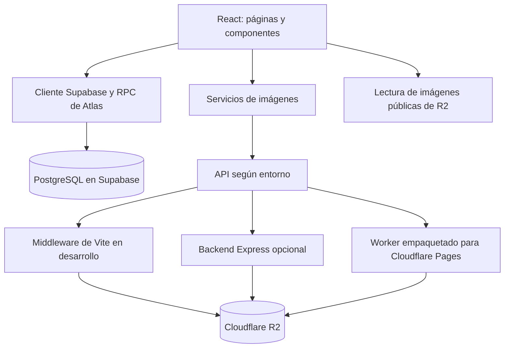
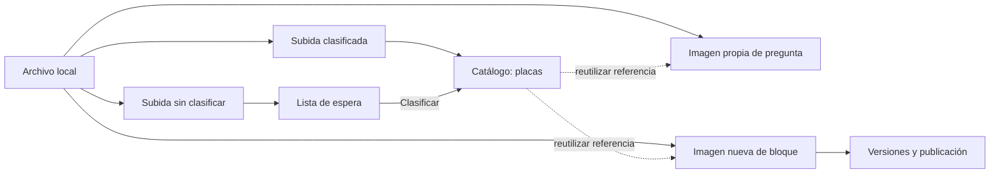

# Guía de Atlas

Referencia para localizar el código, comprender sus conexiones y preparar cambios sin perjudicar el sitio existente.

**Base de esta guía:** revisión del repositorio local del 30 de octubre de 2026. Se revisaron rutas, configuraciones, servicios, componentes principales y scripts SQL. Posteriormente se contrastaron tablas, relaciones y firmas de funciones con metadatos remotos de Supabase mediante lecturas, documentadas en [el inventario verificado](supabase-inventario.md). La exploración inicial fue de solo lectura; las correcciones de datos posteriores y las comprobaciones de producción se documentan por separado en esta guía. No todos los cambios locales están desplegados ni todos los recorridos completos están verificados en producción.

## 1. Cómo usar esta guía

1. Lee las reglas de [AGENTS.md](../AGENTS.md).
2. Localiza el área en la tabla de la sección 3.
3. Sigue su recorrido desde la página hasta servicios, datos y componentes compartidos. Algunas páginas consultan Supabase directamente: no toda la lógica está en `services/`.
4. Revisa las pruebas existentes y los consumidores de las funciones que vas a cambiar.
5. Antes de usar un navegador o ejecutar scripts con escritura, confirma a qué servicios apuntan y utiliza datos aislados.

La habilidad local [atlas-desarrollo](../.agents/skills/atlas-desarrollo/SKILL.md) aplica este recorrido a tareas del repositorio. Puede invocarse como `$atlas-desarrollo`; sus instrucciones también están enlazadas desde `AGENTS.md`.

Para cambios de diseño web rige el [contrato portable](diseno-web.md): [la regla](../.agents/rules/design-quality.md), la skill [diseno-web](../.agents/skills/diseno-web/SKILL.md) y los adaptadores por editor fijan el uso de Emil Kowalski, Impeccable y Taste. La skill puede invocarse como `$diseno-web`.

La guía es un índice de investigación, no una afirmación de que todos los módulos han sido auditados.

**Mapa especializado:** [gestión y recorrido de las imágenes](mapa-gestion-imagenes.md), desde subida clasificada o lista de espera hasta catálogo, preguntas, bloques, versiones, créditos y eliminación. Incluye carpetas, campos, consumidores y fuentes de código.

**Editor de señalados:** [revisión funcional de herramientas y escritura](revisiones/editor-senalados-herramientas-2026-10-30.md), con recorrido de navegador aislado, correcciones de teclado/formato y límites de comprobación.

**Editor de mapas interactivos:** [revisión de herramientas, textos y cambio de placa](revisiones/editor-mapas-interactivos-2026-10-31.md), con pruebas aisladas de geometría, guardado, carga de imágenes y ambos visores públicos.

**Editor de páginas:** [inventario completo y diagnóstico](revisiones/editor-paginas-inventario-2026-11-17.md), con mapa de archivos, 30 tipos de bloque, flujos de guardado/publicación, renderizador, estilos, pruebas y decisiones abiertas para la versión 2.0. El plan de la [Fase 1 del editor 2.0](revisiones/editor-paginas-v2-fase1-plan.md) (cerrada) fija el sistema paralelo, la navegación rediseñada, la persistencia propia y el modelo de borradores y versiones; el [plan de la Fase 2](revisiones/editor-paginas-v2-fase2-plan.md) (cerrada en local) incorpora `BlockStyle`, `Tarjeta / Caja`, Inspector `Diseño` con revelación progresiva, `PageTheme` con 6 temas curados, `RichTextV2` con Tiptap v3 encapsulado, `Insignia`/`Icono`, multimedia estilizable con `Editor2Lightbox`, animaciones/hover con `prefers-reduced-motion` y 8 plantillas editables en 1 clic (con SQL local aislado `database/editor2/002_presets_templates.sql` pendiente de ejecución autorizada); el [plan de la Fase 3](revisiones/editor-paginas-v2-fase3-plan.md) (cerrada en local) integra `Editor2PublicSlot` (carga diferida con `React.lazy` y fallback automático a v1) en `Home.tsx`, `TemarioPublico.tsx`, `Subtemas.tsx` y `PlacasSubtema.tsx`, añade el bloque dinámico *Pruebas por parcial* (`examCarousel`) y el control de reversión `Volver a v1` (`database/editor2/003_unpublish.sql`, pendiente de ejecución autorizada).

**Editor 2.0, fase 4 (implementada en local).** Las secciones y tarjetas admiten cuadrícula, fila, columna y superposición. Los documentos anteriores usan cuadrícula. En filas y columnas se editan separación, alineación, reparto y ancho de los hijos, con ajuste al contenido, relleno, ancho fijo y límites opcionales. La ruta del inspector resalta y selecciona ancestros. El menú Mover bloque permite reorganizar con teclado y deshacer. La biblioteca guarda la sección elegida. Estos ajustes viajan en el documento de la página y en sus versiones; utilizan la persistencia existente.

**Editor 2.0, fase 5 (implementada en local).** El lienzo de edición usa todo el ancho disponible entre los bordes del encabezado y el pie. En el inspector se puede elegir qué pantalla editar sin cambiar el ancho del lienzo. Por defecto se edita el rango del lienzo: móvil por debajo de 640 px, tableta entre 640 y 1023 px y valores base a partir de 1024 px. Las secciones y tarjetas admiten distribución, separación y alineación por rango. Móvil y tableta heredan cada ajuste de distribución base si el campo indica «Heredado». Los campos específicos muestran un botón para restablecerlos. La vista previa y la página pública muestran los bloques sobre una superficie transparente. El fondo del lienzo se usa al editar y los fondos de los bloques se muestran en todas las vistas. El lienzo, la vista previa y la página pública calculan el rango a partir del ancho de su propia superficie y leen los mismos ajustes del documento. La vista previa monta la página pública real (Header, contenedores y Footer) con el borrador en memoria, de modo que se revisa la integración sin exigir publicación; las claves sin integración pública muestran el documento aislado con un aviso.

**Plantillas de título y párrafo del Editor 2.0.** Las dos galerías bajo la barra de formato ofrecen las mismas diez familias. Cada pareja comparte la paleta y las referencias tipográficas. Los títulos tienen una composición propia que aprovecha su jerarquía H1, H2 o H3 mediante líneas de encabezado, franjas compactas o superficies abiertas. Por ejemplo, Nota de estudio usa un subrayado azul para el título y una caja celeste con una línea lateral para el párrafo. Al aplicar una plantilla se conservan el nivel, el texto y su formato por palabra, y el tamaño vuelve a ajustarse automáticamente según el ancho y el tema. Los estilos guardados se conservan hasta aplicar otra plantilla. El fondo y el margen interior se ajustan desde la misma franja. En Diseño, «Línea y borde» muestra el adorno y permite cambiar el color, el grosor, el trazo y la posición, o quitarlo. El redondeado se ajusta en «Esquinas, relleno y ancho». Las plantillas guardan sus ajustes en el documento existente y se ven en el lienzo, la vista previa y la página publicada.

**Plantillas de insignia del Editor 2.0.** Las diez familias de título y párrafo tienen una variante de etiqueta compacta. Al aplicar una plantilla se actualizan el acabado, el color, el tamaño y el icono de la insignia; se conservan su texto, alineación y posición. En Diseño, «Aspecto de la insignia» permite retocar esos cuatro ajustes y quitar el icono. Los cambios se guardan en las propiedades existentes del bloque.

**Plantillas de icono, nota y tabla del Editor 2.0.** Cada bloque ofrece diez variantes de las familias compartidas. En Diseño se pueden ajustar el símbolo, el tamaño, el color y el marco del icono; el tipo, fondo y borde de la nota; y la cabecera, las filas alternas, el espaciado y la cuadrícula de la tabla. Aplicar una plantilla conserva la posición de los bloques, el texto y el título de las notas y todas las celdas de las tablas. Los ajustes se guardan en las propiedades existentes del documento.

**Plantillas de botón, separador y pruebas por parcial del Editor 2.0.** Los tres bloques ofrecen diez variantes de las familias compartidas. En Diseño se pueden ajustar el acabado, color e icono del botón, el color, trazo, grosor y dirección del separador (con ancho para líneas horizontales), y el acento, fondo, borde, esquinas y relleno del carrusel de pruebas. Aplicar una plantilla conserva los enlaces, las etiquetas, la orientación del separador, el parcial y el máximo de pruebas. Las muestras del carrusel usan datos de ejemplo y el bloque real conserva su consulta de evaluaciones publicadas.

**Botón de ficha semanal.** La plantilla Observación toma de Temas de la semana la miniatura circular, el acento lateral y la flecha. Al aplicarla, «Elegir destino en Atlas» permite seleccionar un tema o subtema. El editor, la vista previa y la página pública muestran el nombre y la imagen del catálogo para ese destino. Se puede cambiar el color y el icono de respaldo. Las fichas antiguas que apuntan a otra clase de página se muestran como botones de contorno hasta elegir un tema o subtema.

**Plantillas de imagen, carrusel y comparador del Editor 2.0.** Los tres bloques tienen diez plantillas de las familias compartidas, con formatos para micrografías panorámicas, cuadradas y verticales, marcos al ras y fondos de montaje. Las muestras muestran los controles del carrusel o el corte del comparador. Aplicar una plantilla ajusta el marco, la proporción, el fondo y el pie de foto, y conserva las imágenes, los textos, los filtros y el ajuste de la imagen. En Diseño se puede elegir «Cubrir» para llenar el marco con recorte proporcional o «Mostrar completa» para ver toda la micrografía. El ajuste se aplica a ambos lados del comparador y funciona con el pie visible u oculto. El carrusel usa el pie de la diapositiva activa y el comparador tiene un pie común que se escribe en Diseño. Las etiquetas A y B siguen identificando los lados.

**Destinos internos y títulos de pruebas del Editor 2.0.** «Elegir destino en Atlas» ofrece acordeones para temas, subtemas agrupados por su tema y otras páginas. La selección guarda la ruta pública del destino en el enlace del botón. Las tarjetas de Pruebas por parcial tienen el mismo tamaño y reservan dos líneas para el título, que se centra verticalmente si ocupa una sola y se acorta con puntos suspensivos si ocupa más de dos. El nombre completo sigue disponible para lectores de pantalla y al pasar el cursor. En Diseño, el texto de «Iniciar prueba» puede ser Normal, Grande o Más grande.

**Tamaño del texto en Botón y Título.** En Diseño, ambos bloques ofrecen Normal, Grande y Más grande. Título también ofrece Jumbo y Enorme. El ajuste se conserva al cambiar de plantilla y se aplica en el lienzo, la vista previa y la publicación. Los tamaños se adaptan al ancho y al tema, y en Título respetan el nivel H1, H2 o H3. Los títulos con un tamaño fijo anterior lo conservan hasta elegir un tamaño o aplicar una plantilla.

**Selección de fotos del Atlas en Editor 2.0.** Al abrir «Elegir del Atlas» se carga el índice de temas y subtemas. Las placas se consultan al elegir un subtema dentro de su acordeón, con una búsqueda local por número, tinción o aumento y miniaturas de carga diferida. Imagen, Carrusel, GIF, ambos lados del Comparador y los fondos de Diseño usan el mismo selector. Al elegir una placa, se guarda la URL de la foto.

**Acceso al Editor 2.0.** La tarjeta «Editor de páginas 2.0» en Edición se muestra a Administrador y Microscopía mediante el permiso `editar_paginas`. Las rutas y las operaciones privadas del editor comprueban la sesión de Atlas y esos mismos roles.

**Paleta de texto del Editor 2.0.** El control de color ofrece tonos del tema y colores estándar. «Más colores…» abre el selector nativo del navegador. La paleta se comparte entre el color de títulos, párrafos y viñetas, el color y resaltado por palabra, el texto del tema y los colores de botones, insignias, cabeceras, pestañas, acordeones y el carrusel de pruebas. «Automático» restaura el color heredado cuando el bloque o fragmento permite herencia. Los colores explícitos se guardan con el mismo formato hexadecimal que los documentos anteriores.

**Ventana de vista previa del Editor 2.0.** La página pública se monta en un iframe del mismo origen y recibe el borrador en memoria. La cabecera, el contenido y el pie usan el ancho real del iframe. El iframe ocupa toda la ventana y se ajusta automáticamente al redimensionarla. El botón flotante «Volver a editar» aparece solo en la vista previa, en la esquina inferior derecha. El iframe usa la vista anónima y excluye sus visitas de las estadísticas.

En la vista previa se pueden seguir los enlaces del bloque Botón y de «Iniciar prueba» y usar las flechas de Pruebas por parcial. En el lienzo las flechas también funcionan y los enlaces quedan reservados para la vista previa. Las flechas aparecen cuando las tarjetas desbordan el área visible y se deshabilitan al llegar a cada extremo.

La vista previa y la publicación usan el mismo renderizador de componentes. «Cubrir» recorta proporcionalmente dentro del marco y «Mostrar completa» mantiene visible toda la imagen. El Carrusel usa 4:3 como proporción automática cuando la cuadrícula no le asigna altura y conserva el marco al cambiar de ajuste o de diapositiva. La vista previa permite recorrer también las pestañas y los acordeones. Los efectos de entrada y al pasar el cursor se aplican desde los estilos guardados y respetan la preferencia de movimiento reducido.

**Precisión de la cuadrícula del Editor 2.0.** El lienzo y el inspector muestran 48 columnas y usan pasos de media celda en ambos ejes. En el lienzo de edición, las guías horizontales y verticales son líneas pálidas de 1 px sobre fondo blanco y llegan a los bordes superior e inferior del área de edición. Imagen, Carrusel y Comparador con altura asignada usan sus filas como límite para el marco y el pie de foto. Los bloques sin altura asignada y los que están en un contenedor de flujo conservan el ajuste automático. Las posiciones y dimensiones se guardan en la unidad original, que ahora admite incrementos de 0,5. Los borradores, versiones y plantillas anteriores conservan sus coordenadas al abrirse. El renderizador compartido convierte esas unidades a las líneas de la cuadrícula nueva. El formato del documento sigue siendo la versión 2 y utiliza las RPC existentes.

Las guías y el arrastre usan las dimensiones reales de las columnas y filas del lienzo, las secciones, las tarjetas y los paneles. Se dibuja una línea por división, sin duplicar bordes. Los números de referencia aparecen en el margen superior y el izquierdo. La guía punteada coincide con la marca 24 y deja ocho divisiones entre las marcas 16 y 24 y entre 24 y 32. Las guías se actualizan cuando el contenido cambia la altura de una fila o cambia el ancho del editor.

En distribución de cuadrícula, las columnas y filas son contiguas. Los bordes de un bloque ocupan toda el área asignada de guía a guía. Las filas pueden crecer si necesitan alojar contenido y las guías siguen las dimensiones reales. El relleno horizontal de las superficies se limita cuando el área es estrecha. Los anchos máximos configurados y los modos de fila, columna y superposición conservan su comportamiento.

En la cuadrícula se puede arrastrar un bloque desde su superficie o desde el tirador de la barra. En los bloques de texto, un clic selecciona y un doble clic abre la edición. Mientras se edita, arrastrar sobre el texto selecciona caracteres.

**Altura del lienzo del Editor 2.0.** Al pie del lienzo se pueden añadir o quitar una u ocho filas, o escribir el número exacto de filas mínimas. Vaciar el campo devuelve la altura automática. La altura se guarda con el borrador y sus versiones, aparece en la vista previa y pasa a la página pública cuando se publica. Los bloques colocados pueden ampliar el lienzo si ocupan filas adicionales.

En el editor, un clic selecciona el bloque y muestra sus controles. Un clic en el fondo del lienzo quita la selección y devuelve el menú de componentes. Un doble clic edita el texto o la celda sobre la que se hizo clic. También se puede usar «Editar texto» o pulsar Enter o F2 con el bloque enfocado. Escape termina la edición y devuelve el foco al bloque. La vista previa y el sitio público muestran el texto en modo de solo lectura.

**Diseño de la publicación semanal:** `ContentBlockRenderer.tsx` y `src/styles/weeklyHistology.css` adaptan el HTML de referencia del usuario con el ámbito `cb-weekly-lab`: lámina de vidrio, etiqueta esmerilada, fichas con lentes, cubreobjetos y distribución móvil. Las tipografías Fraunces e IBM Plex Mono se alojan en `src/assets/fonts/weekly-slide/`, con sus licencias. Las reglas anteriores de `home.css` excluyen este ámbito. Se conservan temas/enlaces, fechas, placa/visor y opciones del editor; el movimiento respeta la preferencia reducida y el ajuste de imagen «contener». No se inventan valores de tinción, aumento ni escala a partir de los rótulos ilustrativos del HTML. La copia del diseño original está en `recovered_images/design-backups/weekly-before-20261031-080829/`; la propuesta intermedia y el HTML de referencia, en `recovered_images/design-backups/weekly-reference-before-20261031-082841/`. Ambas carpetas están ignoradas por Git y tienen parches de reversión.

**Créditos:** `src/pages/Creditos.tsx` conserva `loadCredits`, perfiles, instructores, cargos, períodos, aportes y tratamiento de imágenes fallidas. `src/styles/credits.css` limita el rediseño al ámbito `.credits-lab`: presentación editorial violeta, tarjetas inspiradas en portaobjetos con imágenes histológicas y etiquetas de vidrio, fichas de instructores y cierre de agradecimiento. Reutiliza fuentes locales del laboratorio, mantiene Header/Footer y adapta las columnas a escritorio, tableta y móvil. El registro llamado «Snoopy» se presenta como guiño del equipo en una tarjeta horizontal a la derecha de la introducción, con imagen contenida en una columna independiente y aporte en otra; título y presentación comparten el bloque izquierdo y la tarjeta se centra respecto a este bloque, evitando la composición escalonada; se excluye de la lista de instructores solo al renderizar, sin modificar el registro ni el editor. El título de instructores ajusta su fuente al ancho de la sección y permanece en una línea. Comprobado en local a 320, 390, 768 y 1440 px, con nombres extensos, lista vacía e imagen fallida; sin cambios de datos ni publicación.

## 2. Arquitectura y entornos

**Bordes fijos y vectoriales en el visor público:** `RegionBordersOverlay` dibuja contornos y segmentos en un SVG hermano de la capa de imagen, proyectado por `useWhiteboardProjection` mediante matrices SVG nativas. Se elimina la regeneración de segmentos por zoom y la compensación inversa del grosor en el visor: las mismas rayas permanecen ancladas a la placa y se amplían con ella, sin depender de una textura CSS rasterizada. El relleno y los controles siguen en su capa original. Los gestos táctiles actualizan solo la proyección, no el patrón. Este criterio sustituye el tamaño constante de pantalla tanto en el visor público como en el editor; ambos comparten la misma capa vectorial. Se verificó en navegador aislado un patrón de 60 segmentos idéntico en seis aumentos (125–250 %), sin modificar datos guardados.

**Escala uniforme de bordes:** `regionStrokeMetrics` compensa grosor, longitud y separación con el zoom actual en unidades de imagen para obtener medidas constantes en pantalla. Los segmentos personalizados no combinan esta compensación con `non-scaling-stroke`; la muestra del panel usa directamente píxeles SVG sin viewBox escalado. El trazo provisional comparte `regionDashPath` con el definitivo, sin superponer dos contornos. Cada palito conserva su longitud también al cruzar curvas; la cantidad depende del perímetro, no se escala el estilo al tamaño de la región. En el visor público se actualizan trazado y grosor desde `DIRECT_VIEW_TRANSFORM_EVENT` solo cuando cambia el zoom, sin render React ni lecturas de layout. No cambian los valores persistidos ni el formato de señalados. Verificación aislada en Chromium con dos regiones y seis niveles de zoom; pruebas de métricas, tamaños distintos y pellizco directo.

**Edición explícita de regiones y exclusiones:** `PlateAnnotationViewerEditor` separa los modos Dibujar región, Editar borde y Crear exclusión. Al seleccionar un borde existente se activa edición; las regiones nuevas y múltiples no se convierten automáticamente en huecos por caer dentro de otra. Los controles aparecen al principio del inspector y permiten cambiar sin perder la selección. En exclusión no hay tiradores; en edición aparecen los del contorno y solo los del hueco elegido. Los contactos de los tiradores no inician paneo ni dibujo y el movimiento de vértices tiene historial para deshacer. `regionExclusion.ts` valida que los recortes no salgan, se crucen a sí mismos ni se superpongan con huecos existentes; también impide arrastrar un hueco fuera del contorno o atravesar uno al ajustar un vértice. El formato guardado no cambia. El botón de confirmar una sesión se llama «Añadir señalado» y mantiene su transición a Mano. Verificado con regiones superpuestas y guardado en memoria en navegador, a 1440 y 850 px, y suite completa local (512 pruebas).

**Propuesta de dos datos semanales:** El prototipo de dos datos histológicos de la semana permanece únicamente en local. Por petición del usuario se retiró de Inicio y se excluyeron su componente y sus estilos de esta subida; no forma parte de la publicación ni modifica contenido guardado.

**Marca de agua del visor público:** `usePlateWatermark.ts` sitúa el icono, nombre y enlace en la esquina inferior izquierda de la intersección entre imagen y viewport, evitando los márgenes de fondo. Sigue zoom/desplazamiento, transiciones y redimensionado; reduce la marca cuando el área visible no permite su tamaño normal y la oculta si la imagen queda totalmente fuera. Los contactos táctiles usan las medidas preparadas y `DIRECT_VIEW_TRANSFORM_EVENT`, sin medir el DOM por contacto ni provocar renders de React. El minimapa permanece abajo a la derecha.

**Acabado de los segmentos discontinuos:** Los bordes con ajustes de estilo usan `regionDashPath.ts` en editor y visor público. Cada palito es una recta corta con extremos redondos, evitando reproducir el zigzag dentro de cada segmento; el conjunto sigue el perímetro muestreado y sus huecos. Se compensa el grosor en el hueco para mantener separación visible y el paso se adapta al zoom. El relleno y los puntos guardados permanecen independientes del acabado. Los bordes antiguos sin propiedades de estilo conservan su representación anterior. El dibujo provisional muestra extremos redondos; el acabado segmentado se aplica al cerrar la región.

**Suavizado leve de bordes:** El panel de borde individual/múltiple permite activar `regionSmooth`, conservado en `senalados_meta`. Los bordes nuevos lo activan por defecto; los antiguos sin el campo mantienen el recorrido original. `regionPolygonPath.ts` comparte el render entre editor y visor público: aplica una sola pasada de filtro limitada al 0.1 % del lado menor y redondea uniones hasta un 0.05 % adicional, acotado por la longitud de las aristas. No sustituye los puntos guardados ni acumula cambios al reabrir; conserva anillos y huecos independientes. El dibujo provisional sigue el contacto directamente y al terminar muestra el contorno suavizado. Las coordenadas de edición y la detección de interior continúan usando la geometría original; la pequeña diferencia visual queda limitada por esos márgenes.

**Estilo de bordes en el editor de señalados:** Borde individual y Bordes múltiples comparten opciones estándar definidas en `REGION_BORDER_PRESETS`: grosor Muy delgado (1 px), Delgado (1.75 px), Medio (2.5 px) y Grueso (4 px); separación Corta (3 px), Media (7 px) y Larga (12 px); longitud Corto (4 px), Medio (10 px) y Largo (16 px), con muestra SVG. Un valor anterior fuera de estas opciones aparece como «Valor guardado» y se conserva hasta elegir otro. Se guardan como `regionStrokeWidth`, `regionDashLength` y `regionDashGap` dentro de `senalados_meta`, sin cambiar el esquema SQL. Se aplican al borde seleccionado o al grupo en creación y a los nuevos bordes; editor y visor público mantienen tamaño visual constante al ampliar. Se conservan en creación, edición, lista de espera, visor y alineación. Los señalados antiguos conservan el aspecto público previo (2.5 px, patrón 10/7); los valores guardados fuera de rango se acotan al renderizar. Las pruebas comprueban guardado, geometría intacta, lectura pública y compatibilidad antigua.

**Movimiento exclusivo de placas:** Gestión de placas → Reasignación → Mover placa usa `/trasladar-placa`, conserva identidad/URL/señalados y sincroniza ubicación del mapa de forma atómica. La función SQL se instaló con autorización el 2 de noviembre de 2026; el frontend continúa local. Ver [alcance, pruebas y activación](mover-placas.md). El editor anterior permanece separado.

Atlas permite consultar material de histología, explorar placas y anotaciones, usar mapas interactivos y realizar evaluaciones. Incluye administración de catálogo, contenido, usuarios y auditoría.

**Versus de placas (local, 6 de noviembre de 2026):** `ComparadorPlacas.tsx` coordina cuatro posiciones A–D con modos de 2, 3 y 4 placas. El selector de cantidad precede a Sincronizar; en los tres modos aparece Distribución abajo a la izquierda con miniaturas (en modo 2 permite elegir una al lado de otra o una arriba de otra): columnas iguales, A en la mitad izquierda y las restantes apiladas a la derecha, y cuadrícula 2 × 2 para cuatro. Cada modo conserva su distribución durante la sesión. Sincronizar, señalados, restablecer e intercambiar actúan sobre las posiciones visibles; Intercambiar rota su orden. En la distribución destacada de 3/4, «Alternar destacada», junto a Distribución, lleva la primera pequeña a la vista grande y envía la grande al final de las pequeñas. Reducir el modo conserva las selecciones ocultas. Los parámetros `placaA`/`placaB` siguen siendo compatibles; `placaC`, `placaD`, `modo` y `distribucion` permiten restaurar los nuevos modos. La URL espera a la restauración inicial y no se reescribe por cada gesto de zoom. `DualPlateViewport` y `PlatePickerModal` admiten A–D; las imágenes se encajan al tamaño de cada panel mediante unidades de contenedor CSS, con controles compactos según el ancho disponible. Las fichas de identidad de cada placa muestran únicamente la letra y el subtema en una línea, con el mismo fondo blanco/azul claro, borde celeste, redondeado y sombra de los controles de la placa, separador fino y nombre del subtema en negrita; aumento y tinción no se presentan en esa barra. Los textos largos se truncan con su contenido completo en el título. Comprobado con datos e imágenes simulados en Chromium (1440, 768 y 390 px), pruebas de coordinación, tipos y compilación; sin escritura remota ni despliegue.

### Frontend

- Entrada: `src/main.tsx`; composición y rutas: `src/App.tsx`.
- React 18, TypeScript, Vite y React Router. Las páginas principales se cargan con `lazy` y `Suspense`.
- `App.tsx` reúne autenticación, mantenimiento, SEO, restauración de navegación, registro de visitas y errores del cliente.
- Estilos compartidos en `src/style.css`, `src/styles/` y archivos CSS de componentes. Los cambios globales pueden afectar varias pantallas.
- Tema navideño del encabezado: `src/components/Header.tsx`, decoraciones SVG/CSS en `src/components/ChristmasHeaderDecor.tsx` y estilos acotados en `src/styles/christmasHeader.css`. Las luces respetan la preferencia de movimiento reducido; la temática no requiere consultas ni recursos externos nuevos.
- Tiptap participa en edición de texto; Konva/React Konva y XYFlow están entre las dependencias visuales. Comprueba los imports del módulo antes de elegir una implementación.

### API de imágenes y despliegue

- `src/services/cloudinary.ts` conserva un nombre histórico y opera con R2. Resuelve la URL de API usando `VITE_BACKEND_BASE_URL` y el entorno del navegador.
- En localhost, una URL configurada hacia localhost se resuelve a rutas relativas: el middleware de `vite.config.ts` atiende operaciones de imágenes.
- `backend/server.js` ofrece una implementación Express opcional con acceso S3 a R2.
- `.github/workflows/deploy-cloudflare-pages.yml` instala dependencias, ejecuta pruebas, comprueba tipos, compila, copia `cloudflare/_worker.js` a `dist/_worker.js` y despliega en Pages. Se activa al subir a `main` o al ejecutarlo manualmente.
- `functions/api/` contiene otra implementación de endpoints. No debe asumirse que sea la que se ejecuta con el Worker empaquetado; revisar la ruta de despliegue antes de modificarla.
- Configuración de producción observada en el panel de Cloudflare el 30 de octubre de 2026: `SUPABASE_URL` y `SUPABASE_SERVICE_ROLE_KEY` están declaradas como secretos cifrados; `R2_BUCKET` está vinculado a `atlas-media`. También figuran `R2_PUBLIC_DOMAIN` y `VITE_R2_PUBLIC_DOMAIN`. No se revelaron ni validaron los valores cifrados y no se cambió ni desplegó configuración. Ver [comprobación de producción](revisiones/configuracion-produccion-2026-10-30.md).

Las operaciones de imágenes requieren `SUPABASE_URL` y `SUPABASE_SERVICE_ROLE_KEY` en el servidor que las atiende: Vite lee `.env` y `backend/.env`, Express lee `backend/.env`, y Cloudflare usa variables/secretos del Worker o Functions. Nunca usar `VITE_` para la clave de servidor. La función `atlas_authorize_token` debe estar disponible para ese servidor; antes de desplegar, comprobar configuración y compatibilidad sin ejecutar los SQL históricos automáticamente. Si falta esa configuración, la administración multimedia se detiene con 503; no se habilita un acceso alternativo. El panel de producción confirmó la presencia de ambos nombres como secretos cifrados; sus valores y la autenticación extremo a extremo permanecen sin verificar.

Configuración local revisada el 30 de octubre de 2026, después de que el usuario añadió la clave en `backend/.env`: las variables requeridas para Vite y Express están presentes. Se comprobó el rol `service_role` declarado por la clave y la coincidencia del identificador del proyecto con `SUPABASE_URL`, sin validar remotamente la credencial. Los archivos privados están ignorados y no rastreados por Git; no se detectó la clave en variables `VITE_`, fuentes del frontend ni la compilación existente. No se imprimieron valores ni se reiniciaron procesos. Los servidores que ya estaban abiertos necesitan volver a cargar su entorno; las pruebas de operaciones multimedia siguen siendo simuladas. Esta comprobación no confirma la configuración de producción.

Contrato de errores de las operaciones multimedia: 401 sin sesión, 403 cuando la comprobación de permisos devuelve `false`, 503 si no se puede verificar la sesión o falta R2, 400 para parámetros inválidos y 500 si falla una operación de almacenamiento. Un borrado solo devuelve éxito después de eliminar original y miniatura. Si falla la miniatura tras eliminar el original, se informa error: no hay transacción entre objetos ni restauración automática. Los parámetros de consulta ya decodificados no se vuelven a decodificar al resolver una clave. Las pruebas de `src/test/r2ImageTransfers.test.js` ejecutan las cuatro implementaciones con almacenamiento y autorización simulados, sin cargar credenciales ni usar red real.

## 3. Mapa para localizar cambios

Todas las rutas de archivo de esta sección parten de la raíz del repositorio.

| Área | Puntos de entrada | Conexiones que revisar |
| --- | --- | --- |
| Inicio y contenido semanal | `src/pages/Home.tsx`, `src/components/HomeHistologyFact.tsx`, `src/components/ExamWeekTestsCarousel.tsx`, `src/components/RaffleModal.tsx` | Publicación de bloques, estilos del inicio, `ChristmasCountdown.tsx` y componentes de temporada cuando corresponda. |
| Catálogo público | `src/pages/TemarioPublico.tsx`, `src/pages/Subtemas.tsx`, `src/pages/PlacasSubtema.tsx` | `src/services/catalogService.ts`, cachés, orden de temas y subtemas, publicación y visor. |
| Edición del catálogo | `src/pages/EditarTemario.tsx`, `src/pages/EditarSubtemas.tsx`, `src/components/temario/` | Tablas `temas` y `subtemas`, orden, dependencias de placas, permisos y auditoría. |
| Placas y lista de espera | `src/pages/EditarPlacas.tsx`, `src/pages/ListaEspera.tsx`, `src/pages/MoverPlaca.tsx`, `src/components/PlateEditorPanel.tsx` | `placas`, `placas_sin_clasificar`, servicio de imágenes, miniaturas y registros de actividad. |
| Visor y anotaciones | `src/components/ImageViewerModal.tsx`, `src/components/PlateAnnotationViewerEditor.tsx`, `src/components/SenaladoLocationPicker.tsx` | Consumidores en páginas, formato de señalados, coordenadas, zoom, imagen original y guardado. |
| Editor de páginas | `src/pages/EditorPaginas.tsx`, `src/components/PageContentEditor.tsx`, `src/components/page-editor/` | Tipos y registro de bloques, renderer, versiones, publicaciones y estilos compartidos. |
| Bloques de contenido | `src/types/contentBlocks.ts`, `src/components/blocks/blockRegistry.ts`, `src/components/ContentBlockRenderer.tsx` | Valores por defecto, normalización, editores y `src/components/histology-blocks/`. |
| Mapas interactivos | `src/pages/MapasInteractivos.tsx`, `src/components/InteractiveMapViewerModal.tsx` | Tabla `interactive_maps`, relación con placas, visor y estado de navegación. |
| Crear y administrar evaluaciones | `src/pages/GestionPruebas.tsx`, `src/pages/EditorDePruebas.tsx` | Preguntas, opciones, RPC `guardar_prueba_completa`, imágenes propias y auditoría. |
| Realizar evaluaciones | `src/pages/Evaluaciones.tsx`, `src/pages/EjecutarPrueba.tsx`, `src/pages/evaluacionesUtils.ts` | RPC públicas, calificación, publicación, temporizador y oportunidades. |
| Herramientas de estudio | `src/pages/Herramientas.tsx`, `src/pages/ComparadorPlacas.tsx`, `src/pages/DesafioIdentificacion.tsx` | Catálogo, imágenes, `src/components/comparador/` y estado de la experiencia. |
| Acceso y usuarios | `src/contexts/AuthContext.tsx`, `src/components/PrivateRoute.tsx`, `src/security/permissions.ts`, `src/pages/GestionUsuarios.tsx` | Sesiones propias, rutas, RPC, políticas SQL y controles específicos de usuario. |
| Auditoría y operación | `src/pages/HistorialAuditoria.tsx`, `src/pages/Estadisticas.tsx`, `src/components/SiteControlCenter.tsx` | `unifiedAuditService.ts`, `adminControlCenter.ts`, analítica, presencia, mantenimiento y acciones administrativas. |
| Navegación persistente | `src/services/navigationStateKeeper.ts`, `src/hooks/useSmartBackNavigation.ts`, `src/components/BackButton.tsx` | Parámetros de URL, filtros, restauración de scroll y botones de regreso. |

No elimines archivos solo por llamarse `Old`, `backup` o estar en `archived/`: comprueba imports y consumidores. Por ejemplo, `PlacasSubtema.tsx` importa un componente de `archived/`.

La ventana de la rifa (`RaffleModal.tsx`) se cierra en ~260 ms con una animación retro hecha solo con CSS: destello rojo, sacudidas y recortes de la tarjeta hasta desaparecer. Conserva X, Escape, clic en el fondo y el enlace a WhatsApp; no añade librerías. Al abrir enfoca el botón de cierre, atrapa Tab/Shift+Tab dentro del diálogo y devuelve el foco al control previo; usa `acquireAtlasScrollLock`/`releaseAtlasScrollLock` para no romper otros overlays.

## 4. Recorridos que conviene entender antes de cambiar

### Pizarra temporal del visor público

`ImageViewerModal.tsx` integra el botón para abrir/cerrar la pizarra en la barra derecha de zoom y visualización. `ViewerWhiteboard.tsx` inserta ese botón mediante un portal y muestra su barra vertical de herramientas a la izquierda solo mientras la pizarra está abierta (estilos acotados en `viewerWhiteboard.css`). La barra tiene selección, mano, láser, lápiz, resaltador, formas agrupadas, texto y borrador por trazo; mantiene a mano ajustes y deshacer/rehacer. La lista central de herramientas permite desplazamiento independiente en pantallas bajas. Los paneles muestran opciones según la herramienta o el apunte seleccionado.

- El lápiz suaviza los trazos con curvas cuadráticas, conserva la punta y recoge muestras agrupadas del dispositivo. La previsualización se actualiza por cuadro; los trazos terminados reutilizan su representación. Un contacto táctil no interrumpe un trazo activo de lápiz óptico.
- Cada herramienta recuerda su color, grosor y opacidad durante la placa. El resaltador comienza translúcido y más ancho; Shift o su opción de trazo recto permite resaltar líneas.
- Flecha, línea, elipse y rectángulo tienen atajos y controles de extremos al seleccionarlos. Shift u opciones de proporción producen círculos, cuadrados y ángulos de 45°, respetando las proporciones físicas de una imagen rectangular y sus bordes.
- Seleccionar permite mover, duplicar, borrar, cambiar estilo y editar texto existente. El texto admite varias líneas, vista previa, tamaño, color y fondo medido con los glifos reales; el fondo cambia entre claro y oscuro según la tinta. La fuente se normaliza al zoom para mantener tamaño y espaciado al escribir con aumento; Ctrl/⌘ + Enter guarda y Escape cancela la edición. El borrador usa una zona de acierto ampliada e interpola el recorrido para alcanzar trazos finos; en figuras vacías alcanza su contorno, mientras que selección también permite tocar el interior. Los textos se ajustan a los bordes de la imagen al guardar y se descartan las figuras degeneradas.
- Atajos: V seleccionar, H mano, K láser, P lápiz, M resaltador, A flecha, L línea, O elipse, R rectángulo, T texto y E borrador. Ctrl/⌘ + Z deshace, Ctrl/⌘ + Shift + Z o Ctrl + Y rehace, Ctrl/⌘ + D duplica y Supr elimina el seleccionado. Los campos de texto conservan sus atajos nativos. Escape cancela primero el gesto, selección o panel abierto; después cierra las herramientas.
- Un gesto completo cuenta como una acción del historial; los gestos cancelados se descartan. El borrado completo está en ajustes, requiere confirmar y puede deshacerse. Las pruebas de interacción están en `ViewerWhiteboard.test.tsx` e `ImageViewerModal.keyboard.test.tsx`; las de geometría, en `viewerWhiteboardGeometry.test.ts`; y las de proyección, fondos y presentación, en `whiteboardRendering.test.ts`.

Los apuntes usan coordenadas relativas a la imagen y un SVG independiente de la capa CSS ampliada. `useWhiteboardProjection.ts` proyecta su grupo SVG con la matriz visible de la imagen, incluidos desplazamiento, giro, cambios de tamaño y transiciones; se actualiza antes del repintado. Esto conserva el dibujo vectorial y evita estirar una textura con texto pequeño. `WhiteboardText.tsx` mide las letras y normaliza el tamaño de fuente dentro del SVG, sin cambiar el anclaje de los apuntes. El láser limpia su rastro al cambiar de herramienta y solo anima mientras está activo. `laserTrail.ts` conserva la estela durante movimientos rápidos, separa las pausas/reentradas sin unirlas y limita la densidad de puntos sin eliminar tramos recientes; salir del lienzo deja desvanecer el rastro durante sus 1750 ms de vida. `laserTrail.test.ts` comprueba continuidad, separación y caducidad. La mano conserva el recorrido de interacción existente; la rueda y los controles derechos siguen disponibles, y mantener espacio permite mover la placa con ratón. Dos dedos permiten ampliar y desplazar desde las herramientas de dibujo; al iniciar el gesto se descarta el trazo provisional y se bloquean nuevos trazos hasta levantar todos los dedos. Para mover con un dedo se selecciona la mano.

El botón inferior centrado «Guardar apuntes» descarga un PNG y permite elegir «Vista actual» (zoom y encuadre visibles) o «Placa completa» (todos los apuntes, respetando el giro). `whiteboardExport.ts` usa la imagen original o de alta resolución y una copia vectorial de los apuntes; excluye controles, selección, zonas de acierto y láser. La composición superpone una tarjeta oscura translúcida arriba a la izquierda: tema en mayúsculas violeta y subtema grande en serif. Una insignia redondeada de Atlas Histolab con su dominio ocupa la esquina inferior derecha, según la referencia visual. No añade franjas exteriores ni marca diagonal central; las etiquetas quedan fijas en las esquinas independientemente del zoom o giro y tema y subtema reducen su tamaño de letra de forma independiente para permanecer cada uno en una sola línea. El texto pendiente se confirma antes de capturar la copia. Descargar no borra el trabajo del visor y un fallo permite reintentar.

La ruta pública de solo lectura `GET /api/plate-image?url=…` permite componer la imagen sin cambiar la configuración CORS de R2. Está implementada en Vite, Express, el Worker empaquetado y la alternativa `functions/api/plate-image.ts`. Solo acepta HTTPS del dominio público R2 configurado y su prefijo de ruta, extensiones PNG/JPEG/WebP y tipos MIME de imagen equivalentes; rechaza credenciales en URL, redirecciones, otros destinos, objetos mayores de 32 MiB y respuestas que excedan 20 segundos. No usa credenciales ni RPC y no recibe apuntes. Las operaciones de escritura existentes conservan su autorización.

Solo la foto se rasteriza primero a un máximo de 1080 px en su lado mayor, conservando proporciones y sin ampliar fuentes pequeñas. Se compone después con los apuntes vectoriales a mayor resolución: hasta 4096 px y 12 millones de píxeles en el área de imagen; la vista actual usa hasta doble resolución de pantalla. Así la foto no recupera detalle original al ampliarla y los textos y trazos se rasterizan directamente al tamaño final, sin reducirse junto con ella. Las tarjetas se dibujan también al tamaño final, dentro de la imagen sin ampliar sus dimensiones. Conserva PNG. Esto limita la exportación normal, pero no restringe el acceso a las imágenes públicas de R2 ni impide capturas. El archivo completo no supera 16 millones de píxeles. Los nombres largos se ajustan en una sola línea reduciendo la letra y los campos ausentes se indican como «No especificado». El PNG descargado permanece en el dispositivo aunque se cierre el visor; no representa una sesión editable de pizarra.

Los apuntes permanecen al cerrar las herramientas, pero se descartan al cambiar la identidad o URL de la placa o desmontar el visor. Solo existen en memoria del componente: no se guardan en el navegador ni se envían a Supabase/R2, y no modifican señalados ni mapas publicados. Este comportamiento describe el cambio local, no un despliegue verificado.

En pantallas táctiles, los eventos de la pizarra no se propagan al controlador de navegación del contenedor. Un dedo utiliza la herramienta elegida, la mano desplaza la placa y dos dedos cancelan el trazo provisional para navegar con pellizco; el dedo restante queda bloqueado hasta levantar ambos. El lápiz digital activo tiene prioridad sobre contactos táctiles en la superficie de dibujo. El controlador táctil de mano/láser usa listeners no pasivos y agrupa los cambios de vista por fotograma. El visor normal comparte la actualización por fotograma, confirma el último estado al terminar/cancelar y descarta taps pendientes al empezar un pellizco. Ambos modos reajustan la referencia al sustituir dedos, y durante el pellizco se mantienen el filtro, enfoque y grano de partida y se aplaza el cambio de fuente de alta resolución; los límites de arrastre consideran el giro. Los botones principales de pizarra aumentan a 44 px en dispositivos de puntero grueso. Verificación local con multitáctil emulado en Chromium; no equivale a una prueba física de iOS/Android.

**Revisiones locales:** [herramientas y nitidez con zoom](revisiones/pizarra-publica-nitidez-2026-10-31.md) y [descarga de apuntes](revisiones/pizarra-exportacion-apuntes-2026-10-31.md).

**Rendimiento del visor y pizarra:** `WhiteboardDraft.tsx` previsualiza lápiz y resaltador en una capa Canvas temporal con `Path2D` incremental, manteniendo SVG como alternativa si Canvas no está disponible. Al confirmar, el mismo buffer se copia al historial y se representa en SVG mediante `WhiteboardMark.tsx`; edición y exportación conservan su formato. La matriz de escritura se reutiliza mientras no cambie la proyección y se invalida al redimensionar. En contactos táctiles, `viewerTouchNavigation.ts` actualiza imagen, porcentaje y minimapa con medidas preparadas previamente; `useWhiteboardProjection.ts` calcula la matriz desde el zoom/giro/desplazamiento del evento, sin medir el DOM después de mover la imagen. React confirma el último estado al terminar/cancelar o perder foco; cambiar de placa o reiniciar la vista restablece también el DOM. La escena SVG vacía no se monta con la pizarra cerrada. `useViewerInteraction.ts` reduce temporalmente desenfoques de interfaz mientras se navega o escribe; conserva los filtros, enfoque, sombra y grano de la placa durante el arrastre para evitar cambios de luminosidad al pulsar/soltar. En dispositivos táctiles se mantiene la composición ligera estable definida por CSS durante toda la sesión. Verificado en navegador aislado comparando filtro y visibilidad del grano antes, durante y después del contacto en superficies de visor y pizarra. El listener global de movimiento táctil del minimapa es pasivo. Las revisiones anteriores documentan la [primera optimización](revisiones/visor-rendimiento-2026-11-01.md) y el [recorrido táctil directo](revisiones/visor-tactil-rendimiento-2026-11-01.md). El [ajuste de layout y pintura](revisiones/visor-tactil-pintura-2026-11-01.md) se subió en `9b0d2d3`; el usuario informa mejora en celular Android y retraso persistente en tablet Android.

El ajuste posterior, todavía local, limita la limpieza del Canvas a la huella completa de la tinta provisional, con margen de grosor y antialias; al cambiar proyección, estilo o tamaño se limpia toda la capa. No reduce la densidad de píxeles ni modifica el trazo guardado. ResizeObserver solo cambia las dimensiones del Canvas cuando realmente varían. Los controles con desenfoque se identifican con `data-viewer-backdrop`; durante contactos sobre la placa, su desenfoque se desactiva sin transición. La mejora de latencia en la tablet física sigue pendiente de comprobar.

**Lectura para exportar en Pages (1 de noviembre de 2026):** se confirmó mediante GET público que una placa existente devuelve 200 en R2 y 502 a través de `/api/plate-image` en producción. El Worker local ahora utiliza `R2_BUCKET.get` cuando está disponible, después de validar la URL pública, y conserva los límites de formato, 32 MiB y tiempo de lectura. Decodifica la clave sin los parámetros de caché. Vite, Express y Functions conservan la lectura HTTP; el workflow despliega `cloudflare/_worker.js`. Las pruebas simulan el binding y el fallo HTTP, sin escribir datos remotos. Corrección local pendiente de despliegue y comprobación del PNG en línea; no se determinó la causa interna del fallo HTTP del Worker.

### Acceso y permisos

1. `AuthContext.tsx` llama a `atlas_login`, `atlas_validate_session` y `atlas_logout` mediante RPC.
2. El navegador guarda el token en `atlas_session_token` y datos del usuario en `atlas_user`.
3. `src/services/supabase.ts` agrega `X-Atlas-Session` a las peticiones y contiene reintentos ante determinados fallos de red.
4. `PrivateRoute.tsx` controla acceso a pantallas; `permissions.ts` define permisos por rol. Algunas rutas incorporan restricciones adicionales por usuario: revisar `App.tsx`, no solo el rol.
5. Los scripts de seguridad definen sesiones, funciones y controles de acceso de base de datos. Las APIs de imágenes tienen sus propias validaciones del token.

Roles declarados: `Instructor`, `Microscopía` y `Administrador`. No equivalen automáticamente a los roles de Supabase Auth. La interfaz no sustituye la autorización de servidor.

**Jefatura de Microscopia (implementación local pendiente de aplicar):** es una función independiente de `usuarios.rol`. `database/setup_microscopy_chief.sql` prepara una tabla de una sola fila, inicialmente sin titular, que ancla la cuenta autorizada inicial a su ID. Solo esa cuenta y el titular actual pueden consultar los candidatos y asignar, transferir o retirar la jefatura mediante RPC y `X-Atlas-Session`. La transferencia bloquea la fila, vuelve a comprobar la autoridad y exige la revisión leída por el editor; no hay un estado con dos titulares ni se sobrescribe silenciosamente un cambio concurrente. Las respuestas de login y validación incluyen `can_manage_microscopy`; el navegador no habilita esta capacidad desde la caché sin conexión.

La casilla aparece al editar un usuario en `GestionUsuarios.tsx`, con guardado independiente en `MicroscopyChiefEditor.tsx`. Un titular sin rol Administrador dispone de un editor limitado con nombre/correo de candidatos activos y la casilla; no obtiene permisos generales de gestión de usuarios. La excepción de acceso en `PrivateRoute` solo se habilita para `/gestion-usuarios`. Los roles generales y los permisos sobre contenido se conservan. Antes de cambiar el rol Administrador, desactivar o borrar al titular hay que retirar o transferir su jefatura; la cuenta inicial se conserva. Un trigger impide a otros administradores apropiarse de estas identidades mediante correo o contraseña. La revalidación de sesión actualiza la interfaz; cada RPC comprueba los permisos actuales aunque una pestaña aún muestre información anterior.

El SQL no debe ejecutarse como exploración ni repetirse: crea objetos nuevos y sustituye login/validación conservando la implementación local de `alter_pruebas_user_tracking.sql`. Antes de aplicarlo hay que comparar las definiciones desplegadas, confirmar una única cuenta inicial activa, revisar políticas y triggers de `usuarios`, y respaldar sus definiciones, permisos y datos afectados. No se ha verificado respaldo ni aplicado el cambio remoto. Para recuperar: volver al frontend anterior, restaurar las definiciones respaldadas de login/validación, quitar el trigger y las RPC nuevas, y retirar la tabla tras exportar su titular/revisión. La operación de producción necesita autorización explícita; las pruebas locales de interfaz no validan la ejecución ni concurrencia en PostgreSQL.

Verificación local con datos simulados: pruebas del componente, integración en la edición, rutas y sesión; compilación y tipos. En Chromium se comprobó la presentación de la casilla en escritorio y móvil y la transferencia desde un titular Instructor, que pierde el acceso al editor al revalidarse. Todas las peticiones externas se interceptaron; no se escribieron datos remotos.

La revalidación distingue errores de conexión de una respuesta que invalida la sesión. Conserva ese comportamiento al corregir problemas de acceso. En el código local, las rutas de subida, movimiento y borrado de imágenes en Vite, Express, Worker y Functions exigen una respuesta booleana `true` de `atlas_authorize_token`, conservando los roles Administrador y Microscopía y el encabezado `X-Atlas-Session`. No se permite operar ante configuración ausente, fallos de red, errores HTTP o respuestas inesperadas. Esta corrección local no demuestra que esté desplegada.

**Diagnóstico remoto de jefatura, 14 de noviembre de 2026:** consultas de lectura confirmaron los objetos instalados y el error `21000: UPDATE requires a WHERE clause` dentro de `atlas_set_microscopy_chief`. El guardado supera la autorización y falla en el UPDATE sin filtro; la fila sigue sin titular y con revisión cero. `database/fix_microscopy_chief_update.sql` prepara únicamente el reemplazo de esa función añadiendo `WHERE singleton = true`, conservando contrato, bloqueos, validaciones y privilegios. `database/rollback_microscopy_chief_update.sql` respalda la definición remota anterior. La corrección no modifica usuarios ni asigna la jefatura y sigue pendiente de autorización para aplicarse. No volver a ejecutar la instalación sobre los objetos existentes. La interfaz distingue este rechazo SQL de un problema de permisos y no confirma éxito ante él. No se ejecutaron escrituras remotas durante el diagnóstico.

**Corrección aplicada con autorización el 14 de noviembre de 2026:** migración `fix_microscopy_chief_update_where`, limitada a `atlas_set_microscopy_chief(integer,bigint)`. Se verificó por lectura que el filtro está instalado, los privilegios y el propietario se conservan y existe una sola fila, sin titular y con revisión cero. No se asignó ni retiró la jefatura ni se modificaron usuarios. El guardado desde una sesión autorizada queda para el usuario; no se realizaron asignaciones reales como prueba. El respaldo anterior se conserva en `database/rollback_microscopy_chief_update.sql`.

Las pruebas públicas por banco se crean por tema desde Administración de pruebas. Después de instalar el banco, `database/public_bank_local_draw.sql` añade una consulta de solo lectura que devuelve los grupos habilitados de una prueba publicada y sus opciones sin claves de respuesta. El navegador sortea según los cupos y conserva los identificadores por prueba, cuenta (o visitante) y grupo en localStorage. Las vistas previas usan el sorteo anterior. En instalaciones sin esta consulta, el cliente conserva el sorteo anterior hasta actualizar la base.

**Acceso a Prueba de instructores (local):** la tarjeta Pruebas de `Edicion.tsx` incluye el botón «Prueba de instructores» solo si la sesión confirmada tiene `can_manage_microscopy === true` (cuenta inicial o Jefe actual). Abre `/pruebas/instructores`, protegida con `requireMicroscopyManager` en `PrivateRoute`. Ser Administrador por sí solo no concede este acceso. `PruebaInstructores.tsx` contiene únicamente la pantalla de entrada; las funciones internas se definirán posteriormente. No consulta ni guarda pruebas, ni modifica la gestión de evaluaciones existente. No requiere SQL adicional. Verificado con pruebas de visibilidad/ruta, tipos, compilación y Chromium en escritorio/móvil con peticiones externas simuladas; sin escrituras remotas ni publicación.

**Sistema de pruebas de instructores (local, pendiente de activar):** el editor ya permite guardar borradores, configurar un código de seis dígitos y publicar un snapshot. Las pruebas publicadas se listan al final de `/evaluaciones`, después de todos los parciales. `/evaluaciones/instructores/:pruebaId` exige código y usa autorización temporal y calificación en servidor. Se conserva el acceso exclusivo de la cuenta inicial y el Jefe para editar. La persistencia está separada de las pruebas normales; requiere instalar `database/setup_instructor_tests.sql` con autorización nueva. Ver [comportamiento, SQL, comprobaciones y recuperación](revisiones/prueba-instructores-sistema-2026-11-14.md); esta implementación sustituye la pantalla de entrada sin funciones descrita anteriormente.

**Activación SQL autorizada del sistema de instructores (14 de noviembre de 2026):** se instaló `add_instructor_tests_system`. Se verificaron RLS, privilegios, rechazo de administración sin sesión y catálogo público vacío; las tres tablas nuevas siguen sin filas. La preparación local indicada antes ya cuenta con persistencia remota. No se crearon pruebas ni se publicó el frontend. Ver la revisión enlazada para alcance y recuperación; no repetir el script de instalación.

**Cuatro formatos de preguntas de instructores (ampliación local):** el editor permite selección única, respuesta breve, completación con huecos numerados y términos pareados. La pantalla pública y la calificación cubren los cuatro formatos, conservando las preguntas históricas sin `type`. `database/extend_instructor_question_formats.sql` necesita una autorización nueva para sustituir validación, proyección de acceso y calificación; no cambia tablas ni preguntas existentes. Definiciones remotas previas respaldadas en `database/rollback_instructor_question_formats.sql`. Ver detalles y pruebas aisladas en la revisión del sistema de instructores; la ampliación SQL todavía no se ha aplicado.

**Ampliación de formatos activada en Supabase (14 de noviembre de 2026):** se aplicó con autorización `extend_instructor_question_formats`. Se verificaron validación y proyección con los cuatro formatos y contenido sintético, normalización del texto y conservación de propietarios/privilegios; los dos auxiliares nuevos son privados. No se modificaron filas existentes ni se publicaron cambios del frontend. Las indicaciones anteriores de SQL pendiente describen la preparación previa a esta activación.

**Editor de preguntas con incisos (local, pendiente de SQL):** `InstructorTestComposer.tsx` ofrece navegación por preguntas y pestañas de incisos, con los datos generales en una sección propia. Solo monta la pregunta/inciso activos; cambiar de posición conserva lo escrito. Cada inciso puede ser de cualquiera de los cuatro formatos. El contenido mantiene los IDs de respuesta y añade una propiedad opcional `groups` para la organización; las pruebas antiguas se abren sin migrar datos. La proyección pública y el catálogo requieren `database/group_instructor_questions.sql`, todavía no aplicado. Definiciones remotas respaldadas en `database/rollback_group_instructor_questions.sql`. La calificación sigue por inciso. Ver pruebas y recuperación en la revisión del sistema de instructores.

**Examen de instructores por banco:** Versus admite una consigna de respuesta breve por placa, con revisión manual. Términos pareados admite hasta veinte opciones incorrectas adicionales, mezcladas con las correctas. Se puede elegir la misma opción para más de un término y se califica con la clave habitual. El servidor sortea hasta el cupo configurado por tema entre las preguntas de la versión publicada, mezcla el orden final y conserva la asignación al recuperar el intento. La vista previa del instructor puede mostrar el tema. Las respuestas de la API durante el examen omiten ese dato y la navegación para estudiantes usa números de pregunta. El cambio SQL local está en `database/update_instructor_bank_exam.sql` e incluye el ajuste de guardado de `database/fix_instructor_bank_progress.sql`.

**Borrado de pruebas configuradas (local, SQL pendiente):** desde **Pruebas configuradas** se puede eliminar una prueba del banco en cualquier estado, incluso después de recibir entregas. El diálogo avisa que se borran las respuestas, calificaciones y avances. `database/delete_instructor_tests.sql` instala una RPC que verifica la sesión de gestión de Microscopía y la revisión de la prueba. Al confirmar, la RPC elimina la prueba, sus accesos, intentos, avances y entregas en una transacción. El banco de preguntas y R2 se conservan. La instalación no elimina filas. Antes de aplicarla en producción, verificar el esquema y el respaldo de `instructor_tests`, `instructor_test_access`, `instructor_test_attempts`, `instructor_test_progress` e `instructor_test_submissions`, y obtener autorización. Para desactivar el borrado, retirar el acceso a `atlas_delete_instructor_test(uuid, integer)`. Recuperar una prueba borrada requiere restaurar sus filas desde el respaldo.

**Borradores y revisión de completación:** desde la configuración se puede eliminar un borrador de prueba sin historial de publicación, intentos ni entregas. `database/delete_instructor_test_drafts.sql` añade la operación con permiso de gestión de Microscopía y comprobación de revisión. En completación, la clave de cada hueco sigue calificando automáticamente y se copia a las nuevas entregas junto con la referencia opcional del instructor. Ambas se muestran en la revisión administrativa y quedan fuera de la proyección para estudiantes. El ajuste de guardado de las referencias está en `database/update_instructor_bank_exam.sql`.

**Imágenes al cambiar el formato del inciso:** se conserva la imagen con sus señalados, incluso si todavía está pendiente de subir. Al pasar a Versus, la imagen activa ocupa la placa A. Al pasar de Versus a un formato de una sola imagen, se usa la placa A o la B si es la única. Si hay dos placas, la B queda como referencia interna para restaurarla al volver a Versus. En Señalar en imagen, la proyección pública sigue mostrando la imagen sin los señalados del editor. `database/preserve_instructor_question_images.sql` actualiza la validación de las referencias conservadas.

**Selección múltiple en pruebas de instructores:** el editor convierte un inciso de selección única con «Permitir selección múltiple» y conserva sus opciones y su imagen. El participante puede marcar varias casillas. La calificación automática exige todas las opciones correctas y ninguna extra, sin importar el orden. Las preguntas anteriores siguen usando una opción cuando no tienen la clave múltiple. `database/update_instructor_bank_exam.sql` valida, guarda y califica las selecciones y proyecta el modo de respuesta sin exponer la clave.

### Placas, archivos y miniaturas

El [mapa completo de gestión de imágenes](mapa-gestion-imagenes.md) documenta cada entrada y transición. Este resumen distingue los tres recorridos principales:

Elegir una placa existente para una pregunta o un bloque comparte su referencia; no crea un archivo nuevo. Subir una imagen a una pregunta o bloque no la incorpora por sí mismo al catálogo ni a la lista de espera. El mapa ampliado también cubre logos, portadas, créditos, mapas interactivos, reemplazos y borrados, e identifica los caminos que solo existen como servicios.

La resolución de claves compartida entre frontend y auditorías está en `src/services/r2ImageLocation.mjs` (declaraciones TypeScript en `.d.mts`). Las URLs históricas se resuelven a R2; los candidatos de lectura no vuelven al proveedor anterior. Se preservan formatos reales guardados en R2, parámetros y versiones de caché. Las subidas habituales se detienen si falla la conversión del original o la miniatura a WebP, si el canvas devuelve otro formato o si la imagen tiene dimensiones inválidas. No se envía el original con un nombre WebP como alternativa silenciosa. Cambios locales pendientes de despliegue.

El frontend prepara imágenes WebP y miniaturas; para los GIF del editor de páginas conserva el original animado. La API correspondiente escribe objetos en R2. La base de datos conserva referencias y metadatos. `src/services/cloudinaryImages.ts` resuelve URLs, perfiles de lectura e invalidación de caché de imágenes reemplazadas.

Una placa no es solamente un archivo: puede tener referencias en el catálogo, anotaciones, mapas y preguntas. Mover, reemplazar o eliminar exige revisar imagen, miniatura, URL, referencias y cachés. R2 y PostgreSQL son sistemas distintos; no se debe asumir una transacción única entre ambos. Evita eliminar el origen antes de comprobar el resultado y sus referencias.

Protección preparada en el repositorio local: los reemplazos de placas generan una clave nueva y conservan el original; los movimientos copian imagen y miniatura a un destino con identificador único y devuelven la URL efectiva que debe guardarse. Vite, Express, Worker y Functions conservan el origen. Los reemplazos de logos del temario y fotografías de créditos también conservan el archivo anterior. No se elimina automáticamente un archivo al recibir un error de guardado de la fotografía: la escritura remota podría haberse confirmado aunque falle la respuesta. Esto puede dejar copias adicionales; cualquier limpieza posterior necesita comprobar todas las referencias, incluidas publicaciones y versiones. Esta protección no cambia las acciones de eliminación explícita de archivos y no implica que esté desplegada en producción.

Corrección de datos confirmada en producción el 30 de octubre de 2026, con autorización explícita: se actualizaron 21 referencias de preguntas y una URL de la publicación 52 a destinos R2 existentes. Se verificaron las 22 referencias tras la transacción y se conservaron los demás bloques publicados. No se borraron objetos ni se corrigieron referencias sin archivo existente. Ver [alcance, respaldo y reversión](revisiones/r2-referencias-2026-10-30.md). Esta operación de datos no despliega los cambios locales de código.

Mantenimiento adicional confirmado en producción el 30 de octubre de 2026, solicitado explícitamente por el usuario: se generaron las ocho miniaturas de placas y una de portada de evaluación faltantes, a 480 píxeles de ancho, con originales intactos. Se vaciaron 13 referencias irrecuperables en 12 registros (siete fotografías de colaboradores, tres campos de borradores, uno de publicación y dos dentro de una versión), conservando personas, textos y bloques. Las nueve miniaturas públicas y los valores guardados se verificaron mediante lecturas. Las imágenes faltantes del catálogo quedaron fuera. Ver [alcance y recuperación](revisiones/r2-miniaturas-y-referencias-2026-10-30.md).

Verificación funcional local: [subida, clasificación, editor de señalados y reapertura](revisiones/flujo-placas-editor-2026-10-30.md). Con servicios simulados se completaron esos recorridos y se corrigió la falta de estado de error al no cargar el original del editor visual. La miniatura disponible no garantiza que se pueda abrir el original. El editor local muestra carga/error y reintento, conserva marcadores y bloquea guardado mientras falta la imagen. Cambios pendientes de publicación.

### Borradores, versiones y publicación

| Concepto | Referencia en el código | Precaución |
| --- | --- | --- |
| Bloques en edición | `content_blocks`, `PageContentEditor.tsx` | Guardar edición puede insertar, actualizar y eliminar bloques. |
| Historial de bloques/página | `content_block_versions`, `src/services/contentVersioning.ts` | Guardar/restaurar usa RPC; restaurar cambia datos. |
| Versiones nombradas | `content_page_versions`, `src/services/pageVersionsService.ts` | Crear una versión y publicarla son acciones distintas. |
| Contenido público | `content_page_publications`, `src/services/contentPublication.ts` | El snapshot publicado debe seguir visible durante una edición. |

`getRenderableBlocks` usa el snapshot de publicación cuando encuentra un registro, incluso si su estado es `draft`. Si no encuentra publicación o falla su consulta, el código intenta leer los bloques en edición. Por tanto, la separación pública no debe darse por garantizada sin comprobar ese recorrido. Hay una caché de bloques renderizables de 60 segundos y funciones para invalidarla.

Guardar, reemplazar imágenes o eliminar bloques en `PageContentEditor.tsx` conserva los archivos en R2: no consulta todos los borradores para decidir un borrado físico. La ausencia en `content_blocks` no demuestra que un archivo esté libre; puede seguir en publicaciones, versiones, plantillas u otras referencias. La limpieza física queda fuera del guardado y requiere una revisión independiente. El método `saveChanges` expuesto por el editor usa el estado del render actual, incluidos los bloques guardados y la versión activa. Cambio local, sin migraciones ni limpieza remota.

Los bloques usan `entity_type`, `entity_id`, `block_type`, `sort_order` y `content`; los tipos de página incluyen `subtemas_page`, `placas_page` y `home_page`. Al añadir o cambiar bloques, revisa tipos, registro, normalización, edición, renderizado y compatibilidad con JSON ya guardado.

### Evaluaciones

`EditorDePruebas.tsx` carga preguntas y opciones y guarda mediante `guardar_prueba_completa`. La ejecución pública utiliza `atlas_get_public_test` y `atlas_grade_test`; también hay rutas de lectura alternativas en el archivo. Revisa cuándo se selecciona cada recorrido antes de cambiarlo y conserva la separación entre datos públicos y respuestas de calificación.

Las imágenes de referencia tienen lógica de propiedad y limpieza en `src/services/testReferenceImages.ts`. No borres una imagen compartida por otra entidad al eliminar o editar una evaluación.

## 5. Datos: mapa funcional e inventario verificado

La siguiente tabla agrupa referencias del código. Para objetos confirmados mediante lecturas remotas, relaciones y límites de la comprobación, consulta [el inventario de Supabase](supabase-inventario.md).

| Grupo | Tablas referenciadas |
| --- | --- |
| Catálogo y placas | `temas`, `subtemas`, `placas`, `placas_sin_clasificar`, `interactive_maps` |
| Contenido | `content_blocks`, `content_block_versions`, `content_page_versions`, `content_page_publications` |
| Evaluaciones | `pruebas`, `prueba_preguntas`, `prueba_pregunta_opciones` |
| Acceso | `usuarios`, `atlas_sessions` |
| Auditoría y operación | `unified_audit_logs`, `placas_activity_logs`, `site_analytics_events`, `site_online_presence`, `site_runtime_settings`, `site_control_audit_logs`, `site_client_errors` |

Esta lista orienta búsquedas y no es exhaustiva. `database/` contiene scripts de instalación, cambios y reparaciones; no se observó una secuencia versionada que permita deducir por sí sola qué se aplicó. Tampoco se debe inferir un orden de ejecución por nombre de archivo.

Los SQL locales declaran algunas relaciones con `ON DELETE CASCADE`, incluidas placas respecto del catálogo y mapas respecto de placas. Antes de borrar o modificar relaciones, comprueba las restricciones reales: una operación puede afectar registros dependientes. No supongas que todos los identificadores tienen el mismo tipo; los scripts combinan enteros y UUID.

### Procedimiento para cambios que afecten producción

1. Investigar con lecturas acotadas; revisar el cuerpo de cualquier función antes de llamarla. Consultar solo los datos necesarios y no copiar registros sensibles en documentación.
2. Preparar el cambio en local y comprobar compatibilidad con los datos y la versión desplegada. Conservar columnas, campos JSON, IDs y URLs existentes salvo que cambiarlos sea parte explícita del trabajo.
3. Identificar alcance, dependencias, posible interrupción, respaldo y recuperación. Confirmar que el respaldo cubre lo afectado; un respaldo de base de datos no debe suponerse respaldo de objetos R2.
4. Probar con datos aislados o un entorno de pruebas confirmado. Un frontend local o una vista previa no demuestra aislamiento de datos.
5. Presentar la operación concreta y obtener autorización explícita antes de escribir en producción. Una instrucción general de investigar o corregir no autoriza borrar, reiniciar o migrar datos reales.
6. Tras una operación autorizada, verificar conservación de datos y funcionamiento de los recorridos afectados. No declarar éxito solamente por una respuesta sin error.

## 6. Desarrollo y validación

Comandos desde la raíz, definidos en `package.json`:

| Comando | Efecto |
| --- | --- |
| `npm run dev` | Inicia Vite en el puerto 5173 con middleware local de imágenes. |
| `npm run dev:frontend` | Intenta liberar el puerto 5173 y luego inicia Vite; puede terminar el proceso que lo ocupa. |
| `npm run dev:backend` | Ejecuta el servidor de `backend/`; su puerto predeterminado es 3001. |
| `npm run dev:all` | Actualmente solo ejecuta `dev:backend`; el nombre no implica que inicie ambos servidores. |
| `npm test` | Ejecuta la suite Vitest. |
| `npm test -- src/contexts/AuthContext.test.tsx` | Ejecuta un archivo de pruebas concreto. |
| `npm run test:watch` | Mantiene Vitest observando cambios. |
| `npm run design:check` | Audita el contrato y las líneas nuevas de archivos de diseño; usa el detector de Impeccable si está instalado. |
| `npm run design:check:strict` | Igual que `design:check`, pero exige que el detector de Impeccable esté disponible. |
| `npm run typecheck` | Comprueba tipos del frontend con `tsc --noEmit`. |
| `npm run build` | Compila el frontend en `dist/`; no publica por sí solo. |
| `npm run preview` | Sirve la compilación para vista previa; no equivale al entorno de API desplegado. |

Antes de cerrar un cambio visual, la [regla de calidad visual](../.agents/rules/design-quality.md) exige cargar Emil Kowalski, Impeccable y Taste, ejecutar `npm run design:check` con el diff visible y reportar herramientas usadas, comprobaciones y limitaciones. El script detecta patrones concretos y llama al detector de Impeccable cuando está instalado, pero no sustituye la revisión en navegador.

`publish:github` prepara archivos, crea un commit y hace push a `main`: solo usarlo por petición explícita de publicación y tras revisar qué incluye.

Vitest usa jsdom, Testing Library y `src/test/setup.ts`. Hay pruebas junto a componentes y servicios y otras en `src/test/`. `backend/package.json` no tiene una suite funcional: su script `test` es un marcador que termina con error.

### Aislamiento de las pruebas automáticas

`vitest.config.ts` busca archivos de entorno en `src/test/`, en lugar de cargar los `.env` de la raíz. Define destinos ficticios bajo `.invalid` para Supabase, la API y R2, junto con una clave de prueba sin privilegios. No modifica los archivos de entorno del desarrollo ni el despliegue.

`src/test/setup.ts` instala el bloqueo de `src/test/blockNetwork.ts` antes de cargar las suites y lo renueva entre casos. Bloquea `fetch`, el envío de `XMLHttpRequest` (incluido Axios con su adaptador de navegador), `WebSocket`, `EventSource` y `sendBeacon`. Un intento no simulado también hace fallar la prueba aunque la aplicación capture el error. El registro guarda únicamente el transporte, sin URLs, cabeceras ni cuerpos.

Simula la dependencia del módulo en la prueba (`vi.mock`) o una respuesta local del transporte; no habilites red real para hacer pasar un caso. `src/test/networkIsolation.test.ts` comprueba el bloqueo, incluido el cliente Supabase y una eliminación de Axios, sin enviarlos al exterior. `PageNavigator.test.tsx` simula la consulta de contenido semanal que el componente hace al montarse.

Este aislamiento aplica a la suite Vitest/jsdom: no es un cortafuegos del sistema, no intercepta clientes de red nativos de Node y no configura un entorno independiente para `npm run dev`, scripts administrativos o pruebas de navegador. Para esos recorridos aún se necesitan servicios de pruebas separados y respaldos verificados.

### Regresiones de acceso, edición y publicación

Estas pruebas usan servicios simulados y datos en memoria; no requieren escribir en Supabase ni R2:

| Archivo | Comportamientos comprobados |
| --- | --- |
| `src/contexts/AuthContext.test.tsx` | Inicio y cierre de sesión, credenciales rechazadas, cuenta desactivada, bloqueo y conservación de sesión ante fallos temporales. La auditoría también está simulada. |
| `src/components/PrivateRoute.test.tsx` | Espera de validación, acceso por rol, usuario protegido y combinación de rol con ID permitido. |
| `src/components/PlateEditorPanel.test.tsx` | Volver a editar sin perder el cambio, confirmar salida sin guardar, cierre sin cambios y acción de guardado deshabilitada. |
| `src/services/contentPublication.test.ts` | Snapshot visible durante edición, actualización al publicar e invalidación de caché, fallo de publicación y publicación vacía sin recuperar contenido antiguo. |

No sustituyen una prueba completa de navegador ni verifican permisos de servidor, SQL o persistencia real. Los casos de publicación comprueban el servicio frontend con respuestas simuladas; los del panel comprueban sus interacciones y callbacks, sin guardar una placa real.

TypeScript usa `strict`, comprobación de variables y parámetros no usados y prevención de caídas entre casos de `switch`. `tsconfig.json` incluye `src/` y excluye `src/components/security_backup`; pasar tipos no valida automáticamente Worker, backend, SQL ni políticas reales. No se encontró configuración de ESLint/Prettier ni scripts de lint/formato en el paquete principal.

| Tipo de cambio | Validación pertinente |
| --- | --- |
| Documentación | Rutas, comandos, enlaces locales, exactitud y diff; no necesita llamadas a producción. |
| Lógica de frontend | Pruebas relacionadas; tipos y compilación cuando corresponda. |
| Visores, edición o estilos | Pruebas relacionadas y recorrido visual, incluyendo pantallas pequeñas y contenido guardado. |
| Acceso o publicación | Pruebas de permisos, sesión, fallos de red, borrador y lectura pública, según el cambio. |
| API de imágenes | Verificar la implementación del entorno objetivo y coherencia de archivo, miniatura y referencias con datos aislados. |
| SQL o datos | Revisar esquema real, dependencias, preservación y recuperación; aplicar el procedimiento de producción. |

## 7. Documentación histórica y mantenimiento

Los scripts `audit-images.mjs`, `audit-integrity.mjs` y `audit-all-urls.mjs` comparten `scripts/lib/media-audit.mjs` y su ejecutor `run-media-audit.mjs`. Leen 13 fuentes declaradas con columnas explícitas, conteos y paginación, incluyendo créditos, preguntas, publicación, versiones y lista de espera. Los mapas referencian su placa con `placa_id`; no tienen `image_url` propio. El inventario del centro de mantenimiento consulta esa relación. Los errores de tablas, permisos, columnas o paginación producen un informe incompleto y no se interpretan como ausencia de problemas. Los informes quedan en `recovered_images/audits/`, ignorado por Git. No se deduce que un objeto sin referencia se pueda borrar. Consulta [comprobaciones y límites](revisiones/mantenimiento-multimedia-2026-10-30.md).

- El apartado multimedia de `README.md` describe R2 y las auditorías actuales. El documento también conserva instrucciones históricas de instalación y SQL; no ejecutarlas automáticamente sobre una instalación existente.
- `INSTRUCCIONES_AUTENTICACION.md` describe también un modelo inicial de usuarios y contraseñas que no refleja por completo el recorrido actual de sesiones RPC. No ejecutar sus ejemplos sobre producción como parte de una investigación.
- `GEMINI.md` y `.agents/rules/` documentan restricciones de publicación y uso exclusivo de R2. `AGENTS.md` da una entrada común para Codex y enlaza esta guía.
- Se confirmó parte del esquema remoto mediante metadatos; el detalle está en [el inventario de Supabase](supabase-inventario.md). La lista de migraciones registrada resultó vacía y no permite reconstruir qué scripts se aplicaron. Se documentaron respaldos específicos de las correcciones multimedia y la presencia de variables/binding en producción; esto no confirma un respaldo general, los valores cifrados ni qué commit está desplegado. Verificar cada punto cuando sea relevante para la tarea.

Al cambiar arquitectura, persistencia, endpoints, comandos o reglas operativas, actualiza esta guía en el mismo trabajo. Documenta el comportamiento final y su fuente; no conviertas suposiciones o comentarios antiguos en hechos comprobados.

### Composición táctil estable del visor

`ViewerPageSuspension`, montado en `App`, cuenta las aperturas/cierres mediante `IMAGE_VIEWER_VISIBILITY_EVENT`. Mientras hay visores, aplica `content-visibility: hidden` e `inert` a `#root`, conserva su altura y pausa animaciones CSS. Los portales en `body` permanecen operativos. Al cerrar el último, restaura la página bajo `AtlasLoadingScreen` durante dos fotogramas (con salida de respaldo a un segundo). No recarga datos ni desmonta componentes: conserva estado y evita nuevas consultas; los temporizadores JavaScript no se suspenden globalmente. La pantalla indica restauración visual, no una espera de peticiones de red.

Al abrir `ImageViewerModal`, su portal directo en `body` permite ocultar visualmente `#root` y pausar sus animaciones CSS, incluidos pseudoelementos, mediante `viewerInteraction.css`. Así la portada semanal no sigue pintándose detrás del visor. El contenido permanece montado y conserva su layout y estado; al cerrar el último visor se restaura automáticamente. Esto no pausa temporizadores JavaScript ni constituye una medición de FPS en dispositivos reales.

Celular y tablet usan los mismos filtros de color ligeros durante toda la sesión cuando el dispositivo tiene un puntero táctil (any-pointer: coarse), también si se escribe con lápiz. En estos dispositivos se omiten enfoque, grano y desenfoques de fondo para evitar reconstruir la composición de la foto en cada trazo. La tinta provisional usa Canvas sincronizado y un presupuesto de dos millones de píxeles con densidad máxima 2; los apuntes definitivos y la exportación conservan su representación vectorial y resolución. El movimiento sigue agrupándose por requestAnimationFrame. Cambio local: las pruebas automatizadas no demuestran 30 fps ni ausencia de parpadeo en una tablet física.

**Zoom fijo también en edición:** El editor usa RegionBordersOverlay para los contornos guardados y provisionales. La proyección SVG nativa mantiene los segmentos anclados a la placa, sin regenerarlos ni compensarlos por zoom. Rellenos, vértices y eventos permanecen en el lienzo original; la capa de bordes no intercepta contactos. Se verificó en Chromium con dos regiones y seis niveles de zoom, además de pruebas de geometría/guardado y modos de exclusión. No cambia el formato persistido.

**Contornos por tramos en el editor:** Al crear borde individual o múltiple, soltar conserva un contorno abierto. «Mover placa», espacio con arrastre y dos dedos permiten navegar sin descartarlo. «Continuar trazado» admite empezar cerca del extremo: `borderTrace.ts` busca en los últimos 64 píxeles de pantalla, acepta una distancia de 24 píxeles, recorta el pequeño solapamiento y desvanece la corrección durante los siguientes 24 píxeles. El resto del contorno conserva sus puntos. «Deshacer tramo» revierte la última continuación. «Cerrar borde» muestra la unión con el inicio y «Confirmar cierre» crea la región; si el final está cerca del inicio, ajusta únicamente el tramo final. Un contorno pendiente debe cerrarse o cancelarse antes de guardar o cambiar de herramienta. Los segmentos se dibujan como un único recorrido abierto, sin reiniciar el patrón en cada continuación. Crear exclusión comparte el trazado por tramos y confirma el cierre con su propia validación. Si el hueco es inválido, el borrador se conserva para ajustarlo o cancelarlo. No cambia el formato guardado: solo se persisten los puntos del contorno confirmado. Comprobado localmente con pruebas aisladas; no implica modificación de datos de producción.

**Panel del editor de señalados:** `plateAnnotationInspector.css` contiene los estilos del inspector y los ajustes de apariencia de la barra izquierda. La cabecera reúne metadatos; las cuatro herramientas de creación aparecen únicamente a la derecha. La barra izquierda reúne mano, zoom, giro, visibilidad y deshacer; la mano conserva un contorno por tramos pendiente al entrar en navegación. La apariencia de aguja/flecha y sus colores se ajusta desde un desplegable de la barra izquierda, con cierre explícito y mediante Escape. Se retiró la acción de mover todos los señalados y su conexión al modal tanto del visor editor como del panel de placa. Las propiedades, edición de geometría y lista están separadas; la ayuda de edición se despliega a petición. El contorno por tramos aparece dentro de la creación, después del nombre. La lista se oculta automáticamente mientras está activa una herramienta de creación y reaparece al añadir el señalado o volver a Mano, sin perder filtro ni estado plegado. La lista se puede plegar con «Ocultar lista» y reabrir con «Mostrar lista», conservando filtro y selección. Cuatro botones con texto y contador sustituyen la búsqueda: Punto, Puntos, Borde y Bordes. La clasificación distingue geometría y agrupación por nombre; un grupo de varias marcas del mismo tipo se muestra en la categoría múltiple. Los puntos y contornos del mismo nombre se mantienen separados en la lista. Seleccionar una marca cambia a su categoría; filtrar la lista no modifica lo que se guarda; las acciones de grupo, foco, borrado, exclusiones y guardado se conservan. Las acciones generales «Guardar señalados» y «Cancelar / Salir» aparecen centradas arriba del lienzo, fuera del inspector, con indicador de cambios pendientes y sin iniciar gestos en la placa. En móvil se extienden en la parte superior y se reserva espacio en la cabecera del inspector. «Añadir señalado» termina la sesión de creación y vuelve a Mano; no sustituye el guardado general. Las notificaciones se sitúan debajo de las acciones para evitar solapamientos. Se verificaron los recorridos con datos aislados en escritorio y tablet de 850 px, sin escritura remota.

**Opciones internas de las herramientas:** La creación distingue identificación, instrucciones de colocación o trazado, apariencia y la acción Añadir señalado. `AnnotationOptionControls.tsx` comparte el selector espacial del origen del puntero (arriba, izquierda, automático en el centro, derecha y abajo) y la paleta con nombre y marca del color seleccionado, tanto en creación como en edición. Los bordes muestran el estilo en un desplegable abierto inicialmente, con vista previa y explicación de grosor, separación y longitud; conservan los presets y valores anteriores. El suavizado usa un interruptor accesible mediante teclado. Color y relleno forman otra sección con porcentaje y muestra visual; no modifica los límites de opacidad ni la persistencia existente. Comprobado en navegador aislado con selección de origen y guardado, presets, color y opacidad, además de las pruebas del editor y compilación.

### Inventario de bloques que admiten imágenes

Revisión local del 10 de noviembre de 2026 del registro de bloques, sus editores y el renderizador compartido. Estos catorce tipos ofrecen campos propios para seleccionar imágenes. El marco de referencia es el de Generalidades del Tejido, con cuatro esquinas blancas y acercamiento interior de 1.03 en 0.35 segundos. El indicador Ampliar acompaña las fotos que abren el visor.

| Componente del editor | Tipo | Imágenes admitidas y recorrido revisado |
| --- | --- | --- |
| Imagen | image | Una foto con pie opcional; marco, acercamiento y visor. |
| Texto con imagen | text_image | Foto lateral junto al texto; marco, acercamiento y visor. |
| Dos imágenes | two_images | Dos fotos con pies independientes; marco, acercamiento y visor en cada foto. |
| Tres imágenes | three_images | Tres fotos con pies independientes; marco, acercamiento y visor en cada foto. |
| Galería deslizante | carousel | Fotos por diapositiva; marco, acercamiento y visor. |
| Texto + galería | text_carousel | Fotos del carrusel lateral; reutiliza el reproductor de galería. |
| Doble galería | double_carousel | Fotos de ambos carruseles; reutiliza el reproductor de galería. |
| Datos histológicos de la semana | weekly_histology_facts | Una o dos tarjetas; ilustración original o imagen/GIF de referencia por tarjeta, con ampliación opcional. |
| Generalidades del Tejido | histology_generalities | Micrografía de referencia; diseño que sirve de referencia para los demás. |
| Tríada. Función, Criterios y Ubicaciones | histology_pillars | Foto de función; cubiertas las variantes de una sola tarjeta y de varias tarjetas, con pie separado y visor. |
| Tinciones Histológicas | histology_stains | Una muestra por tinción; esquinas, acercamiento e indicador compacto dentro de la miniatura. |
| Dato Extra / Correlación Médica | histology_extra_data | Foto opcional con pie; marco, acercamiento y visor. |
| Publicación semanal | weekly_publication | Placa destacada y miniaturas de temas; esquinas y acercamiento uniforme. La placa conserva su entrada al visor y las miniaturas enlazan al tema. |
| Semana de exámenes | exam_week | Imagen del banner, personalizada o ilustración predeterminada; marco y acercamiento. |

La presentación se comparte entre el editor de páginas, sus vistas previas y la página pública mediante ContentBlockRenderer. BlockPhotoFrame y blockPhotoFrame.css concentran el formato de las fotos añadidas a Tríada, Tinciones, Dato Extra y Semana de exámenes. Los pies quedan fuera de la transformación.

Los componentes internos HistologyFunctionBlock, HistologyMorphologyBlock y HistologyLocationsBlock también reciben una imagen, pero pertenecen a HistologyStudyGuide y no son tipos insertables independientes del editor. Los bloques restantes del registro no ofrecen un selector propio de fotos.

Comprobación local con TypeScript, las 53 pruebas existentes de ContentBlockRenderer y un navegador con imágenes aisladas. Se comprobó el acercamiento sin variación del tamaño de los marcos, las esquinas, apertura por teclado y disposición a 390 px para Tríada, Tinciones y Dato Extra. Los banners se revisaron en código. Esta revisión no modifica contenido guardado ni acredita un despliegue.

**Permiso de ampliación por bloque.** Los catorce tipos del inventario ofrecen el interruptor «Permitir ampliación de imagen» en las opciones de contenido de los editores visual y de formulario. Afecta a las fotos del bloque completo, incluidas todas las diapositivas o muestras cuando hay varias. Se activa por defecto, también para contenido anterior sin la propiedad. IMAGE_EXPANSION_FIELDS reutiliza los campos image_zoom, ti_zoom, two_zoom, three_zoom, carousel_zoom, tc_zoom y dc_zoom. Generalidades, Tríada, Tinciones, Dato Extra y los banners usan image_zoom. El valor false se conserva mediante la normalización y los recorridos existentes de borrador, versión y publicación. Al desactivarlo se ocultan los indicadores de ampliación y se desconectan las entradas de clic y teclado al visor. La imagen predeterminada del banner de exámenes también respeta el ajuste. Las miniaturas que enlazan a un tema en Publicación semanal conservan su navegación al tema; el permiso regula la ampliación de su placa. Se añadieron 42 pruebas aisladas para los catorce tipos, con contenido anterior, alternancia y desactivación pública.

**Salida del editor de versiones con cambios pendientes.** EditorPaginas mantiene habilitado el Header y le entrega onBeforeNavigate para aplazar la navegación. Al salir de una versión abierta, UnsavedChangesDialog ofrece Cancelar y Guardar y salir, tanto si quedan cambios como si el guardado automático ya terminó; el título distingue ambos casos. El destino se ejecuta después de la decisión; el guardado fallido conserva el cuadro y permite reintentar. El mismo recorrido protege el cambio de página del explorador, la vuelta al listado de versiones y el Header de RealPageDraftViewer. Abrir y cerrar la búsqueda no abandona la edición. El editor de versiones mantiene activo el guardado automático. Si quedan cambios pendientes al navegar, Guardar y salir solicita su guardado y continúa únicamente si termina correctamente. La protección nativa beforeunload permanece para cerrar o recargar la pestaña. PageContentEditor solo actualiza la referencia de contenido persistido después de completar el guardado de la versión, de modo que un fallo permite reintentar. Comprobaciones locales con datos simulados; no se guardó contenido en producción durante la revisión.

### Desafío de Identificación

La herramienta pública de /herramientas/identificador usa src/pages/DesafioIdentificacion.tsx y src/styles/desafioIdentificacion.css. Consulta placas con sus relaciones a subtemas y temas, y aplica el estado de mantenimiento, los permisos existentes de excepción y la exclusión de Introducción a la Microscopía del primer parcial. La selección ofrece Parcial completo o Tema específico, después el parcial y, para el segundo modo, un tema con placas disponibles. Se retiró Todos los Parciales. Cambiar de parcial invalida un tema que ya no pertenece a la selección. La partida toma hasta 30 fotos exclusivamente del conjunto elegido, conservando la distribución por subtemas y el historial de la sesión. Los distractores priorizan el tema y el parcial, y pueden recurrir al catálogo activo cuando faltan nombres diferentes.

IdentificationRoundImage controla la foto visible de cada ronda. Espera carga válida, dimensiones naturales, decode cuando está disponible y dos fotogramas antes de avisar al cronómetro. Cada ronda tiene una clave y un token propios; los eventos y decodificaciones anteriores se descartan y el reloj solo se inicia una vez por ronda. El inicio no depende de las precargas. La precarga solo registra como completadas las descargas que terminan correctamente. La cuenta previa de preparación puede terminar antes de descargar las fotos, pero el cronómetro de respuesta permanece detenido hasta que se presenta la imagen. Tras 12 segundos de espera o ante un fallo se ofrece Reintentar carga, sin consumir tiempo ni vidas. Una placa se incorpora al historial cuando se muestra y comienza su ronda.

Revisado localmente el 10 de noviembre de 2026 con siete pruebas aisladas y un recorrido de navegador que simula catálogo, carga lenta, error y reintento. Se comprobó la selección por tema, cambio de parcial, decodificación, caché, eventos tras desmontaje y comienzo único del reloj, además de la disposición en escritorio y a 390 px. Los casos reportados de producción no se reprodujeron con sus redes o dispositivos concretos; esta comprobación verifica los escenarios simulados.

**Partida de tema con menos de 30 placas.** El modo Tema específico usa el conjunto completo del tema cuando tiene hasta 30 placas y baraja sus fotos sin repetir IDs dentro de la partida. Con más de 30 se mantienen 30 como límite. El acordeón de temas respeta sort_order ascendente del catálogo público, con valores nulos al final, tanto en Tema específico como en Modo señalados. Muestra nombre, cantidad de fotos de la partida y selección actual; se cierra al elegir y devuelve el foco a su cabecera. Se verificaron conjuntos de 1, 7, 29, 30 y 45 placas; las suites del desafío y de carga de imágenes reúnen 12 pruebas.

**Modo señalados del desafío.** La tercera modalidad usa selección de parcial y tema, y limita las fotos a placas activas con al menos un señalado ubicado y una alternativa diferente disponible en el mismo subtema. Se consultan senalados y senalados_meta junto al catálogo. identificationAnnotations.ts valida coordenadas normalizadas y regiones, agrupa las etiquetas disponibles por subtema y genera preguntas aleatorias por combinación de placa y nombre del señalado. Prioriza distractores de la misma placa y solo completa con otras placas del mismo subtema, sin recurrir a otros subtemas del tema o parcial. Deduplica etiquetas ignorando negritas, espacios, mayúsculas y acentos. Si hay menos de tres distractores, muestra entre dos y cuatro opciones; las placas sin ninguna alternativa quedan fuera del modo. En esta modalidad agotar las alternativas incorrectas consume una oportunidad.

IdentificationRoundImage e IdentificationAnnotationOverlay muestran exclusivamente el señalado elegido, sin su etiqueta, tanto en la partida como en el zoom. El SVG usa las dimensiones naturales y preserveAspectRatio para coincidir con object-fit contain; admite puntos, agujas con origen guardado y regiones con exclusiones y suavizado mediante regionPolygonPath. El reloj sigue esperando carga, decodificación y presentación de la foto junto al señalado. El filtro de mantenimiento y el modelo de sesiones existentes se conservan. Pruebas con datos simulados cubren el límite de subtema, prioridad de la misma placa, etiquetas duplicadas, posiciones inválidas, regiones y selección del tercer modo.

En Modo señalados una placa puede aparecer de nuevo con otra estructura. generateAnnotationMatch distribuye hasta 30 preguntas entre placas, prioriza una foto diferente de la anterior mientras queden alternativas y no repite la combinación de placa y nombre de señalado dentro de la partida. Las ubicaciones con el mismo nombre en una foto se consideran una sola estructura para la prueba. El inicio y los resultados cuentan preguntas en este modo. Las notas informativas debajo del acordeón se retiraron.

Para variar los señalados entre preguntas, el planificador prioriza una placa distinta y, entre esas placas disponibles, un nombre distinto al anterior. Busca entre todos los señalados restantes de cada foto. Si no hay otro nombre disponible en esas alternativas, permite repetirlo; las etiquetas compartidas por distintas placas siguen siendo preguntas válidas.

La salida desde el Header de /editor-paginas usa window.location.replace, igual que los otros recorridos de administración, para cargar el documento de destino. Después de confirmar y guardar se permite esa descarga sin un segundo aviso nativo. PageContentEditor comparte la promesa del guardado activo, espera su resultado y guarda las ediciones posteriores antes de completar Guardar y salir. Se verificó con el editor real y servicios simulados que Cancelar conserva la versión, la URL y el documento cambian al destino, y un fallo conserva el cuadro para reintentar. El navegador de prueba no realizó escrituras remotas.

### GIF animados en el editor de páginas

Los catorce bloques con imágenes admiten GIF desde el selector compartido de PageContentEditor. La subida activa preserveAnimation para conservar los bytes, la extensión .gif y el MIME image/gif del original; se genera una miniatura WebP por separado. Los demás formatos mantienen el procesamiento habitual. Los perfiles de lectura conservan la URL original GIF incluso en tamaños pequeños, con parámetros e invalidación de caché. Los componentes públicos usan img y el navegador inicia la animación automáticamente al mostrar el archivo, respetando los ciclos definidos en el GIF. No se requiere cambiar el JSON de los bloques ni sus recorridos de borrador, versión y publicación. Un GIF que ya se hubiera convertido en una imagen fija necesita volver a subirse desde el archivo animado original.

Vite, Express y el Worker de Cloudflare ya guardan el cuerpo y el tipo MIME del original recibido; el Worker desplegable está en cloudflare/_worker.js. La reproducción pública carga el archivo directamente desde R2. Las pruebas de subida usan solicitudes simuladas y no escriben en producción.

Comprobado localmente el 12 de noviembre de 2026 con 71 pruebas de subida, URLs y renderizado, TypeScript y compilación. En navegador se simuló la subida de un GIF de dos fotogramas, verificando sus bytes originales en la petición y fotogramas distintos sin interacción en la vista pública. El ejemplo incluyó los catorce tipos de bloque y 21 instancias de imagen. Las solicitudes de escritura se interceptaron y no se subió contenido a R2 durante la comprobación.

### Datos histológicos de la semana como bloque editable

weekly_histology_facts está registrado en tipos, biblioteca, renderizador y editores visual y de formulario. Los valores iniciales viven en weeklyHistologyFactsData.ts y conservan los textos e ilustraciones del hígado y del asa de Henle. WeeklyHistologyFacts mantiene el diseño original de dos tarjetas. Sus opciones permiten editar título, etiqueta, descripción y pista, mostrar uno o dos datos, intercambiarlos, elegir imagen o GIF para cada uno, cambiar texto alternativo y ajuste, restaurar la ilustración y permitir o desactivar ampliación.

Al abrir una versión del inicio en EditorPaginas, includeHomeDefaults incorpora el bloque heredado si falta, con un UUID estable y sin duplicarlo. Se incluye en el borrador y se persiste mediante el guardado normal de esa versión, incluido su guardado automático; su inserción cuenta como cambio pendiente. El bloque heredado puede ocultarse desde sus opciones o desde la acción de ocultación; se conserva su registro invisible para evitar que reaparezca el contenido fijo anterior. La vista pública Home usa los bloques de datos de la publicación y, mientras no haya ninguno en el snapshot publicado, conserva la sección heredada. Los cambios del borrador se hacen públicos al publicar. El bloque continúa encima de la cuenta regresiva en el inicio.

Comprobación local con una versión y servicios simulados: se incorporó el bloque a una plantilla existente, se modificó su título, se subió un GIF de referencia mediante el selector compartido, se guardó y se verificó una única sección en el inicio simulado, a 1440 y 390 px. No se modificaron versiones ni publicaciones remotas durante las pruebas.

**Imagen opcional en respuesta breve de instructores (local, SQL pendiente):** cada inciso de respuesta breve admite una imagen subida desde el equipo (PNG/JPEG/WebP) o seleccionada del catalogo con `PlatePickerModal`. Las subidas se preparan en memoria y se realizan en R2 al guardar; el JSON conserva `image: {url, source, plate_id?}`. La pantalla publica muestra la imagen junto al campo, encima en movil, con ampliacion mediante el visor existente y sin nombres ni anotaciones de la placa. Requiere `database/add_instructor_short_answer_images.sql` despues de la agrupacion pendiente; no se ha aplicado en Supabase. La proyeccion publica entrega solamente `image.url`. Ver alcance, pruebas y recuperacion en la revision del sistema.

**Senalados propios en imagenes de instructores (local, SQL pendiente):** `InstructorShortAnswerImage` abre el mismo `PlateAnnotationViewerEditor` en memoria. Guarda geometria, estilo y etiquetas en `questions[].image.annotations`, exclusivamente en el JSON del inciso, sin consultar ni actualizar `placas.senalados_meta`. Elegir otra imagen descarta las marcas previas; subir una imagen preparada conserva sus marcas al sustituir la URL temporal. La imagen y el visor publico muestran estas marcas con etiquetas neutras, sin exponer los nombres privados del editor ni importar los originales del catalogo. `database/add_instructor_image_annotations.sql` extiende validacion/proyeccion despues del SQL de imagenes; su recuperacion esta en `database/rollback_instructor_image_annotations.sql`. Ambos estan preparados localmente, sin aplicacion remota en esta tarea.

**Quinto formato: senalar en imagen (local, SQL pendiente):** `image_point` permite elegir/subir una foto y escribir instrucciones. `InstructorPointResponse` abre `PlateAnnotationViewerEditor` con `singlePickerMode` y `answerPointMode`: solo punto unico, mover, eliminar, mano y zoom; sin inspector, etiquetas, bordes ni multiples. La respuesta guarda coordenadas normalizadas `{x,y}` y queda pendiente de revision manual. El listado de pruebas incorpora Revisar respuestas (`InstructorSubmissionReview`), exclusivo de los administradores de microscopia existentes: muestra el snapshot y acepta Correcto/Incorrecto con control de revision. `database/add_instructor_point_questions.sql` agrega una tabla privada de entregas persistentes, conserva snapshots y respuestas, y extiende validacion, proyeccion y calificacion. Requiere el SQL de anotaciones anterior. Las entregas anteriores de formatos automaticos conservan su comportamiento. Preparado sin ejecutar en Supabase; recuperacion local en `database/rollback_instructor_point_questions.sql`. Ver limites en la revision del sistema.

**Entregas de todos los formatos con nombre (local, SQL pendiente):** `RealizarPruebaInstructores` pide nombre completo despues de validar el codigo y antes de mostrar preguntas. `atlas_start_instructor_test` registra el nombre en el acceso valido; la entrega exige nombre registrado y conserva la firma previa de calificacion. `database/store_all_instructor_submissions.sql` extiende la tabla independiente `instructor_test_submissions` para persistir tambien las pruebas completamente automaticas y listar nombre, pendientes, aciertos y porcentaje. El detalle administrativo muestra todas las respuestas y permite revisar solo senalados. Las filas anteriores sin identidad se presentan como Sin nombre registrado. Requiere el SQL del quinto formato. Plantilla manual `database/clean_instructor_submissions.sql`: vacia entregas y accesos temporales sin tocar pruebas/imagenes, pero revierte por defecto con ROLLBACK. No se ejecuto en produccion. Ver recuperacion y comprobaciones en la revision del sistema.

**Revision de texto libre y puntos por pregunta (local, SQL pendiente):** las nuevas entregas con `scoring_version: 2` requieren revision de respuesta breve y senalar en imagen. Seleccion, completacion y pareados conservan correccion automatica por inciso. Cada pregunta/grupo vale 1 punto dividido entre sus incisos; la calificacion suma esos pesos y el total corresponde a preguntas. Las entregas anteriores conservan sus reglas/pesos. El detalle de revision permite decidir texto/posicion, guardar parcialmente y ver pesos y puntaje provisional/final. Las referencias antiguas de respuesta breve pasan a guia opcional privada del revisor. `database/review_instructor_open_answers.sql` se aplica despues de todas las ampliaciones anteriores; convierte `auto_correct` a numeric y sustituye validacion, calificacion, revision, listado/detalle con auxiliares privados. SQL preparado, no ejecutado remotamente. Ver pruebas y recuperacion en la revision.

**Secciones por tema del Atlas (local, SQL pendiente):** el editor incorpora Secciones por tema y asignacion de pregunta completa a una seccion. Reutiliza `getCachedTemas`, sin consultar subtemas, y permite un unico bloque por tema. Secciones opcionales para compatibilidad; al publicar con secciones, cada pregunta debe pertenecer a una y cada seccion debe tener preguntas. Cada pregunta sigue valiendo 1 punto dividido entre sus incisos. La imagen publica identifica el tema; resultado y revision muestran tabla por tema con puntos obtenidos/posibles y estado provisional/final. `database/section_instructor_tests_by_topic.sql` requiere el SQL de revision anterior, valida IDs contra `temas`, proyecta nombres oficiales y agrega `auto_results` en entregas para desglosar el puntaje automatico historico. No modifica notas anteriores. Recuperacion preparada en `database/rollback_section_instructor_tests_by_topic.sql`; sin ejecucion remota en esta tarea.

**Cuenta y recuperacion de instructores (local, SQL pendiente):** despues del codigo correcto se elige Nueva prueba (nombre y cuenta obligatorios) o Continuar prueba (solo cuenta). Cuenta como texto de 10 a 13 digitos, preserva ceros, sin consultar ni modificar perfiles del Atlas. `resume_instructor_tests_by_account.sql` agrega una tabla privada de progreso por prueba/version/cuenta, columnas de cuenta en accesos/entregas, inicio/recuperacion/guardado protegidos por token y revision. `useInstructorProgress` guarda tras 700 ms de inactividad, serializa peticiones y muestra pendiente/guardado/error con reintento. Recupera nombre, respuestas de todos los formatos y posicion de la pregunta tras renovar el codigo/token; no reabre entregas ni mezcla versiones publicadas. Recuperar invalida las escrituras de la sesion anterior. Listado/detalle administrativo muestra la cuenta. La plantilla de limpieza ahora incluye progreso si existe. Pendiente de SQL, sin push ni cambios remotos en esta tarea; recuperacion local en `rollback_resume_instructor_tests_by_account.sql`.

**Horario y consulta de resultados de instructores (local, SQL pendiente):** el editor permite fecha/hora de apertura y cierre en Honduras (UTC-06), dentro del snapshot publicado; pruebas sin horario mantienen disponibilidad anterior. El catalogo informa intervalo/estado/reloj servidor. Fuera del intervalo no se muestra el campo de codigo para intentar; el servidor bloquea inicio, recuperacion, guardado y entrega. Al cierre se conserva el progreso confirmado y se bloquea incluso el editor de posicion abierto. Si se publica un cambio solo de horario se conserva la identidad del intento y puede recuperarse despues de ampliar el plazo, sin mezclar contenido diferente. Consultar resultados pide codigo y cuenta y devuelve solo la ultima entrega revisada de esa cuenta/prueba, respuestas originales, decisiones y puntajes/secciones, sin guias privadas; funciona fuera de horario, tras caducar acceso y al pasar a borrador. SQL `database/schedule_instructor_tests_and_results.sql` posterior a recuperacion por cuenta, con recuperacion local en `database/rollback_schedule_instructor_tests_and_results.sql`. Sin aplicacion remota ni push en esta tarea.

**Vista publica de instructores y navegacion (local):** `instructorPublic.css` aplica exclusivamente a `.instructor-public-scope`: tarjetas de catalogo, cabecera, acceso/recuperacion y resultados usan azules/turquesas acordes a Atlas. El editor conserva sus estilos. `InstructorExamNavigator` muestra una pregunta con sus incisos a la vez, mapa numerado con respondida/pendiente, selector de tema, progreso, estado de guardado y anterior/siguiente/primera pendiente. Las respuestas siguen en el estado del runner y el grupo activo se guarda con la RPC existente; recuperar monta la pregunta guardada y restaura el desplazamiento. Finalizar con preguntas incompletas lleva a la primera pendiente. Se conserva cierre horario, revision y consulta posterior. La barra compacta flotante general se oculta solo en esta pantalla para no tapar controles; cabecera y navegacion principal permanecen disponibles. Sin SQL nuevo ni ejecucion remota para este redise?o.

**Mapa de preguntas con tres estados (local):** los cuadrados de `InstructorExamNavigator` conservan blanco sin respuestas, amarillo si hay cualquier contenido pero falta completar algun inciso, y verde cuando todos los incisos estan completos. Incluye respuestas parciales dentro de huecos/pareados y vuelve a blanco al vaciar todo. La pregunta activa se distingue por contorno, sin sustituir el color del estado. Cada cuadrado conserva salto directo y etiqueta accesible de avance; no representa correccion academica. Sin cambios SQL.

**Vista exclusiva al responder (local):** al iniciar o recuperar un intento, el runner usa un portal al body con `.instructor-taking-exam`, fijo a todo el viewport y scroll propio. No monta Header/Footer ni la presentacion publica; muestra solo topbar de examen, progreso, navegacion e incisos. La barra conserva Guardar y salir con espera al guardado. Se solicita fullscreen nativo sobre documentElement para incluir los portales de imagen/senalados; si el navegador lo deniega, permanece la vista a ventana completa y un boton permite reintentar por gesto. Al entregar o salir se restaura scroll/vista normal y se sale del fullscreen solicitado por esta pantalla. Sin SQL nuevo ni push.

**Eliminar entregas recibidas (local, SQL pendiente):** `InstructorSubmissionReview` ofrece Eliminar entrega en cada fila y Eliminar esta entrega en el detalle. Confirma nombre/cuenta/referencia y perdida permanente de respuestas, calificacion y progreso asociado. La nueva RPC `atlas_delete_instructor_submission` verifica autoridad actual de microscopia, prueba e ID/revision, y elimina exclusivamente entrega/accesos/progreso relacionados, manteniendo prueba y medios. Una cuenta liberada puede empezar otra vez esa version si el horario lo permite. SQL `database/delete_instructor_submissions.sql` solo instala el endpoint, no borra filas. Desactivacion en `database/disable_delete_instructor_submissions.sql`; no recupera filas ya borradas. Preparado sin aplicacion remota ni borrados de produccion.

**Un intento por cuenta en instructores (local, SQL pendiente):** `database/unique_instructor_attempt_per_account.sql`, posterior a horarios, agrega indices unicos por prueba/cuenta en progreso y entregas; las entregas historicas sin cuenta conservan compatibilidad. Inicio y recuperacion consultan todas las versiones: una entrega bloquea nuevos intentos incluso tras republicar; un intento sin entregar se recupera con nombre, respuestas y posicion existentes, transfiriendo el token como antes. Si cambio el contenido, avisa que el intento pertenece a una version anterior y conserva sus respuestas sin mezclarlas. Otra prueba admite la misma cuenta. La eliminacion administrativa explicita de entrega/progreso sigue liberando esa cuenta. El SQL toma bloqueos con espera maxima de 5 segundos y aborta integramente si ya hay duplicados, sin borrarlos ni fusionarlos. Respaldar definiciones y tablas de pruebas/accesos/progreso/entregas antes de instalar; revisar duplicados por separado si aborta. Recuperacion manual en `database/rollback_unique_instructor_attempt_per_account.sql`, que restaura el comportamiento anterior sin borrar datos. Verificacion aislada: `verify_instructor_tests.mjs --unique-account`; sin aplicacion remota ni publicacion.

**Confirmacion de borrado de entregas (local):** `InstructorDeleteConfirmation` sustituye el confirm nativo al eliminar desde listado o detalle por un dialogo visible del sitio con nombre, cuenta, referencia y advertencia de perdida permanente. Cancelar recibe el foco inicial; Escape o fondo cancelan, Tab mantiene el foco dentro y al cerrar se restaura el boton de origen. No llama a la RPC hasta pulsar Eliminar definitivamente. Conserva revision local si falla. No requiere SQL nuevo.

**Activacion de pantalla completa de instructores:** la solicitud nativa se hace desde el submit de iniciar/recuperar, antes de esperar la RPC para conservar el gesto del usuario. Si se rechaza o no existe API, un aviso ofrece reintento manual; el examen sigue fijo a todo el viewport. Durante el intento, `body[data-atlas-instructor-exam="active"]` oculta `#root` mientras el examen se monta en un portal al body, evitando que la interfaz general permanezca visible. Al entregar, salir o desmontar se restaura el atributo y el scroll; si falla el inicio se abandona el fullscreen solicitado, incluso si su promesa se resuelve despues. No altera cuentas, respuestas ni SQL. Verificado con pruebas de gesto previo a RPC, rechazo, reintento y limpieza, y navegador con API/datos aislados.
