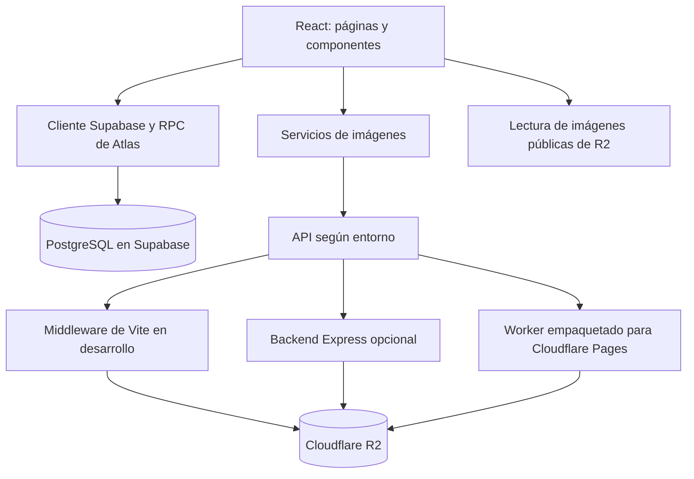
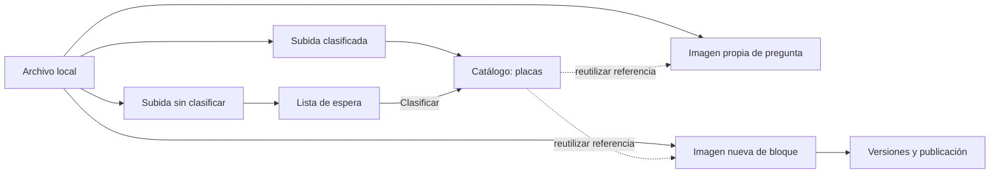

# Guía de Atlas

Referencia para localizar el código, comprender sus conexiones y preparar cambios sin perjudicar el sitio existente.

**Base de esta guía:** revisión del repositorio local del 30 de octubre de 2026. Se revisaron rutas, configuraciones, servicios, componentes principales y scripts SQL. Posteriormente se contrastaron tablas, relaciones y firmas de funciones con metadatos remotos de Supabase mediante lecturas, documentadas en [el inventario verificado](supabase-inventario.md). La exploración inicial fue de solo lectura; las correcciones de datos posteriores y las comprobaciones de producción se documentan por separado en esta guía. No todos los cambios locales están desplegados ni todos los recorridos completos están verificados en producción.

## 1. Cómo usar esta guía

1. Lee las reglas de [AGENTS.md](../AGENTS.md).
2. Localiza el área en la tabla de la sección 3.
3. Sigue su recorrido desde la página hasta servicios, datos y componentes compartidos. Algunas páginas consultan Supabase directamente: no toda la lógica está en `services/`.
4. Revisa las pruebas existentes y los consumidores de las funciones que vas a cambiar.
5. Antes de usar un navegador o ejecutar scripts con escritura, confirma a qué servicios apuntan y utiliza datos aislados.

La habilidad local [atlas-desarrollo](../.agents/skills/atlas-desarrollo/SKILL.md) aplica este recorrido a tareas del repositorio. Puede invocarse como `$atlas-desarrollo`; sus instrucciones también están enlazadas desde `AGENTS.md`.

La guía es un índice de investigación, no una afirmación de que todos los módulos han sido auditados.

**Mapa especializado:** [gestión y recorrido de las imágenes](mapa-gestion-imagenes.md), desde subida clasificada o lista de espera hasta catálogo, preguntas, bloques, versiones, créditos y eliminación. Incluye carpetas, campos, consumidores y fuentes de código.

**Editor de señalados:** [revisión funcional de herramientas y escritura](revisiones/editor-senalados-herramientas-2026-10-30.md), con recorrido de navegador aislado, correcciones de teclado/formato y límites de comprobación.

**Editor de mapas interactivos:** [revisión de herramientas, textos y cambio de placa](revisiones/editor-mapas-interactivos-2026-10-31.md), con pruebas aisladas de geometría, guardado, carga de imágenes y ambos visores públicos.

**Diseño de la publicación semanal:** `ContentBlockRenderer.tsx` y `src/styles/weeklyHistology.css` adaptan el HTML de referencia del usuario con el ámbito `cb-weekly-lab`: lámina de vidrio, etiqueta esmerilada, fichas con lentes, cubreobjetos y distribución móvil. Las tipografías Fraunces e IBM Plex Mono se alojan en `src/assets/fonts/weekly-slide/`, con sus licencias. Las reglas anteriores de `home.css` excluyen este ámbito. Se conservan temas/enlaces, fechas, placa/visor y opciones del editor; el movimiento respeta la preferencia reducida y el ajuste de imagen «contener». No se inventan valores de tinción, aumento ni escala a partir de los rótulos ilustrativos del HTML. La copia del diseño original está en `recovered_images/design-backups/weekly-before-20261031-080829/`; la propuesta intermedia y el HTML de referencia, en `recovered_images/design-backups/weekly-reference-before-20261031-082841/`. Ambas carpetas están ignoradas por Git y tienen parches de reversión.

**Créditos:** `src/pages/Creditos.tsx` conserva `loadCredits`, perfiles, instructores, cargos, períodos, aportes y tratamiento de imágenes fallidas. `src/styles/credits.css` limita el rediseño al ámbito `.credits-lab`: presentación editorial violeta, tarjetas inspiradas en portaobjetos con imágenes histológicas y etiquetas de vidrio, fichas de instructores y cierre de agradecimiento. Reutiliza fuentes locales del laboratorio, mantiene Header/Footer y adapta las columnas a escritorio, tableta y móvil. El registro llamado «Snoopy» se presenta como guiño del equipo en una tarjeta horizontal a la derecha de la introducción, con imagen contenida en una columna independiente y aporte en otra; título y presentación comparten el bloque izquierdo y la tarjeta se centra respecto a este bloque, evitando la composición escalonada; se excluye de la lista de instructores solo al renderizar, sin modificar el registro ni el editor. El título de instructores ajusta su fuente al ancho de la sección y permanece en una línea. Comprobado en local a 320, 390, 768 y 1440 px, con nombres extensos, lista vacía e imagen fallida; sin cambios de datos ni publicación.

## 2. Arquitectura y entornos

**Marca de agua del visor público:** `usePlateWatermark.ts` sitúa el icono, nombre y enlace en la esquina inferior izquierda de la intersección entre imagen y viewport, evitando los márgenes de fondo. Sigue zoom/desplazamiento, transiciones y redimensionado; reduce la marca cuando el área visible no permite su tamaño normal y la oculta si la imagen queda totalmente fuera. Los contactos táctiles usan las medidas preparadas y `DIRECT_VIEW_TRANSFORM_EVENT`, sin medir el DOM por contacto ni provocar renders de React. El minimapa permanece abajo a la derecha.

**Acabado de los segmentos discontinuos:** Los bordes con ajustes de estilo usan `regionDashPath.ts` en editor y visor público. Cada palito es una recta corta con extremos redondos, evitando reproducir el zigzag dentro de cada segmento; el conjunto sigue el perímetro muestreado y sus huecos. Se compensa el grosor en el hueco para mantener separación visible y el paso se adapta al zoom. El relleno y los puntos guardados permanecen independientes del acabado. Los bordes antiguos sin propiedades de estilo conservan su representación anterior. El dibujo provisional muestra extremos redondos; el acabado segmentado se aplica al cerrar la región.

**Suavizado leve de bordes:** El panel de borde individual/múltiple permite activar `regionSmooth`, conservado en `senalados_meta`. Los bordes nuevos lo activan por defecto; los antiguos sin el campo mantienen el recorrido original. `regionPolygonPath.ts` comparte el render entre editor y visor público: aplica una sola pasada de filtro limitada al 0.1 % del lado menor y redondea uniones hasta un 0.05 % adicional, acotado por la longitud de las aristas. No sustituye los puntos guardados ni acumula cambios al reabrir; conserva anillos y huecos independientes. El dibujo provisional sigue el contacto directamente y al terminar muestra el contorno suavizado. Las coordenadas de edición y la detección de interior continúan usando la geometría original; la pequeña diferencia visual queda limitada por esos márgenes.

**Estilo de bordes en el editor de señalados:** Borde individual y Bordes múltiples comparten opciones estándar definidas en `REGION_BORDER_PRESETS`: grosor Muy delgado (1 px), Delgado (1.75 px), Medio (2.5 px) y Grueso (4 px); separación Corta (3 px), Media (7 px) y Larga (12 px); longitud Corto (4 px), Medio (10 px) y Largo (16 px), con muestra SVG. Un valor anterior fuera de estas opciones aparece como «Valor guardado» y se conserva hasta elegir otro. Se guardan como `regionStrokeWidth`, `regionDashLength` y `regionDashGap` dentro de `senalados_meta`, sin cambiar el esquema SQL. Se aplican al borde seleccionado o al grupo en creación y a los nuevos bordes; editor y visor público mantienen tamaño visual constante al ampliar. Se conservan en creación, edición, lista de espera, visor y alineación. Los señalados antiguos conservan el aspecto público previo (2.5 px, patrón 10/7); los valores guardados fuera de rango se acotan al renderizar. Las pruebas comprueban guardado, geometría intacta, lectura pública y compatibilidad antigua.

**Movimiento exclusivo de placas:** Gestión de placas → Reasignación → Mover placa usa `/trasladar-placa`, conserva identidad/URL/señalados y sincroniza ubicación del mapa de forma atómica. La función SQL se instaló con autorización el 2 de noviembre de 2026; el frontend continúa local. Ver [alcance, pruebas y activación](mover-placas.md). El editor anterior permanece separado.

Atlas permite consultar material de histología, explorar placas y anotaciones, usar mapas interactivos y realizar evaluaciones. Incluye administración de catálogo, contenido, usuarios y auditoría.

### Frontend

- Entrada: `src/main.tsx`; composición y rutas: `src/App.tsx`.
- React 18, TypeScript, Vite y React Router. Las páginas principales se cargan con `lazy` y `Suspense`.
- `App.tsx` reúne autenticación, mantenimiento, SEO, restauración de navegación, registro de visitas y errores del cliente.
- Estilos compartidos en `src/style.css`, `src/styles/` y archivos CSS de componentes. Los cambios globales pueden afectar varias pantallas.
- Tema navideño del encabezado: `src/components/Header.tsx`, decoraciones SVG/CSS en `src/components/ChristmasHeaderDecor.tsx` y estilos acotados en `src/styles/christmasHeader.css`. Las luces respetan la preferencia de movimiento reducido; la temática no requiere consultas ni recursos externos nuevos.
- Tiptap participa en edición de texto; Konva/React Konva y XYFlow están entre las dependencias visuales. Comprueba los imports del módulo antes de elegir una implementación.

### API de imágenes y despliegue

- `src/services/cloudinary.ts` conserva un nombre histórico y opera con R2. Resuelve la URL de API usando `VITE_BACKEND_BASE_URL` y el entorno del navegador.
- En localhost, una URL configurada hacia localhost se resuelve a rutas relativas: el middleware de `vite.config.ts` atiende operaciones de imágenes.
- `backend/server.js` ofrece una implementación Express opcional con acceso S3 a R2.
- `.github/workflows/deploy-cloudflare-pages.yml` instala dependencias, ejecuta pruebas, comprueba tipos, compila, copia `cloudflare/_worker.js` a `dist/_worker.js` y despliega en Pages. Se activa al subir a `main` o al ejecutarlo manualmente.
- `functions/api/` contiene otra implementación de endpoints. No debe asumirse que sea la que se ejecuta con el Worker empaquetado; revisar la ruta de despliegue antes de modificarla.
- Configuración de producción observada en el panel de Cloudflare el 30 de octubre de 2026: `SUPABASE_URL` y `SUPABASE_SERVICE_ROLE_KEY` están declaradas como secretos cifrados; `R2_BUCKET` está vinculado a `atlas-media`. También figuran `R2_PUBLIC_DOMAIN` y `VITE_R2_PUBLIC_DOMAIN`. No se revelaron ni validaron los valores cifrados y no se cambió ni desplegó configuración. Ver [comprobación de producción](revisiones/configuracion-produccion-2026-10-30.md).

Las operaciones de imágenes requieren `SUPABASE_URL` y `SUPABASE_SERVICE_ROLE_KEY` en el servidor que las atiende: Vite lee `.env` y `backend/.env`, Express lee `backend/.env`, y Cloudflare usa variables/secretos del Worker o Functions. Nunca usar `VITE_` para la clave de servidor. La función `atlas_authorize_token` debe estar disponible para ese servidor; antes de desplegar, comprobar configuración y compatibilidad sin ejecutar los SQL históricos automáticamente. Si falta esa configuración, la administración multimedia se detiene con 503; no se habilita un acceso alternativo. El panel de producción confirmó la presencia de ambos nombres como secretos cifrados; sus valores y la autenticación extremo a extremo permanecen sin verificar.

Configuración local revisada el 30 de octubre de 2026, después de que el usuario añadió la clave en `backend/.env`: las variables requeridas para Vite y Express están presentes. Se comprobó el rol `service_role` declarado por la clave y la coincidencia del identificador del proyecto con `SUPABASE_URL`, sin validar remotamente la credencial. Los archivos privados están ignorados y no rastreados por Git; no se detectó la clave en variables `VITE_`, fuentes del frontend ni la compilación existente. No se imprimieron valores ni se reiniciaron procesos. Los servidores que ya estaban abiertos necesitan volver a cargar su entorno; las pruebas de operaciones multimedia siguen siendo simuladas. Esta comprobación no confirma la configuración de producción.

Contrato de errores de las operaciones multimedia: 401 sin sesión, 403 cuando la comprobación de permisos devuelve `false`, 503 si no se puede verificar la sesión o falta R2, 400 para parámetros inválidos y 500 si falla una operación de almacenamiento. Un borrado solo devuelve éxito después de eliminar original y miniatura. Si falla la miniatura tras eliminar el original, se informa error: no hay transacción entre objetos ni restauración automática. Los parámetros de consulta ya decodificados no se vuelven a decodificar al resolver una clave. Las pruebas de `src/test/r2ImageTransfers.test.js` ejecutan las cuatro implementaciones con almacenamiento y autorización simulados, sin cargar credenciales ni usar red real.

## 3. Mapa para localizar cambios

Todas las rutas de archivo de esta sección parten de la raíz del repositorio.

| Área | Puntos de entrada | Conexiones que revisar |
| --- | --- | --- |
| Inicio y contenido semanal | `src/pages/Home.tsx`, `src/components/HomeHistologyFact.tsx`, `src/components/ExamWeekTestsCarousel.tsx` | Publicación de bloques, estilos del inicio, `ChristmasCountdown.tsx` y componentes de temporada cuando corresponda. |
| Catálogo público | `src/pages/TemarioPublico.tsx`, `src/pages/Subtemas.tsx`, `src/pages/PlacasSubtema.tsx` | `src/services/catalogService.ts`, cachés, orden de temas y subtemas, publicación y visor. |
| Edición del catálogo | `src/pages/EditarTemario.tsx`, `src/pages/EditarSubtemas.tsx`, `src/components/temario/` | Tablas `temas` y `subtemas`, orden, dependencias de placas, permisos y auditoría. |
| Placas y lista de espera | `src/pages/EditarPlacas.tsx`, `src/pages/ListaEspera.tsx`, `src/pages/MoverPlaca.tsx`, `src/components/PlateEditorPanel.tsx` | `placas`, `placas_sin_clasificar`, servicio de imágenes, miniaturas y registros de actividad. |
| Visor y anotaciones | `src/components/ImageViewerModal.tsx`, `src/components/PlateAnnotationViewerEditor.tsx`, `src/components/SenaladoLocationPicker.tsx` | Consumidores en páginas, formato de señalados, coordenadas, zoom, imagen original y guardado. |
| Editor de páginas | `src/pages/EditorPaginas.tsx`, `src/components/PageContentEditor.tsx`, `src/components/page-editor/` | Tipos y registro de bloques, renderer, versiones, publicaciones y estilos compartidos. |
| Bloques de contenido | `src/types/contentBlocks.ts`, `src/components/blocks/blockRegistry.ts`, `src/components/ContentBlockRenderer.tsx` | Valores por defecto, normalización, editores y `src/components/histology-blocks/`. |
| Mapas interactivos | `src/pages/MapasInteractivos.tsx`, `src/components/InteractiveMapViewerModal.tsx` | Tabla `interactive_maps`, relación con placas, visor y estado de navegación. |
| Crear y administrar evaluaciones | `src/pages/GestionPruebas.tsx`, `src/pages/EditorDePruebas.tsx` | Preguntas, opciones, RPC `guardar_prueba_completa`, imágenes propias y auditoría. |
| Realizar evaluaciones | `src/pages/Evaluaciones.tsx`, `src/pages/EjecutarPrueba.tsx`, `src/pages/evaluacionesUtils.ts` | RPC públicas, calificación, publicación, temporizador y oportunidades. |
| Herramientas de estudio | `src/pages/Herramientas.tsx`, `src/pages/ComparadorPlacas.tsx`, `src/pages/DesafioIdentificacion.tsx` | Catálogo, imágenes, `src/components/comparador/` y estado de la experiencia. |
| Acceso y usuarios | `src/contexts/AuthContext.tsx`, `src/components/PrivateRoute.tsx`, `src/security/permissions.ts`, `src/pages/GestionUsuarios.tsx` | Sesiones propias, rutas, RPC, políticas SQL y controles específicos de usuario. |
| Auditoría y operación | `src/pages/HistorialAuditoria.tsx`, `src/pages/Estadisticas.tsx`, `src/components/SiteControlCenter.tsx` | `unifiedAuditService.ts`, `adminControlCenter.ts`, analítica, presencia, mantenimiento y acciones administrativas. |
| Navegación persistente | `src/services/navigationStateKeeper.ts`, `src/hooks/useSmartBackNavigation.ts`, `src/components/BackButton.tsx` | Parámetros de URL, filtros, restauración de scroll y botones de regreso. |

No elimines archivos solo por llamarse `Old`, `backup` o estar en `archived/`: comprueba imports y consumidores. Por ejemplo, `PlacasSubtema.tsx` importa un componente de `archived/`.

## 4. Recorridos que conviene entender antes de cambiar

### Pizarra temporal del visor público

`ImageViewerModal.tsx` integra el botón para abrir/cerrar la pizarra en la barra derecha de zoom y visualización. `ViewerWhiteboard.tsx` inserta ese botón mediante un portal y muestra su barra vertical de herramientas a la izquierda solo mientras la pizarra está abierta (estilos acotados en `viewerWhiteboard.css`). La barra tiene selección, mano, láser, lápiz, resaltador, formas agrupadas, texto y borrador por trazo; mantiene a mano ajustes y deshacer/rehacer. La lista central de herramientas permite desplazamiento independiente en pantallas bajas. Los paneles muestran opciones según la herramienta o el apunte seleccionado.

- El lápiz suaviza los trazos con curvas cuadráticas, conserva la punta y recoge muestras agrupadas del dispositivo. La previsualización se actualiza por cuadro; los trazos terminados reutilizan su representación. Un contacto táctil no interrumpe un trazo activo de lápiz óptico.
- Cada herramienta recuerda su color, grosor y opacidad durante la placa. El resaltador comienza translúcido y más ancho; Shift o su opción de trazo recto permite resaltar líneas.
- Flecha, línea, elipse y rectángulo tienen atajos y controles de extremos al seleccionarlos. Shift u opciones de proporción producen círculos, cuadrados y ángulos de 45°, respetando las proporciones físicas de una imagen rectangular y sus bordes.
- Seleccionar permite mover, duplicar, borrar, cambiar estilo y editar texto existente. El texto admite varias líneas, vista previa, tamaño, color y fondo medido con los glifos reales; el fondo cambia entre claro y oscuro según la tinta. La fuente se normaliza al zoom para mantener tamaño y espaciado al escribir con aumento; Ctrl/⌘ + Enter guarda y Escape cancela la edición. El borrador usa una zona de acierto ampliada e interpola el recorrido para alcanzar trazos finos; en figuras vacías alcanza su contorno, mientras que selección también permite tocar el interior. Los textos se ajustan a los bordes de la imagen al guardar y se descartan las figuras degeneradas.
- Atajos: V seleccionar, H mano, K láser, P lápiz, M resaltador, A flecha, L línea, O elipse, R rectángulo, T texto y E borrador. Ctrl/⌘ + Z deshace, Ctrl/⌘ + Shift + Z o Ctrl + Y rehace, Ctrl/⌘ + D duplica y Supr elimina el seleccionado. Los campos de texto conservan sus atajos nativos. Escape cancela primero el gesto, selección o panel abierto; después cierra las herramientas.
- Un gesto completo cuenta como una acción del historial; los gestos cancelados se descartan. El borrado completo está en ajustes, requiere confirmar y puede deshacerse. Las pruebas de interacción están en `ViewerWhiteboard.test.tsx` e `ImageViewerModal.keyboard.test.tsx`; las de geometría, en `viewerWhiteboardGeometry.test.ts`; y las de proyección, fondos y presentación, en `whiteboardRendering.test.ts`.

Los apuntes usan coordenadas relativas a la imagen y un SVG independiente de la capa CSS ampliada. `useWhiteboardProjection.ts` proyecta su grupo SVG con la matriz visible de la imagen, incluidos desplazamiento, giro, cambios de tamaño y transiciones; se actualiza antes del repintado. Esto conserva el dibujo vectorial y evita estirar una textura con texto pequeño. `WhiteboardText.tsx` mide las letras y normaliza el tamaño de fuente dentro del SVG, sin cambiar el anclaje de los apuntes. El láser limpia su rastro al cambiar de herramienta y solo anima mientras está activo. `laserTrail.ts` conserva la estela durante movimientos rápidos, separa las pausas/reentradas sin unirlas y limita la densidad de puntos sin eliminar tramos recientes; salir del lienzo deja desvanecer el rastro durante sus 1750 ms de vida. `laserTrail.test.ts` comprueba continuidad, separación y caducidad. La mano conserva el recorrido de interacción existente; la rueda y los controles derechos siguen disponibles, y mantener espacio permite mover la placa con ratón. Dos dedos permiten ampliar y desplazar desde las herramientas de dibujo; al iniciar el gesto se descarta el trazo provisional y se bloquean nuevos trazos hasta levantar todos los dedos. Para mover con un dedo se selecciona la mano.

El botón inferior centrado «Guardar apuntes» descarga un PNG y permite elegir «Vista actual» (zoom y encuadre visibles) o «Placa completa» (todos los apuntes, respetando el giro). `whiteboardExport.ts` usa la imagen original o de alta resolución y una copia vectorial de los apuntes; excluye controles, selección, zonas de acierto y láser. La composición superpone una tarjeta oscura translúcida arriba a la izquierda: tema en mayúsculas violeta y subtema grande en serif. Una insignia redondeada de Atlas Histolab con su dominio ocupa la esquina inferior derecha, según la referencia visual. No añade franjas exteriores ni marca diagonal central; las etiquetas quedan fijas en las esquinas independientemente del zoom o giro y tema y subtema reducen su tamaño de letra de forma independiente para permanecer cada uno en una sola línea. El texto pendiente se confirma antes de capturar la copia. Descargar no borra el trabajo del visor y un fallo permite reintentar.

La ruta pública de solo lectura `GET /api/plate-image?url=…` permite componer la imagen sin cambiar la configuración CORS de R2. Está implementada en Vite, Express, el Worker empaquetado y la alternativa `functions/api/plate-image.ts`. Solo acepta HTTPS del dominio público R2 configurado y su prefijo de ruta, extensiones PNG/JPEG/WebP y tipos MIME de imagen equivalentes; rechaza credenciales en URL, redirecciones, otros destinos, objetos mayores de 32 MiB y respuestas que excedan 20 segundos. No usa credenciales ni RPC y no recibe apuntes. Las operaciones de escritura existentes conservan su autorización.

Solo la foto se rasteriza primero a un máximo de 1080 px en su lado mayor, conservando proporciones y sin ampliar fuentes pequeñas. Se compone después con los apuntes vectoriales a mayor resolución: hasta 4096 px y 12 millones de píxeles en el área de imagen; la vista actual usa hasta doble resolución de pantalla. Así la foto no recupera detalle original al ampliarla y los textos y trazos se rasterizan directamente al tamaño final, sin reducirse junto con ella. Las tarjetas se dibujan también al tamaño final, dentro de la imagen sin ampliar sus dimensiones. Conserva PNG. Esto limita la exportación normal, pero no restringe el acceso a las imágenes públicas de R2 ni impide capturas. El archivo completo no supera 16 millones de píxeles. Los nombres largos se ajustan en una sola línea reduciendo la letra y los campos ausentes se indican como «No especificado». El PNG descargado permanece en el dispositivo aunque se cierre el visor; no representa una sesión editable de pizarra.

Los apuntes permanecen al cerrar las herramientas, pero se descartan al cambiar la identidad o URL de la placa o desmontar el visor. Solo existen en memoria del componente: no se guardan en el navegador ni se envían a Supabase/R2, y no modifican señalados ni mapas publicados. Este comportamiento describe el cambio local, no un despliegue verificado.

En pantallas táctiles, los eventos de la pizarra no se propagan al controlador de navegación del contenedor. Un dedo utiliza la herramienta elegida, la mano desplaza la placa y dos dedos cancelan el trazo provisional para navegar con pellizco; el dedo restante queda bloqueado hasta levantar ambos. El lápiz digital activo tiene prioridad sobre contactos táctiles en la superficie de dibujo. El controlador táctil de mano/láser usa listeners no pasivos y agrupa los cambios de vista por fotograma. El visor normal comparte la actualización por fotograma, confirma el último estado al terminar/cancelar y descarta taps pendientes al empezar un pellizco. Ambos modos reajustan la referencia al sustituir dedos, y durante el pellizco se mantienen el filtro, enfoque y grano de partida y se aplaza el cambio de fuente de alta resolución; los límites de arrastre consideran el giro. Los botones principales de pizarra aumentan a 44 px en dispositivos de puntero grueso. Verificación local con multitáctil emulado en Chromium; no equivale a una prueba física de iOS/Android.

**Revisiones locales:** [herramientas y nitidez con zoom](revisiones/pizarra-publica-nitidez-2026-10-31.md) y [descarga de apuntes](revisiones/pizarra-exportacion-apuntes-2026-10-31.md).

**Rendimiento del visor y pizarra:** `WhiteboardDraft.tsx` previsualiza lápiz y resaltador en una capa Canvas temporal con `Path2D` incremental, manteniendo SVG como alternativa si Canvas no está disponible. Al confirmar, el mismo buffer se copia al historial y se representa en SVG mediante `WhiteboardMark.tsx`; edición y exportación conservan su formato. La matriz de escritura se reutiliza mientras no cambie la proyección y se invalida al redimensionar. En contactos táctiles, `viewerTouchNavigation.ts` actualiza imagen, porcentaje y minimapa con medidas preparadas previamente; `useWhiteboardProjection.ts` calcula la matriz desde el zoom/giro/desplazamiento del evento, sin medir el DOM después de mover la imagen. React confirma el último estado al terminar/cancelar o perder foco; cambiar de placa o reiniciar la vista restablece también el DOM. La escena SVG vacía no se monta con la pizarra cerrada. `useViewerInteraction.ts` pausa temporalmente convolución de enfoque, sombra, grano y desenfoque de tarjetas mientras se navega o escribe, conservando imagen a resolución completa y ajustes de color; los efectos vuelven al soltar. El listener global de movimiento táctil del minimapa es pasivo. Las revisiones anteriores documentan la [primera optimización](revisiones/visor-rendimiento-2026-11-01.md) y el [recorrido táctil directo](revisiones/visor-tactil-rendimiento-2026-11-01.md). El [ajuste de layout y pintura](revisiones/visor-tactil-pintura-2026-11-01.md) se subió en `9b0d2d3`; el usuario informa mejora en celular Android y retraso persistente en tablet Android.

El ajuste posterior, todavía local, limita la limpieza del Canvas a la huella completa de la tinta provisional, con margen de grosor y antialias; al cambiar proyección, estilo o tamaño se limpia toda la capa. No reduce la densidad de píxeles ni modifica el trazo guardado. ResizeObserver solo cambia las dimensiones del Canvas cuando realmente varían. Los controles con desenfoque se identifican con `data-viewer-backdrop`; durante contactos sobre la placa, su desenfoque se desactiva sin transición. La mejora de latencia en la tablet física sigue pendiente de comprobar.

**Lectura para exportar en Pages (1 de noviembre de 2026):** se confirmó mediante GET público que una placa existente devuelve 200 en R2 y 502 a través de `/api/plate-image` en producción. El Worker local ahora utiliza `R2_BUCKET.get` cuando está disponible, después de validar la URL pública, y conserva los límites de formato, 32 MiB y tiempo de lectura. Decodifica la clave sin los parámetros de caché. Vite, Express y Functions conservan la lectura HTTP; el workflow despliega `cloudflare/_worker.js`. Las pruebas simulan el binding y el fallo HTTP, sin escribir datos remotos. Corrección local pendiente de despliegue y comprobación del PNG en línea; no se determinó la causa interna del fallo HTTP del Worker.

### Acceso y permisos

1. `AuthContext.tsx` llama a `atlas_login`, `atlas_validate_session` y `atlas_logout` mediante RPC.
2. El navegador guarda el token en `atlas_session_token` y datos del usuario en `atlas_user`.
3. `src/services/supabase.ts` agrega `X-Atlas-Session` a las peticiones y contiene reintentos ante determinados fallos de red.
4. `PrivateRoute.tsx` controla acceso a pantallas; `permissions.ts` define permisos por rol. Algunas rutas incorporan restricciones adicionales por usuario: revisar `App.tsx`, no solo el rol.
5. Los scripts de seguridad definen sesiones, funciones y controles de acceso de base de datos. Las APIs de imágenes tienen sus propias validaciones del token.

Roles declarados: `Instructor`, `Microscopía` y `Administrador`. No equivalen automáticamente a los roles de Supabase Auth. La interfaz no sustituye la autorización de servidor.

La revalidación distingue errores de conexión de una respuesta que invalida la sesión. Conserva ese comportamiento al corregir problemas de acceso. En el código local, las rutas de subida, movimiento y borrado de imágenes en Vite, Express, Worker y Functions exigen una respuesta booleana `true` de `atlas_authorize_token`, conservando los roles Administrador y Microscopía y el encabezado `X-Atlas-Session`. No se permite operar ante configuración ausente, fallos de red, errores HTTP o respuestas inesperadas. Esta corrección local no demuestra que esté desplegada.

### Placas, archivos y miniaturas

El [mapa completo de gestión de imágenes](mapa-gestion-imagenes.md) documenta cada entrada y transición. Este resumen distingue los tres recorridos principales:

Elegir una placa existente para una pregunta o un bloque comparte su referencia; no crea un archivo nuevo. Subir una imagen a una pregunta o bloque no la incorpora por sí mismo al catálogo ni a la lista de espera. El mapa ampliado también cubre logos, portadas, créditos, mapas interactivos, reemplazos y borrados, e identifica los caminos que solo existen como servicios.

La resolución de claves compartida entre frontend y auditorías está en `src/services/r2ImageLocation.mjs` (declaraciones TypeScript en `.d.mts`). Las URLs históricas se resuelven a R2; los candidatos de lectura no vuelven al proveedor anterior. Se preservan formatos reales guardados en R2, parámetros y versiones de caché. Las nuevas subidas se detienen si falla la conversión del original o la miniatura a WebP, si el canvas devuelve otro formato o si la imagen tiene dimensiones inválidas. No se envía el original con un nombre WebP como alternativa silenciosa. Cambios locales pendientes de despliegue.

El frontend prepara imágenes WebP y miniaturas; la API correspondiente escribe objetos en R2. La base de datos conserva referencias y metadatos. `src/services/cloudinaryImages.ts` resuelve URLs, perfiles de lectura e invalidación de caché de imágenes reemplazadas.

Una placa no es solamente un archivo: puede tener referencias en el catálogo, anotaciones, mapas y preguntas. Mover, reemplazar o eliminar exige revisar imagen, miniatura, URL, referencias y cachés. R2 y PostgreSQL son sistemas distintos; no se debe asumir una transacción única entre ambos. Evita eliminar el origen antes de comprobar el resultado y sus referencias.

Protección preparada en el repositorio local: los reemplazos de placas generan una clave nueva y conservan el original; los movimientos copian imagen y miniatura a un destino con identificador único y devuelven la URL efectiva que debe guardarse. Vite, Express, Worker y Functions conservan el origen. Los reemplazos de logos del temario y fotografías de créditos también conservan el archivo anterior. No se elimina automáticamente un archivo al recibir un error de guardado de la fotografía: la escritura remota podría haberse confirmado aunque falle la respuesta. Esto puede dejar copias adicionales; cualquier limpieza posterior necesita comprobar todas las referencias, incluidas publicaciones y versiones. Esta protección no cambia las acciones de eliminación explícita de archivos y no implica que esté desplegada en producción.

Corrección de datos confirmada en producción el 30 de octubre de 2026, con autorización explícita: se actualizaron 21 referencias de preguntas y una URL de la publicación 52 a destinos R2 existentes. Se verificaron las 22 referencias tras la transacción y se conservaron los demás bloques publicados. No se borraron objetos ni se corrigieron referencias sin archivo existente. Ver [alcance, respaldo y reversión](revisiones/r2-referencias-2026-10-30.md). Esta operación de datos no despliega los cambios locales de código.

Mantenimiento adicional confirmado en producción el 30 de octubre de 2026, solicitado explícitamente por el usuario: se generaron las ocho miniaturas de placas y una de portada de evaluación faltantes, a 480 píxeles de ancho, con originales intactos. Se vaciaron 13 referencias irrecuperables en 12 registros (siete fotografías de colaboradores, tres campos de borradores, uno de publicación y dos dentro de una versión), conservando personas, textos y bloques. Las nueve miniaturas públicas y los valores guardados se verificaron mediante lecturas. Las imágenes faltantes del catálogo quedaron fuera. Ver [alcance y recuperación](revisiones/r2-miniaturas-y-referencias-2026-10-30.md).

Verificación funcional local: [subida, clasificación, editor de señalados y reapertura](revisiones/flujo-placas-editor-2026-10-30.md). Con servicios simulados se completaron esos recorridos y se corrigió la falta de estado de error al no cargar el original del editor visual. La miniatura disponible no garantiza que se pueda abrir el original. El editor local muestra carga/error y reintento, conserva marcadores y bloquea guardado mientras falta la imagen. Cambios pendientes de publicación.

### Borradores, versiones y publicación

| Concepto | Referencia en el código | Precaución |
| --- | --- | --- |
| Bloques en edición | `content_blocks`, `PageContentEditor.tsx` | Guardar edición puede insertar, actualizar y eliminar bloques. |
| Historial de bloques/página | `content_block_versions`, `src/services/contentVersioning.ts` | Guardar/restaurar usa RPC; restaurar cambia datos. |
| Versiones nombradas | `content_page_versions`, `src/services/pageVersionsService.ts` | Crear una versión y publicarla son acciones distintas. |
| Contenido público | `content_page_publications`, `src/services/contentPublication.ts` | El snapshot publicado debe seguir visible durante una edición. |

`getRenderableBlocks` usa el snapshot de publicación cuando encuentra un registro, incluso si su estado es `draft`. Si no encuentra publicación o falla su consulta, el código intenta leer los bloques en edición. Por tanto, la separación pública no debe darse por garantizada sin comprobar ese recorrido. Hay una caché de bloques renderizables de 60 segundos y funciones para invalidarla.

Guardar, reemplazar imágenes o eliminar bloques en `PageContentEditor.tsx` conserva los archivos en R2: no consulta todos los borradores para decidir un borrado físico. La ausencia en `content_blocks` no demuestra que un archivo esté libre; puede seguir en publicaciones, versiones, plantillas u otras referencias. La limpieza física queda fuera del guardado y requiere una revisión independiente. El método `saveChanges` expuesto por el editor usa el estado del render actual, incluidos los bloques guardados y la versión activa. Cambio local, sin migraciones ni limpieza remota.

Los bloques usan `entity_type`, `entity_id`, `block_type`, `sort_order` y `content`; los tipos de página incluyen `subtemas_page`, `placas_page` y `home_page`. Al añadir o cambiar bloques, revisa tipos, registro, normalización, edición, renderizado y compatibilidad con JSON ya guardado.

### Evaluaciones

`EditorDePruebas.tsx` carga preguntas y opciones y guarda mediante `guardar_prueba_completa`. La ejecución pública utiliza `atlas_get_public_test` y `atlas_grade_test`; también hay rutas de lectura alternativas en el archivo. Revisa cuándo se selecciona cada recorrido antes de cambiarlo y conserva la separación entre datos públicos y respuestas de calificación.

Las imágenes de referencia tienen lógica de propiedad y limpieza en `src/services/testReferenceImages.ts`. No borres una imagen compartida por otra entidad al eliminar o editar una evaluación.

## 5. Datos: mapa funcional e inventario verificado

La siguiente tabla agrupa referencias del código. Para objetos confirmados mediante lecturas remotas, relaciones y límites de la comprobación, consulta [el inventario de Supabase](supabase-inventario.md).

| Grupo | Tablas referenciadas |
| --- | --- |
| Catálogo y placas | `temas`, `subtemas`, `placas`, `placas_sin_clasificar`, `interactive_maps` |
| Contenido | `content_blocks`, `content_block_versions`, `content_page_versions`, `content_page_publications` |
| Evaluaciones | `pruebas`, `prueba_preguntas`, `prueba_pregunta_opciones` |
| Acceso | `usuarios`, `atlas_sessions` |
| Auditoría y operación | `unified_audit_logs`, `placas_activity_logs`, `site_analytics_events`, `site_online_presence`, `site_runtime_settings`, `site_control_audit_logs`, `site_client_errors` |

Esta lista orienta búsquedas y no es exhaustiva. `database/` contiene scripts de instalación, cambios y reparaciones; no se observó una secuencia versionada que permita deducir por sí sola qué se aplicó. Tampoco se debe inferir un orden de ejecución por nombre de archivo.

Los SQL locales declaran algunas relaciones con `ON DELETE CASCADE`, incluidas placas respecto del catálogo y mapas respecto de placas. Antes de borrar o modificar relaciones, comprueba las restricciones reales: una operación puede afectar registros dependientes. No supongas que todos los identificadores tienen el mismo tipo; los scripts combinan enteros y UUID.

### Procedimiento para cambios que afecten producción

1. Investigar con lecturas acotadas; revisar el cuerpo de cualquier función antes de llamarla. Consultar solo los datos necesarios y no copiar registros sensibles en documentación.
2. Preparar el cambio en local y comprobar compatibilidad con los datos y la versión desplegada. Conservar columnas, campos JSON, IDs y URLs existentes salvo que cambiarlos sea parte explícita del trabajo.
3. Identificar alcance, dependencias, posible interrupción, respaldo y recuperación. Confirmar que el respaldo cubre lo afectado; un respaldo de base de datos no debe suponerse respaldo de objetos R2.
4. Probar con datos aislados o un entorno de pruebas confirmado. Un frontend local o una vista previa no demuestra aislamiento de datos.
5. Presentar la operación concreta y obtener autorización explícita antes de escribir en producción. Una instrucción general de investigar o corregir no autoriza borrar, reiniciar o migrar datos reales.
6. Tras una operación autorizada, verificar conservación de datos y funcionamiento de los recorridos afectados. No declarar éxito solamente por una respuesta sin error.

## 6. Desarrollo y validación

Comandos desde la raíz, definidos en `package.json`:

| Comando | Efecto |
| --- | --- |
| `npm run dev` | Inicia Vite en el puerto 5173 con middleware local de imágenes. |
| `npm run dev:frontend` | Intenta liberar el puerto 5173 y luego inicia Vite; puede terminar el proceso que lo ocupa. |
| `npm run dev:backend` | Ejecuta el servidor de `backend/`; su puerto predeterminado es 3001. |
| `npm run dev:all` | Actualmente solo ejecuta `dev:backend`; el nombre no implica que inicie ambos servidores. |
| `npm test` | Ejecuta la suite Vitest. |
| `npm test -- src/contexts/AuthContext.test.tsx` | Ejecuta un archivo de pruebas concreto. |
| `npm run test:watch` | Mantiene Vitest observando cambios. |
| `npm run typecheck` | Comprueba tipos del frontend con `tsc --noEmit`. |
| `npm run build` | Compila el frontend en `dist/`; no publica por sí solo. |
| `npm run preview` | Sirve la compilación para vista previa; no equivale al entorno de API desplegado. |

`publish:github` prepara archivos, crea un commit y hace push a `main`: solo usarlo por petición explícita de publicación y tras revisar qué incluye.

Vitest usa jsdom, Testing Library y `src/test/setup.ts`. Hay pruebas junto a componentes y servicios y otras en `src/test/`. `backend/package.json` no tiene una suite funcional: su script `test` es un marcador que termina con error.

### Aislamiento de las pruebas automáticas

`vitest.config.ts` busca archivos de entorno en `src/test/`, en lugar de cargar los `.env` de la raíz. Define destinos ficticios bajo `.invalid` para Supabase, la API y R2, junto con una clave de prueba sin privilegios. No modifica los archivos de entorno del desarrollo ni el despliegue.

`src/test/setup.ts` instala el bloqueo de `src/test/blockNetwork.ts` antes de cargar las suites y lo renueva entre casos. Bloquea `fetch`, el envío de `XMLHttpRequest` (incluido Axios con su adaptador de navegador), `WebSocket`, `EventSource` y `sendBeacon`. Un intento no simulado también hace fallar la prueba aunque la aplicación capture el error. El registro guarda únicamente el transporte, sin URLs, cabeceras ni cuerpos.

Simula la dependencia del módulo en la prueba (`vi.mock`) o una respuesta local del transporte; no habilites red real para hacer pasar un caso. `src/test/networkIsolation.test.ts` comprueba el bloqueo, incluido el cliente Supabase y una eliminación de Axios, sin enviarlos al exterior. `PageNavigator.test.tsx` simula la consulta de contenido semanal que el componente hace al montarse.

Este aislamiento aplica a la suite Vitest/jsdom: no es un cortafuegos del sistema, no intercepta clientes de red nativos de Node y no configura un entorno independiente para `npm run dev`, scripts administrativos o pruebas de navegador. Para esos recorridos aún se necesitan servicios de pruebas separados y respaldos verificados.

### Regresiones de acceso, edición y publicación

Estas pruebas usan servicios simulados y datos en memoria; no requieren escribir en Supabase ni R2:

| Archivo | Comportamientos comprobados |
| --- | --- |
| `src/contexts/AuthContext.test.tsx` | Inicio y cierre de sesión, credenciales rechazadas, cuenta desactivada, bloqueo y conservación de sesión ante fallos temporales. La auditoría también está simulada. |
| `src/components/PrivateRoute.test.tsx` | Espera de validación, acceso por rol, usuario protegido y combinación de rol con ID permitido. |
| `src/components/PlateEditorPanel.test.tsx` | Volver a editar sin perder el cambio, confirmar salida sin guardar, cierre sin cambios y acción de guardado deshabilitada. |
| `src/services/contentPublication.test.ts` | Snapshot visible durante edición, actualización al publicar e invalidación de caché, fallo de publicación y publicación vacía sin recuperar contenido antiguo. |

No sustituyen una prueba completa de navegador ni verifican permisos de servidor, SQL o persistencia real. Los casos de publicación comprueban el servicio frontend con respuestas simuladas; los del panel comprueban sus interacciones y callbacks, sin guardar una placa real.

TypeScript usa `strict`, comprobación de variables y parámetros no usados y prevención de caídas entre casos de `switch`. `tsconfig.json` incluye `src/` y excluye `src/components/security_backup`; pasar tipos no valida automáticamente Worker, backend, SQL ni políticas reales. No se encontró configuración de ESLint/Prettier ni scripts de lint/formato en el paquete principal.

| Tipo de cambio | Validación pertinente |
| --- | --- |
| Documentación | Rutas, comandos, enlaces locales, exactitud y diff; no necesita llamadas a producción. |
| Lógica de frontend | Pruebas relacionadas; tipos y compilación cuando corresponda. |
| Visores, edición o estilos | Pruebas relacionadas y recorrido visual, incluyendo pantallas pequeñas y contenido guardado. |
| Acceso o publicación | Pruebas de permisos, sesión, fallos de red, borrador y lectura pública, según el cambio. |
| API de imágenes | Verificar la implementación del entorno objetivo y coherencia de archivo, miniatura y referencias con datos aislados. |
| SQL o datos | Revisar esquema real, dependencias, preservación y recuperación; aplicar el procedimiento de producción. |

## 7. Documentación histórica y mantenimiento

Los scripts `audit-images.mjs`, `audit-integrity.mjs` y `audit-all-urls.mjs` comparten `scripts/lib/media-audit.mjs` y su ejecutor `run-media-audit.mjs`. Leen 13 fuentes declaradas con columnas explícitas, conteos y paginación, incluyendo créditos, preguntas, publicación, versiones y lista de espera. Los mapas referencian su placa con `placa_id`; no tienen `image_url` propio. El inventario del centro de mantenimiento consulta esa relación. Los errores de tablas, permisos, columnas o paginación producen un informe incompleto y no se interpretan como ausencia de problemas. Los informes quedan en `recovered_images/audits/`, ignorado por Git. No se deduce que un objeto sin referencia se pueda borrar. Consulta [comprobaciones y límites](revisiones/mantenimiento-multimedia-2026-10-30.md).

- El apartado multimedia de `README.md` describe R2 y las auditorías actuales. El documento también conserva instrucciones históricas de instalación y SQL; no ejecutarlas automáticamente sobre una instalación existente.
- `INSTRUCCIONES_AUTENTICACION.md` describe también un modelo inicial de usuarios y contraseñas que no refleja por completo el recorrido actual de sesiones RPC. No ejecutar sus ejemplos sobre producción como parte de una investigación.
- `GEMINI.md` y `.agents/rules/` documentan restricciones de publicación y uso exclusivo de R2. `AGENTS.md` da una entrada común para Codex y enlaza esta guía.
- Se confirmó parte del esquema remoto mediante metadatos; el detalle está en [el inventario de Supabase](supabase-inventario.md). La lista de migraciones registrada resultó vacía y no permite reconstruir qué scripts se aplicaron. Se documentaron respaldos específicos de las correcciones multimedia y la presencia de variables/binding en producción; esto no confirma un respaldo general, los valores cifrados ni qué commit está desplegado. Verificar cada punto cuando sea relevante para la tarea.

Al cambiar arquitectura, persistencia, endpoints, comandos o reglas operativas, actualiza esta guía en el mismo trabajo. Documenta el comportamiento final y su fuente; no conviertas suposiciones o comentarios antiguos en hechos comprobados.

### Composición táctil estable del visor

`ViewerPageSuspension`, montado en `App`, cuenta las aperturas/cierres mediante `IMAGE_VIEWER_VISIBILITY_EVENT`. Mientras hay visores, aplica `content-visibility: hidden` e `inert` a `#root`, conserva su altura y pausa animaciones CSS. Los portales en `body` permanecen operativos. Al cerrar el último, restaura la página bajo `AtlasLoadingScreen` durante dos fotogramas (con salida de respaldo a un segundo). No recarga datos ni desmonta componentes: conserva estado y evita nuevas consultas; los temporizadores JavaScript no se suspenden globalmente. La pantalla indica restauración visual, no una espera de peticiones de red.

Al abrir `ImageViewerModal`, su portal directo en `body` permite ocultar visualmente `#root` y pausar sus animaciones CSS, incluidos pseudoelementos, mediante `viewerInteraction.css`. Así la portada semanal no sigue pintándose detrás del visor. El contenido permanece montado y conserva su layout y estado; al cerrar el último visor se restaura automáticamente. Esto no pausa temporizadores JavaScript ni constituye una medición de FPS en dispositivos reales.

Celular y tablet usan los mismos filtros de color ligeros durante toda la sesión cuando el dispositivo tiene un puntero táctil (any-pointer: coarse), también si se escribe con lápiz. En estos dispositivos se omiten enfoque, grano y desenfoques de fondo para evitar reconstruir la composición de la foto en cada trazo. La tinta provisional usa Canvas sincronizado y un presupuesto de dos millones de píxeles con densidad máxima 2; los apuntes definitivos y la exportación conservan su representación vectorial y resolución. El movimiento sigue agrupándose por requestAnimationFrame. Cambio local: las pruebas automatizadas no demuestran 30 fps ni ausencia de parpadeo en una tablet física.
