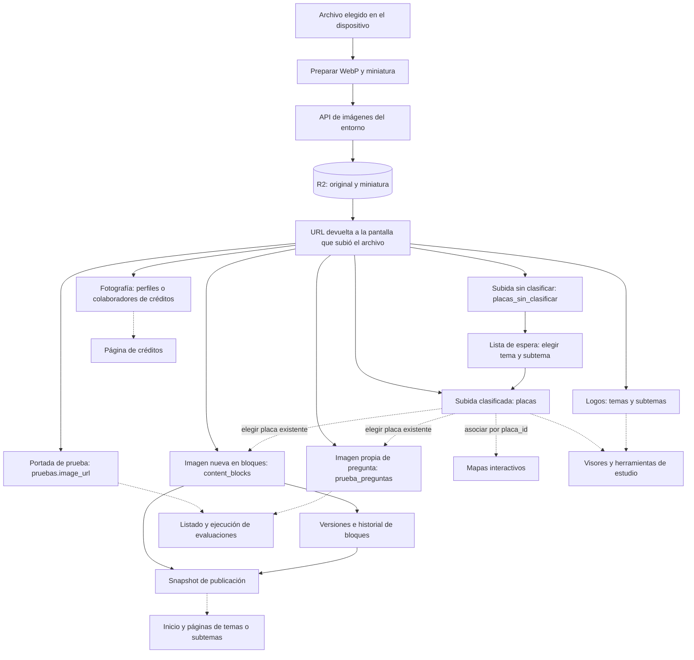
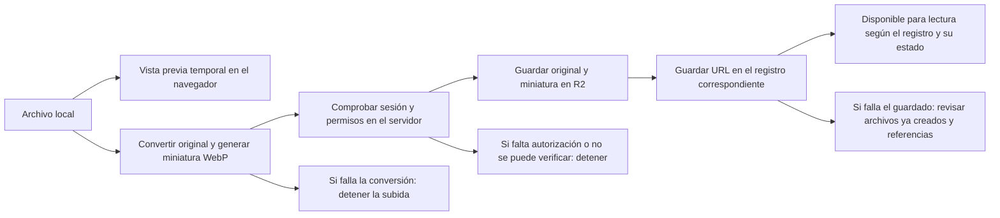
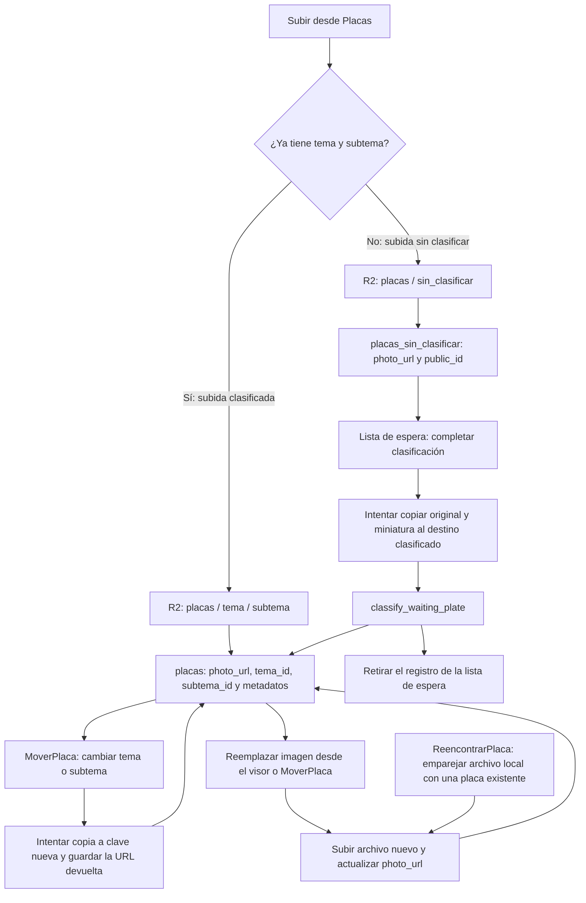
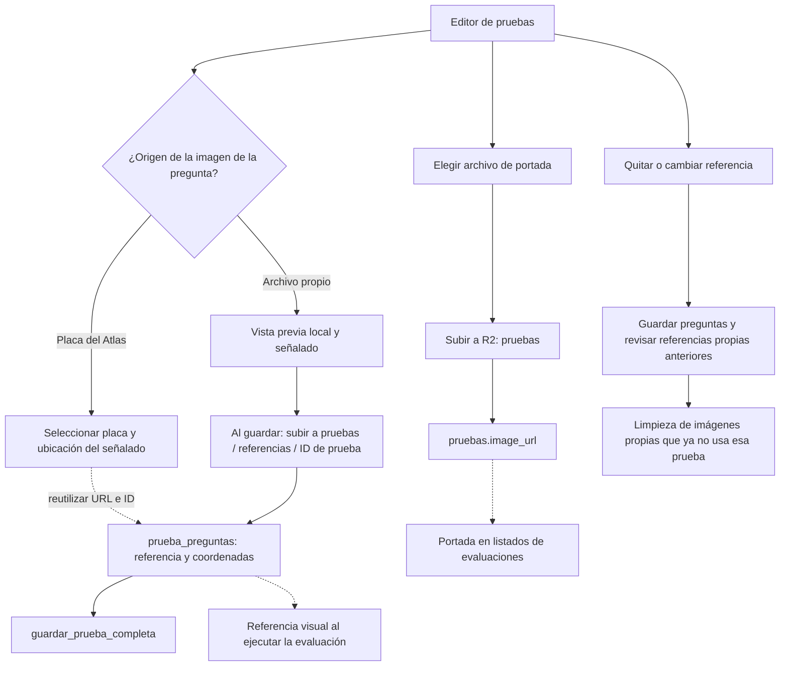
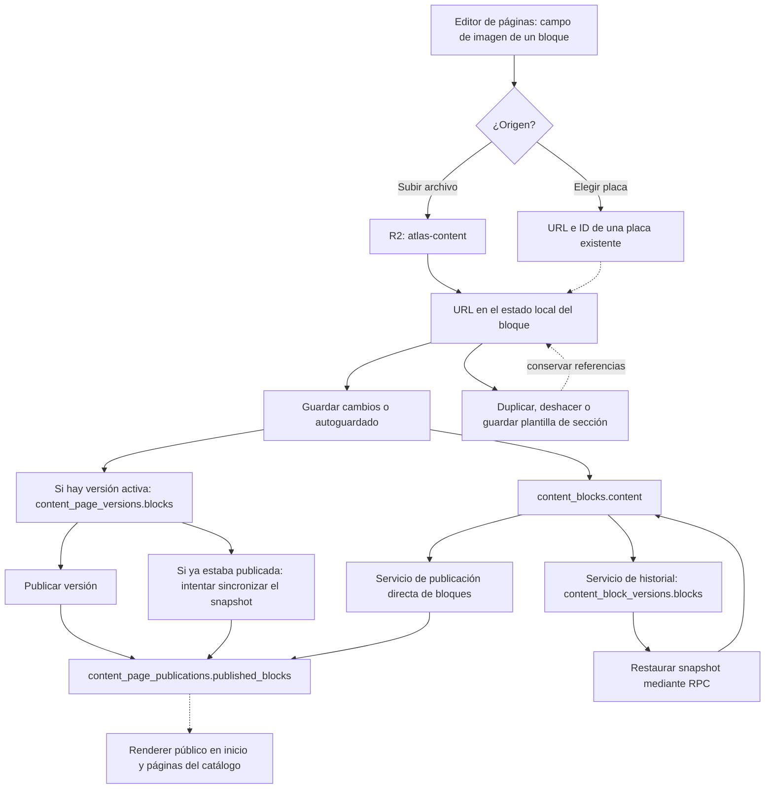
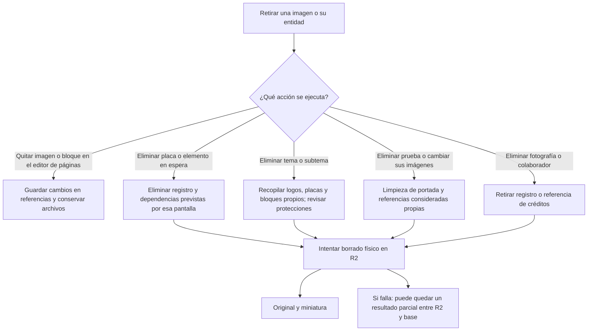

# Mapa de gestión de imágenes de Atlas

Este mapa sigue **el recorrido de las imágenes**, desde su entrada hasta sus usos y retirada. Sirve para localizar qué cambiar, qué referencias revisar y qué archivos conservar.

**Base:** código local revisado el 30 de octubre de 2026. Describe las rutas implementadas, incluidas las protecciones locales todavía pendientes de despliegue. No demuestra que todos los recorridos se hayan probado en producción. Los cambios remotos comprobados están registrados en [la guía](guia-atlas.md#placas-archivos-y-miniaturas).

## 1. Cómo leer el mapa

| Concepto | Qué significa |
| --- | --- |
| Subir | Crear un original y su miniatura en R2, y después guardar una referencia en la base de datos. |
| Referenciar o reutilizar | Guardar la URL o el ID de una imagen que ya existe. No crea otro archivo. |
| Clasificar | Convertir un registro de la lista de espera en una placa del catálogo con tema y subtema. Puede incluir una copia física a otra carpeta. |
| Mover | Cambiar tema/subtema en la base. La API local prepara una copia en otro destino R2 y conserva el origen. |
| Versionar o publicar | Guardar bloques JSON con sus referencias. No duplica los archivos de las imágenes. |
| Quitar una referencia | Vaciar un campo o retirar un bloque. No implica necesariamente borrar el archivo. |
| Borrar físicamente | Eliminar un objeto R2 y su miniatura. Puede afectar otros usos del mismo archivo. |

En los diagramas, **flecha continua** indica una operación del recorrido; **flecha discontinua** indica reutilización o lectura de una referencia. Las tablas aclaran qué parte está en R2 y cuál está en la base.

## 2. Mapa general de entradas y destinos

**La lista de espera recibe la subida sin clasificar.** Las subidas a pruebas, bloques o créditos no pasan por ella ni crean automáticamente placas. El flujo de mover una placa ya clasificada cambia su ubicación dentro del catálogo; no la devuelve a la lista de espera.

Fuentes de entrada: [Placas](../src/pages/Placas.tsx), [ListaEspera](../src/pages/ListaEspera.tsx), [EditorDePruebas](../src/pages/EditorDePruebas.tsx), [PageContentEditor](../src/components/PageContentEditor.tsx), [Temario](../src/pages/Temario.tsx) y [CreditsAdminPanel](../src/components/CreditsAdminPanel.tsx).

## 3. Subida y almacenamiento comunes

La vista previa `blob:` o `data:` y los archivos seleccionados aún sin guardar viven en el navegador; no son una subida completada. La ruta normal prepara los dos WebP antes de enviarlos. No existe una transacción única entre R2 y la base: puede haberse creado un archivo aunque después falle el registro. Tampoco se debe interpretar un error de respuesta como prueba de que no hubo escritura.

| Etapa | Implementación que seguir |
| --- | --- |
| Preparación, subida, reemplazo, movimiento y borrado | [cloudinary.ts](../src/services/cloudinary.ts). Nombres históricos, almacenamiento R2. |
| API usada por Vite en localhost | [vite.config.ts](../vite.config.ts), lee `.env` y `backend/.env`. |
| Backend Express opcional | [backend/server.js](../backend/server.js). |
| API empaquetada para producción | [cloudflare/_worker.js](../cloudflare/_worker.js), copiada por el [workflow](../.github/workflows/deploy-cloudflare-pages.yml). |
| Implementación alternativa de Pages Functions | [functions/api/](../functions/api/); no asumir que sustituye al Worker empaquetado. |
| Lectura de URLs y candidatos | [cloudinaryImages.ts](../src/services/cloudinaryImages.ts), [r2ImageLocation.mjs](../src/services/r2ImageLocation.mjs), [ResilientPlacaThumb](../src/components/ResilientPlacaThumb.tsx). |

La miniatura se deriva como `<nombre>_thumb.webp`. Los perfiles `thumb` y `thumbSmall` la solicitan; `view`, `zoom` y los perfiles amplios leen el original. Los candidatos permiten pasar de miniatura a original y resolver referencias históricas en R2. Los archivos R2 existentes en otro formato conservan su extensión de lectura; las nuevas subidas normales exigen WebP.

## 4. Catálogo y lista de espera

| Camino | Qué queda guardado | Detalle que no se debe perder |
| --- | --- | --- |
| Subir ya clasificada | Original/miniatura bajo `placas/<tema>/<subtema>/`; fila en `placas`. | Las carpetas usan nombres normalizados con `slugify`; la identidad estable es el ID de la placa, no su nombre de archivo. |
| Subir sin clasificar, incluido un lote | Original/miniatura bajo `placas/sin_clasificar/`; fila en `placas_sin_clasificar`. | Cada imagen tiene su propio resultado; un lote puede terminar con éxitos y errores. |
| Clasificar desde espera | Una placa nueva con su clasificación; se retira la fila de espera mediante RPC. | La copia física y el cambio de tablas son operaciones diferentes. Si falla la copia, el código puede conservar la URL de origen y clasificar igualmente. Una carpeta sin clasificar no demuestra que la placa siga pendiente. |
| Compatibilidad de clasificación | `ListaEspera` intenta la firma con `p_photo_url`; tiene una alternativa sin ese parámetro. | Puede hacer una actualización posterior de la URL; comprobar la firma remota y el resultado efectivo antes de asumir que se usó el nuevo destino. |
| Mover una placa existente | Actualiza `tema_id`, `subtema_id`, `photo_url` y metadatos de `placas`. | Intenta sincronizar tema/subtema en `interactive_maps`. Si la copia R2 falla, puede seguir usando la imagen original. |
| Reemplazar desde el visor o desde MoverPlaca | Clave nueva en la carpeta del origen y nueva `photo_url`. | En el código local se conserva el archivo anterior y su miniatura. No se actualizan automáticamente todas las URLs copiadas a preguntas, bloques o versiones. |
| Reencontrar una placa | Archivo subido a la carpeta del tema/subtema y nueva URL en la misma fila de `placas`. | No crea otra placa ni reescribe las referencias que otras entidades ya hubieran guardado. Se documenta el recorrido; no se ejecuta la recuperación como parte de este mapa. |

El SQL local de [classify_waiting_plate](../database/setup_classify_waiting_plate_rpc.sql) muestra la inserción en `placas` y el borrado de la fila de espera. Su existencia en el repositorio no prueba qué firma está desplegada.

Fuentes: [Placas](../src/pages/Placas.tsx), [ListaEspera](../src/pages/ListaEspera.tsx), [MoverPlaca](../src/pages/MoverPlaca.tsx), [ImageViewerModal](../src/components/ImageViewerModal.tsx), [ReencontrarPlaca](../src/pages/ReencontrarPlaca.tsx).

## 5. Evaluaciones: portada y preguntas son caminos diferentes

| Tipo de imagen | Carpeta / campo | Propiedad y reutilización |
| --- | --- | --- |
| Portada | `pruebas/` → `pruebas.image_url`. | Independiente de las referencias visuales de las preguntas. Cambiar la portada no cambia la placa de una pregunta. |
| Referencia elegida del catálogo | Conserva la ubicación R2 de la placa; `reference_placa_id`, `reference_photo_url`, nombres y coordenadas en `prueba_preguntas`. | Compartida. Elegirla no sube ni mueve archivos ni crea placas. Una pregunta puede conservar una URL anterior después de reemplazar la placa. |
| Archivo subido para una pregunta | `pruebas/referencias/<pruebaId>/` → `reference_photo_url`; `reference_placa_id` queda vacío. | Se considera propia de la prueba por el prefijo de la clave. No entra al catálogo ni a la lista de espera. Un mismo archivo seleccionado puede reutilizarse dentro del guardado. |
| Marcadores | Coordenadas en la pregunta. | Marcar una estructura no crea una imagen nueva con el señalado incrustado. |

El guardado sube primero los archivos pendientes y luego guarda las preguntas mediante RPC; la portada tiene su propia actualización. Puede haber un resultado parcial entre esos pasos. La publicación de una evaluación cambia su disponibilidad, no traslada sus archivos a otra carpeta.

**Limpieza existente:** el editor intenta borrar referencias propias que ya no aparecen en las preguntas guardadas y limpiar nuevas subidas si falla el guardado. También intenta borrar la portada anterior al reemplazarla o quitarla. Al eliminar una evaluación, `GestionPruebas` consulta sus referencias, elimina la prueba y después intenta borrar portada y referencias propias. La limpieza por prefijo excluye las placas del catálogo, pero **no es un índice global de usos compartidos** ni una transacción con R2; no extender esa lógica a carpetas compartidas.

Fuentes: [EditorDePruebas](../src/pages/EditorDePruebas.tsx), [GestionPruebas](../src/pages/GestionPruebas.tsx), [testReferenceImages](../src/services/testReferenceImages.ts), [EjecutarPrueba](../src/pages/EjecutarPrueba.tsx).

## 6. Bloques: imágenes nuevas, placas reutilizadas y snapshots

El recorrido principal del editor actual usa versiones nombradas y `publishPageVersion`. Los caminos de publicación directa (`publishBlocksSnapshot`) y de historial/restauración (`createContentVersion`, `restoreContentVersion`) existen como servicios, pero no se encontraron llamadas desde la interfaz actual en esta revisión. Se incluyen para distinguir formatos persistidos y caminos disponibles; no son pasos automáticos de cada guardado.

El mismo selector atiende los campos de imagen de los distintos bloques: imagen, texto con imagen, galerías, bloques de histología, contenido semanal y otros campos que lo invocan. La carpeta depende del camino de subida, no del tipo visual del bloque.

- **Archivo nuevo:** se sube inmediatamente a `atlas-content/` al seleccionarlo; la URL se guarda primero en el estado del editor. Guardar o autoguardar persiste el bloque. Cerrar antes de guardar puede dejar un archivo sin referencia persistida.
- **Placa existente:** se guarda su `photo_url` en el campo solicitado y su `placa_id`; la publicación semanal añade `weekly_image_source` y `weekly_placa_id`. No se copia físicamente a `atlas-content/`.
- **Duplicación, plantillas y deshacer:** pueden conservar las mismas URLs. Las plantillas de sección viven en `localStorage`; no deben olvidarse al evaluar si un archivo dejó de tener usos.
- **Versiones y publicación:** los snapshots contienen referencias, no los bytes de las imágenes. Dos versiones o páginas pueden apuntar al mismo objeto R2. Publicar o restaurar un snapshot no vuelve a subir sus archivos.
- **Versión activa ya publicada:** `savePageVersionBlocks` intenta actualizar inmediatamente `content_page_publications`. Por tanto, no todo guardado de versión queda aislado de la página pública.
- **Quitar o reemplazar un bloque:** en el código local, guardar el editor conserva los archivos anteriores. La limpieza física no forma parte de ese guardado. Esto es distinto de eliminar un tema, una placa o una evaluación con sus acciones específicas.

La lectura pública prioriza el snapshot publicado según el estado guardado. Si no existe o falla su consulta, hay un camino alternativo de lectura de `content_blocks`; revisar [contentPublication](../src/services/contentPublication.ts) antes de asumir aislamiento absoluto entre borrador y público.

Fuentes: [PageContentEditor](../src/components/PageContentEditor.tsx), [EditorPaginas](../src/pages/EditorPaginas.tsx), [pageVersionsService](../src/services/pageVersionsService.ts), [contentVersioning](../src/services/contentVersioning.ts), [ContentBlockRenderer](../src/components/ContentBlockRenderer.tsx).

## 7. Logos, créditos y recursos del propio sitio

| Entrada | Carpeta R2 / destino | Qué sucede al cambiarla |
| --- | --- | --- |
| Logo de tema en `Temario` | `temas/logos/` → `temas.logo_url`. | En el código local, reemplazar conserva el archivo anterior. |
| Logo de subtema en `Temario` | Actualmente `temas/` → `subtemas.logo_url`. | No asumir que usa `subtemas/` por el nombre de la tabla. Reemplazar conserva el anterior. |
| Foto de desarrollador o coordinación | `creditos/` → `credit_profiles.photo_url`, por `profile_key`. | Reemplazar conserva el anterior; quitar la fotografía tiene una acción de borrado propia. |
| Foto de un colaborador/instructor | `creditos/instructores/` → `credit_contributors.photo_url`. | Puede subirse al crear el registro o al editarlo. Eliminar foto o colaborador intenta borrar su archivo; el alta fallida también tiene limpieza propia. |
| Ilustraciones, SVG, árbol navideño y fondos incluidos en el proyecto | `src/assets/` o archivos públicos, empaquetados con el frontend. | Se actualizan con el código y su despliegue; no atraviesan la lista de espera ni los servicios de subida R2. |

Fuentes: [Temario](../src/pages/Temario.tsx), [CreditsAdminPanel](../src/components/CreditsAdminPanel.tsx), [credits](../src/services/credits.ts), [Creditos](../src/pages/Creditos.tsx), [assets](../src/assets/).

## 8. Lecturas compartidas que no crean otra imagen

| Consumidor | De dónde toma la imagen | Qué guarda además |
| --- | --- | --- |
| Visor de placas | `placas.photo_url` y perfiles de lectura. | Los señalados son datos y coordenadas; el zoom y la marca de agua son presentación. La marca de agua no está incrustada en el archivo R2. |
| Mapa interactivo | Relación `interactive_maps.placa_id` → placa. | Estado del mapa y relación con catálogo; no un campo `interactive_maps.image_url` independiente. |
| Comparador e identificación | Placas y catálogo mediante sus consumidores. | Selecciones y estado de la herramienta; no otra subida física. |
| Pregunta con placa del Atlas | ID y URL copiados al preparar la pregunta. | Nombres y ubicación del señalado. |
| Bloque con placa del Atlas | URL e ID copiados al bloque y a sus snapshots posteriores. | Configuración visual del bloque. |
| Registros de actividad | Pueden conservar URLs en detalles de auditoría. | Historial de la operación; no una copia de recuperación de la imagen. |

**Consecuencia:** conservar el ID de una placa no significa que todos sus consumidores lean siempre su URL más reciente. Los campos de URL copiados y los snapshots necesitan revisión propia cuando se reemplaza o mueve el archivo.

Fuentes: [ImageViewerModal](../src/components/ImageViewerModal.tsx), [MapasInteractivos](../src/pages/MapasInteractivos.tsx), [ComparadorPlacas](../src/pages/ComparadorPlacas.tsx), [DesafioIdentificacion](../src/pages/DesafioIdentificacion.tsx), [plateActivityAudit](../src/services/plateActivityAudit.ts).

## 9. Salidas y eliminación: recorridos diferentes

| Acción | Recorrido implementado y límites |
| --- | --- |
| Eliminar placa | [EliminarPlacas](../src/pages/EliminarPlacas.tsx) busca bloques actuales que usan la foto, elimina bloques coincidentes y mapas asociados, elimina la placa y después intenta borrar el archivo. No equivale a una comprobación global de publicaciones, versiones y preguntas. |
| Eliminar elemento en espera | [ListaEspera](../src/pages/ListaEspera.tsx) elimina el registro seleccionado e intenta borrar su imagen. Revisar el orden real y posibles usos del mismo objeto antes de ejecutarlo sobre datos compartidos. |
| Eliminar tema o subtema | [Temario](../src/pages/Temario.tsx) recopila placas y bloques propios, consulta referencias de otros bloques/placas, retira datos dependientes y luego intenta borrar logos, fotos y ciertas imágenes de bloques. Esas protecciones son parciales; no suponen un índice de todas las versiones y preguntas. |
| Eliminar prueba o referencias propias | [GestionPruebas](../src/pages/GestionPruebas.tsx), [EditorDePruebas](../src/pages/EditorDePruebas.tsx) y [testReferenceImages](../src/services/testReferenceImages.ts). El prefijo `pruebas/referencias/<id>/` decide qué referencia se considera propia. |
| Eliminar fotos de créditos | [CreditsAdminPanel](../src/components/CreditsAdminPanel.tsx) tiene borrados de foto y de registro, separados del reemplazo. |
| Eliminar una versión | [pageVersionsService](../src/services/pageVersionsService.ts) elimina su fila de versión; no borra físicamente las imágenes referenciadas. |

La API de borrado no calcula todos los usos de una URL en la base. Recibe una clave y opera sobre el original y su miniatura. Antes de utilizar cualquiera de estas acciones, seguir las reglas de producción de [AGENTS.md](../AGENTS.md): alcance concreto, dependencias, respaldo, recuperación y autorización cuando corresponda. **Documentar una ruta no certifica que su limpieza sea segura para cualquier uso compartido.**

## 10. Mantenimiento fuera de los recorridos de la interfaz

Las [auditorías multimedia](revisiones/mantenimiento-multimedia-2026-10-30.md) leen referencias e inventario; no mueven ni borran archivos. Los scripts de migración, conversión masiva, reorganización, recuperación, deduplicación y generación de miniaturas de [scripts/](../scripts/) constituyen entradas administrativas separadas: algunos pueden escribir R2, otros generan SQL y otros pueden eliminar objetos. No se deben ejecutar como parte automática de una revisión.

Las miniaturas regeneradas y las referencias retiradas el 30 de octubre están documentadas en [su revisión específica](revisiones/r2-miniaturas-y-referencias-2026-10-30.md). Las 24 placas con imagen faltante del catálogo permanecen pendientes; este mapa no inicia su recuperación.

## Comprobación funcional de las páginas

El [recorrido de subida, clasificación y editor de señalados](revisiones/flujo-placas-editor-2026-10-30.md) se comprobó en navegador con servicios aislados, incluyendo recarga y recuperación del señalado. Se reprodujo un editor sin imagen cuando el original no responde aunque la miniatura exista. El código local añade aviso, reintento y guardado bloqueado hasta cargar el original. La revisión no certifica todos los demás recorridos del mapa ni prueba escrituras en producción.

## 11. Cómo mantener este mapa al cambiar código

Para añadir o cambiar un recorrido, revisar y actualizar juntos:

1. **Entrada:** pantalla, selector, carga masiva, reutilización o script administrativo.
2. **Archivo:** carpeta y clave efectivas, original, miniatura y API que atiende cada entorno.
3. **Registro:** tabla, campo, ID, estado y momento real del guardado.
4. **Reutilización:** URLs copiadas, preguntas, bloques, snapshots, mapas, plantillas e historial.
5. **Transición:** clasificación, cambio de tema/subtema, reemplazo, publicación o restauración.
6. **Salida:** quitar referencia, borrar entidad, borrar archivo, fallos parciales y recuperación.
7. **Estado comprobado:** distinguir código local, pruebas aisladas y producción realmente verificada.

Usar este documento junto con [la guía de Atlas](guia-atlas.md) y [el inventario verificado](supabase-inventario.md). Ninguno sustituye la lectura del recorrido concreto antes de modificarlo.
