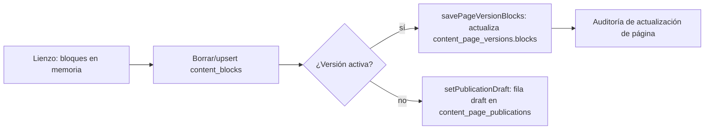

# Editor de páginas de Atlas: inventario completo y diagnóstico

**Fecha de la revisión:** 17 de noviembre de 2026.
**Alcance:** solo lectura del repositorio local. El inventario se construyó con lectura directa y cuatro exploraciones paralelas centradas en persistencia, interfaz del editor, sistema de bloques y renderizado público. No se consultó ni modificó Supabase ni R2; no se ejecutó SQL, ni se publicó o desplegó nada. Lo aquí descrito es el estado del código local y puede diferir de producción.
**Propósito:** servir de referencia única para la iniciativa «Editor de páginas 2.0» y no tener que repetir el análisis del editor existente.

---

## 1. Resumen ejecutivo

El editor actual es una **suite de edición visual por versiones** con tres piezas bien diferenciadas:

1. **Workspace de páginas y versiones** (`EditorPaginas.tsx`): elige la página, gestiona versiones, publica, guarda y ofrece vista previa.
2. **Motor de edición de bloques** (`PageContentEditor.tsx` más `page-editor/` y `HistologyBlockEditors.tsx`): paleta de componentes, lienzo, editores de contenido, formularios de opciones, textos enriquecidos, imágenes, estilos, CTA, historial y guardado.
3. **Renderizador compartido** (`ContentBlockRenderer.tsx`): pinta exactamente el mismo JSON en el editor, la vista previa y las páginas públicas.

El modelo de contenido tiene **30 tipos de bloque** (`BlockType` en `src/types/contentBlocks.ts:1-31`), agrupados en la paleta en cuatro categorías. Cada bloque es una fila con `id`, `entity_type`, `entity_id`, `block_type`, `sort_order` y `content` (un `Record<string,string>`). La entidad puede ser `home_page` (id 0), `subtemas_page` (0 = temario, id de tema = página de tema) o `placas_page` (id de subtema). Hay un caso especial, Créditos, que usa `home_page`/0 pero se edita con `CreditsAdminPanel` y solo lo ve un Administrador (`EditorPaginas.tsx:54-56,94,563,581-583`).

**Diagnóstico breve:** el editor es funcional y muy completo en número de controles, pero el **diseño vive en el código, no en los datos**. El renderizador decide cada estructura, medida, color y variante en un `switch` de unas 2.100 líneas con estilos en línea y mapas de estilos cerrados; el editor solo permite elegir entre esas opciones predefinidas y rellenar campos de texto. No existe un sistema de estilos compartido, ni rejilla libre, ni tokens, ni composición arbitraria de elementos. Además conviven dos interfaces de opciones (el editor en línea y el panel `VisualBlockProperties`) que no siempre ofrecen los mismos valores, y los «presets» se guardan en `localStorage` del navegador, no con la página. Esa es la raíz de la limitación de diseño que motivó el 2.0.

---

## 2. Mapa de archivos

| Área | Archivos | Qué contiene |
| --- | --- | --- |
| Ruta y acceso | `src/App.tsx:232-239` | `/editor-paginas`, protegida con `PrivateRoute allowedRoles={[ROLE_ADMIN, ROLE_MICRO]}`. |
| Workspace | `src/pages/EditorPaginas.tsx` (822 líneas) | Selección de página, versiones, guardado, publicación, vista previa, protección de navegación. |
| Selector y navegación | `src/components/page-editor/FullScreenPageSelector.tsx`, `PageNavigator.tsx` | Selector inicial a pantalla completa y explorador lateral con búsqueda/filtros de temas y subtemas. |
| Hub de versiones | `src/components/page-editor/PageVersionsHub.tsx` | Listado de versiones, crear desde cero o desde otra, publicar, eliminar. |
| Vista previa | `src/components/page-editor/RealPageDraftViewer.tsx` | Renderiza los borradores con el renderizador real sin desmontar el editor. |
| Motor del editor | `src/components/PageContentEditor.tsx` (6.422 líneas) | Paleta, lienzo, historial, portapapeles, selector de imágenes, editor Tiptap, estilos, CTA, guardado. |
| Editores en línea | `src/components/page-editor/HistologyBlockEditors.tsx` (4.274 líneas), `WeeklyHistologyFactsEditor.tsx`, `VisualBlockProperties.tsx` (1.354 líneas), `HistologyRichField.tsx`, `HistologyTextInput.tsx`, `CompactRichTextField.tsx`, `ImageExpansionControl.tsx`, `TextStyleExtensions.ts`, `SpanishEditorShortcuts.ts` | Formularios por tipo de bloque y opciones de contenido/apariencia/texto/diseño/botones. |
| Tipos y registro | `src/types/contentBlocks.ts`, `src/components/blocks/blockRegistry.ts`, `imageExpansion.ts`, `weeklyHistologyFactsData.ts` | Unión de tipos, metadatos, valores por defecto, normalización, campos de ampliación. |
| Renderizador | `src/components/ContentBlockRenderer.tsx` (2.865 líneas), `src/components/histology-blocks/*.tsx`, `src/components/blocks/BlockPhotoFrame.tsx` | Presentación pública y de edición de los 30 tipos. |
| Servicios | `src/services/pageVersionsService.ts`, `contentPublication.ts`, `contentVersioning.ts`, `catalogService.ts`, `unifiedAuditService.ts` | Persistencia de versiones, publicación, snapshots, catálogo y auditoría. |
| SQL | `database/setup_content_blocks.sql`, `setup_content_block_versions.sql`, `setup_content_page_versions_hub.sql`, `setup_content_page_publications.sql` | Definición local de las cuatro tablas y las RPC de guardado/restauración/publicación. |
| Estilos | `src/components/page-editor/pageEditor.css`, `src/styles/weeklyHistology.css`, `src/styles/home.css`, `histologyGuide.css`, `blockPhotoFrame.css`, `weeklyHistologyFacts.css` | Interfaz del editor y diseño público de los bloques. |
| Pruebas | `PageContentEditor.test.tsx`, `ContentBlockRenderer.test.tsx`, `pageVersionsService.test.ts`, `contentPublication.test.ts`, `VisualBlockProperties.test.tsx`, `CompactRichTextField.test.tsx`, `SpanishEditorShortcuts.test.ts`, `PageNavigator.test.tsx`, `UnsavedChangesDialog.test.tsx`, `blocks/imageExpansion.test.tsx`, `blocks/weeklyHistologyFacts.test.tsx` | Cobertura aislada de servicios, render, textos, navegación y compatibilidad. |

---

## 3. Cómo se navega por el editor

**Entrada.** `EditorPaginas.tsx:87-123` restaura la selección desde la URL actual (`?tipo=…&id=…`) y una versión opcional (`?version=…`). Los valores de `tipo` son `credits`, `home`, `temario`, `tema` y `subtema`. Cada selección se traduce en configuración con `getEditorConfig` (`:53-73`):

| Selección | `entity_type` | `entity_id` | URL pública |
| --- | --- | --- | --- |
| `home` y `credits` | `home_page` | 0 | `/` y `/creditos` |
| `temario` | `subtemas_page` | 0 | `/temario` |
| `tema` | `subtemas_page` | id del tema | `/subtemas/:id` |
| `subtema` | `placas_page` | id del subtema | `/ver-placas/:id` |

**Tres vistas.** Sin selección se muestra `FullScreenPageSelector` (`:557-564`). Con selección se abre el workspace con `PageNavigator` lateral opcional (`:567-578`) y, dentro, el `PageVersionsHub` (`:584-615`) o el lienzo de edición (`:616-810`). La vista previa sustituye visualmente al editor mediante `RealPageDraftViewer` y oculta el workspace con `display: none`, sin desmontarlo (`:467-482`).

**Sincronización.** `tipo`, `id` y `version` se escriben en la URL para sobrevivir a una recarga; `pendingVersionRestoreRef` permite reabrir directamente la versión tras F5 (`:121-126,223-239,260-274`).

**Salida protegida.** `requestNavigation` (`:144-148`) retarda cualquier navegación si hay cambios o una versión abierta y muestra `UnsavedChangesDialog` con *Cancelar* y *Guardar y salir* (`:466`). El guardado comparte su promesa y espera a los cambios posteriores antes de permitir la salida (`PageContentEditor.tsx:1421-1441`). El botón nativo del navegador se cubre con `beforeunload` (`:289-298`). El `Header` recibe el mismo `onBeforeNavigate` (`:483`).

---

## 4. Herramientas del workspace (`EditorPaginas.tsx`)

| Herramienta | Qué hace | Referencia |
| --- | --- | --- |
| Explorar páginas / Ocultar páginas | Abre y cierra el `PageNavigator` lateral. | `:589-598`, `:677-686` |
| Ver página pública | Enlace en pestaña nueva a la URL pública de la página elegida. | `:546-551` |
| Versiones | Vuelve al hub; desde la vista previa vuelve primero al modo edición. | `:374-409`, `:653-675` |
| Indicador PUBLICADA / BORRADOR | Estado de la versión activa. | `:688-705` |
| Indicador Guardado / Cambios pendientes | Refleja `isDirty`. | `:711-723` |
| Guardar cambios | Llama a `editorRef.current.saveChanges()`, muestra toast de éxito/error y recarga versiones. | `:335-371`, `:725-749` |
| Vista previa | Abre `RealPageDraftViewer` con los bloques del borrador. | `:751-773` |
| Aviso de modo | Recuerda que editar una versión publicada sincroniza la web al guardar, o que un borrador requiere publicar. | `:780-789` |
| Crear versión | Desde cero o copiando los bloques de otra versión; se abre de inmediato para editar. | `:422-456` |
| Publicar versión | RPC `publish_page_version` y recarga del historial. | `:411-419` |
| Eliminar versión | Borrado de la fila de `content_page_versions`. | `:459-462` |
| Créditos | Sustituye el workspace por `CreditsAdminPanel`. | `:581-583` |

---

## 5. Herramientas del lienzo (`PageContentEditor.tsx`)

### 5.1 Paleta de componentes

La barra lateral agrupa los tipos insertables en cuatro categorías (`BLOCK_TOOLBAR_GROUPS`, `:224-253`): **Texto** (8 entradas), **Imágenes y galerías** (7), **Estructura** (4) y **Fundamentos Histológicos** (11). Hay 31 entradas en la paleta pero solo 30 tipos: `topic_divisions` aparece en Estructura y en Fundamentos. Incluye botón para colapsar/expandir categorías (`:1543-1550`), buscador por nombre/descripción con botón de limpieza (`:1566-1581`), grupos plegables (`:1596-1686`), botones arrastrables con nombre, icono y descripción (`:1627-1678`) y conmutador **Compacto / Extendido** solo en modo avanzado (`:1552-1562`). Se puede hacer clic para añadir al final o arrastrar al lienzo mediante `application/x-atlas-block-type`; el mensaje de ayuda lo indica (`:1689`). La app siempre monta el editor con `experienceMode="advanced"` y `autoSave` (`EditorPaginas.tsx:790-806`).

### 5.2 Tarjeta de cada bloque

Cada bloque se pinta como una tarjeta con color de tipo, etiqueta, indicadores de contenedor y las acciones (`:1898-2106`): casilla de selección para estilos en lote, asa de arrastre, **Editar / Listo** (contrae y guarda, `:2000-2026`), **Cerrar sección** y **Terminar aquí** en secciones (`:2027-2036`), mover a sección anterior/siguiente (`:2037-2056`), **Cortar** (`:2058-2069`), **Duplicar** y **Eliminar** (`:2071-2104`). El diálogo de borrado avisa de que se eliminarán los hijos de contenedores y permite recuperar con Deshacer (`:2341-2352`). El bloque heredado con ID fijo `a7c0f1ab-bc64-49fb-9718-3ed9437860a1` no se elimina: la UI ofrece **Ocultar bloque** y escribe `facts_visible: 'false'` (`:997-998`). Hay barra de selección múltiple con **Seleccionar todos**, **Limpiar selección**, **Contraer todos**, **Expandir todos** y **Cortar todos los seleccionados** (`:1694-1733`). El pegado ofrece puntos de inserción «Pegar aquí arriba» entre bloques (`:1923-1946`) y dentro de divisiones/columnas (`:940-993`).

### 5.3 Estructura

Además de los bloques de texto e imagen, el editor dispone de **secciones** (`section` + marcador `section_end`), **columnas** de 2 a 4 (`columns_2`, con proporción, estilo y alineación) y **divisiones de tema** (`topic_divisions`, pestañas con `layout_parent_id`, `layout_column` y `layout_tab`). Las funciones `addBlockToColumn`, `addBlockToDivision`, `insertSectionEnd`, `closeSectionAtCurrentEnd`, `addBlockToSection`, `moveBlockIntoSection` y `moveBlockToAdjacentSection` gestionan esta jerarquía (`:796-920`). Los hijos se identifican en `content.layout_parent_id`, no por anidación real en el JSON.

### 5.4 Historial y portapapeles

Historial propio de bloques con `undoBlocks`/`redoBlocks` y atajo global (`:690-773`), independiente del historial de Tiptap. Está limitado a 60 estados (`:748`) y no intercepta `Ctrl+Z` dentro de inputs o `contenteditable` (`:759`). Los campos enriquecidos interceptan `Ctrl/Cmd+N` y `Ctrl/Cmd+S` para negrita/subrayado, por lo que esos atajos no llegan al navegador dentro del editor. Cortar/pegar de uno o varios bloques con `toggleCutBlock`, `cutSelectedBlocks`, `pasteCutBlocksToIndex` y `pasteBlocksIntoDivision` (`:927-993`). Duplicado con remapeo de IDs para contenedores y sus hijos (`:1100-1141`).

### 5.5 Selector de imágenes y GIF

`openImageModal`/`ImagePickerModal` (`:1202-1309`, `:4748-4869`) abre un modal con tres pestañas: **Subir imagen** (arrastrar o seleccionar; texto «PNG, JPG, WEBP o GIF animado — máximo 10 MB»), **Placas del subtema/tema/destacadas** según la entidad y **Todas las placas**, que usa `EditorParcialAccordionPicker` con búsqueda, chips de parciales, acordeones y rejilla de temas/subtemas. El catálogo se filtra por tema (`handleAllFilterTema`) y subtema (`handleAllFilterSubtema`). `handleFileUpload` (`:1311-1331`) sube a R2 con `uploadToCloudinary(file, { folder: 'atlas-content', optimizeImage: true, preserveAnimation: true })`: los GIF conservan bytes, extensión y MIME originales y solo la miniatura se convierte a WebP; el resto sigue el procesamiento habitual. El límite de 10 MB es texto de interfaz, no una validación explícita en `cloudinary.ts`. Elegir una placa existente reutiliza su referencia; en `weekly_publication` se tratan además los campos de tema/logo (`handlePickPlaca`, `:1333-1343`).

### 5.6 Texto enriquecido

Tiptap con `StarterKit`, `Link`, `Placeholder`, `TextAlign`, `TextStyle`, `Color`, `Highlight` y la extensión local `FontSize` (`:6-95`). `FontSize` añade `font-size`, `font-family`, `font-weight`, `line-height`, `letter-spacing`, `text-transform` y `-webkit-text-stroke` como atributos globales de `textStyle`. El componente `AutoTextarea` (`:3028-3270`) ofrece barra flotante de negrita, subrayado, color, cursiva, tamaño y resaltado; aplica enlaces mediante `window.prompt`. Escucha `atlas-rich-text-command` y emite `atlas-rich-text-state`; lo mismo hacen `CompactRichTextField.tsx` e `HistologyRichField.tsx`. `HistologyTextInput.tsx` usa marcadores Markdown (`**`, `*`) con atajos propios. `SpanishEditorShortcuts.ts` aporta los atajos en español. Los editores histológicos comparten `MedicalIconPickerModal.tsx` (búsqueda multi-término insensible a acentos y variantes singular/plural, 20 temas más «otros», autofoco y Escape).

### 5.7 Apariencia, estilos reutilizables y botones

`BlockStyleEditor` (`:3296+`) ofrece **Apariencia del bloque**: color de fondo, borde y texto, radio (0-30), padding (0-48), ancho predefinido (Completo/900/700/560 px), alineación, sombra (ninguna/suave/media) y tipografía. Incluye **copiar estilo**, **pegar estilo** y **pegar a la selección**, además de guardar/aplicar/borrar **presets de estilo**; `STYLE_CONTENT_KEYS` (`:151-171`) fija qué claves `style_*` se copian o se guardan como preset. Estos presets y las plantillas de sección se guardan en `localStorage` (`atlas-style-presets-v1`, `atlas-section-templates-v1`, `:173-191,426-445`). Las plantillas de sección están implementadas pero su interfaz está desactivada con `{false && …}` (`:2528-2570`). En la ruta principal `MemoBlockContentEditor` recibe `showStyleEditor={false}` (`:2250`), por lo que los estilos y CTA se gestionan desde `VisualBlockProperties` y no desde el editor en línea, aunque ese código siga existiendo.

`BlockCtaLinksEditor` (`:3554+`) gestiona hasta **cuatro enlaces/botones por bloque** con posición (antes/después), disposición (fila/columna), alineación, separación, estilo (solid/outline/soft), tamaño (sm/md/lg), forma (rounded/pill/square), color de fondo y de texto, texto/URL y apertura en pestaña nueva. Los campos `cta_*` se inyectan en **todos** los bloques desde `CTA_DEFAULT_CONTENT` (`blockRegistry.ts:18-40,424-433`).

`VisualBlockProperties.tsx` es el segundo editor de opciones, con pestañas **Contenido**, **Apariencia**, **Estilo del texto**, **Diseño** y **Botones** (`:1243-1331`). Es el panel que más opciones concretas expone por tipo (por ejemplo, hasta 10 imágenes en `carousel` y 6 en `text_carousel`, `:386-412`).

### 5.8 Ampliación de imagen

`ImageExpansionControl.tsx` muestra el interruptor «Permitir ampliación de imagen». La lista de campos está en `imageExpansion.ts:3-18` y cubre **14 tipos**: `image`, `text_image`, `two_images`, `three_images`, `carousel`, `text_carousel`, `double_carousel`, `histology_generalities`, `histology_pillars`, `histology_stains`, `histology_extra_data`, `weekly_publication`, `weekly_histology_facts` y `exam_week`. Son 14 entradas con siete nombres de campo únicos (`image_zoom` se comparte entre varios tipos). El valor `false` se conserva al normalizar y desactiva el visor en público.

### 5.9 Guardado y autosave

`performSave` (`:1345-1419`) elimina de `content_blocks` los IDs que ya no están en el lienzo, hace `upsert` de todos los bloques con `sort_order` secuencial y llama a `savePageVersionBlocks` si hay versión activa; si no la hay, crea la fila de publicación en estado `draft` para que, cuando existe esa fila, el borrador no se sirva como contenido público. **No borra archivos de R2**: los bloques retirados pueden seguir en publicaciones, versiones o plantillas (`:1383-1385`). El autosave se dispara 30 segundos después del último cambio (`AUTO_SAVE_DELAY_MS`, `:149,1443-1449`) y `saveChanges` espera la promesa en curso y guarda los cambios posteriores antes de terminar (`:1421-1441`). Hay dos puntos de guardado manual —la cabecera del workspace (`EditorPaginas.tsx:725-749`) y una barra interna del motor (`PageContentEditor.tsx:2291-2305`)— que convergen en `onManualSaveRequest`; el toast de éxito/error solo cubre el primero.

---

## 6. Catálogo de los 30 tipos de bloque

Fuente: `BlockType` (`src/types/contentBlocks.ts:1-31`), `BLOCK_REGISTRY` (`src/components/blocks/blockRegistry.ts:42-418`) y los grupos de la paleta (`PageContentEditor.tsx:224-253`). Los campos son siempre cadenas; los números y booleanos se guardan como texto.

| # | Tipo | Etiqueta en la paleta | Grupo | Campos/estructura principal |
| --- | --- | --- | --- | --- |
| 1 | `heading` | Título principal | Texto | `text`, alineación vertical, color de texto. |
| 2 | `subheading` | Subtítulo | Texto | Igual que `heading`. |
| 3 | `paragraph` | Texto | Texto | Igual que `heading`. |
| 4 | `list` | Lista | Texto | `items`, estilo viñeta/numerada, color. |
| 5 | `callout` | Caja destacada | Texto | `text`, variante, estilo, ancho, icono. |
| 6 | `weekly_publication` | Publicación semanal | Texto | Tres temas con ID y logo, placa destacada, fechas, títulos, colores, ancho. |
| 7 | `exam_week` | Semana de exámenes | Texto | Parcial, textos, imagen o ilustración, dos botones, colores, ancho. |
| 8 | `weekly_test` | Pruebita semanal | Texto | Textos, ID/nombre de prueba, estilo, color, ancho. |
| 9 | `image` | Imagen | Imágenes | URL, pie, tamaño, alineación, ancho/alto, ajuste, radio, sombra, filtro, carga, ampliación. |
| 10 | `text_image` | Texto con imagen | Imágenes | Texto, imagen lateral, posición, ajuste, alto/ancho, separación, pie, tipografía. |
| 11 | `two_images` | Dos imágenes | Imágenes | Dos URL/pies, proporción, relación de aspecto, ajuste, separación, radio, sombra. |
| 12 | `three_images` | Tres imágenes | Imágenes | Tres URL/pies, distribución (grid/featured/story), proporción, ajuste. |
| 13 | `carousel` | Galería deslizante | Imágenes | Hasta 10 diapositivas en el panel, intervalo, autoplay, flechas/puntos, estilo. |
| 14 | `text_carousel` | Texto + galería | Imágenes | Texto y galería lateral (6 imágenes en el panel); reutiliza el reproductor. |
| 15 | `double_carousel` | Doble galería | Imágenes | Dos carruseles, proporción,Intervalo y estilos compartidos. |
| 16 | `section` | Sección | Estructura | Título, subtítulo, tono, diseño de grupo, cabecera, guía lateral, separación. Contenedor lógico. |
| 17 | `section_end` | Fin de sección | Estructura | Marcador sin contenido; cierra una sección. |
| 18 | `columns_2` | Columnas | Estructura | 2-4 columnas, proporción, estilo, alineación vertical, separación, títulos por columna. |
| 19 | `topic_divisions` | Divisiones de Tema (Pestañas) | Estructura / Fundamentos | Hasta tres divisiones con título/subtítulo, color de acento y estilo de navegación. |
| 20 | `divider` | Separador | Estructura | Estilo, color, grosor, ancho, espacio y texto central. |
| 21 | `histology_generalities` | Generalidades del Tejido | Fundamentos | Título, insignia, introducción, micrografía, idea clave, puntos y consejo de laboratorio. |
| 22 | `histology_pillars` | Tríada: Función, Criterios y Ubicaciones | Fundamentos | Tres tarjetas activables, función con imagen/pie, contadores de criterios y ubicaciones. |
| 23 | `histology_stains` | Tinciones Histológicas | Fundamentos | Título, introducción, colorimetría por tinción, muestra fotográfica y consejo. |
| 24 | `histology_text_cards` | Texto con Tarjetas Clave | Fundamentos | Texto y tarjetas de conceptos con alineación. |
| 25 | `histology_text_table` | Texto con Tabla Médica | Fundamentos | Título, texto, columnas/filas configurables y color de cabecera. |
| 26 | `histology_text_simple_cards` | Texto con Tarjetas Simples | Fundamentos | Título, texto, columnas (2-4), tarjetas y alineación. |
| 27 | `histology_bullet_cards` | Tarjetas con Viñetas | Fundamentos | Título, texto, columnas y tarjetas con viñetas. |
| 28 | `histology_horizontal_cards` | Tarjetas Horizontales | Fundamentos | Título, texto y tarjetas con subtítulo, etiqueta de color y descripción. |
| 29 | `histology_extra_data` | Dato Extra / Correlación Médica | Fundamentos | Título, texto, imagen opcional y pie. |
| 30 | `weekly_histology_facts` | Datos histológicos de la semana | Fundamentos | Uno o dos datos editables con texto, pista, ilustración/imagen/GIF y restauración. |

> La tabla enumera los **30 tipos únicos** declarados en `BlockType` y en `BLOCK_REGISTRY`. `topic_divisions` aparece dos veces en la paleta (Estructura y Fundamentos Histológicos), pero solo una vez en el registro; eso no añade un tipo nuevo.

**Componentes internos, no insertables.** `HistologyFunctionBlock`, `HistologyMorphologyBlock`, `HistologyLocationsBlock` y otros archivos de `src/components/histology-blocks/` forman parte de bloques compuestos (por ejemplo, la Tríada) y no se pueden añadir como bloques independientes desde la paleta.

**Normalización.** `createDefaultBlockContent` (`:424-433`) fusiona `CTA_DEFAULT_CONTENT` (21 claves para cuatro enlaces), los valores por defecto del tipo, el campo de ampliación y `__schema_version`. `normalizeBlockContent` (`:435-463`) convierte todo a cadena, conserva claves desconocidas del JSON guardado, rellena lo que falte, fuerza la versión de esquema canónica y aplica dos migraciones de temas heredados en `weekly_histology_facts`. Solo `image`, `text_image`, `histology_generalities` y `histology_stains` declaran `schemaVersion: 2`; los demás usan `1`. Esa estrategia permite abrir contenido antiguo sin migración de base de datos.

**Compatibilidad heredada.** Existe un bloque de datos semanales con ID fijo `a7c0f1ab-bc64-49fb-9718-3ed9437860a1`. `includeHomeWeeklyFacts` lo inserta solo en `home_page`/0 si falta, detrás de `exam_week` o `weekly_publication`, y reindexa `sort_order`. La interfaz solo puede ocultarlo con `facts_visible: 'false'`; el renderizador respeta ese flag y el bloque nunca se elimina desde la UI.

**Límites ocultos por familia.** El panel de propiedades ofrece hasta 10 imágenes en `carousel`, 6 en `text_carousel` y 5 por lado en `double_carousel`, pero `readCarouselSlides` (`ContentBlockRenderer.tsx:2505-2518`) lee como máximo 8, 6 y 5 respectivamente: las diapositivas 9 y 10 de `carousel` pueden editarse pero no renderizarse. Los editores histológicos limitan puntos a 4, tinciones a 5, tablas a plantillas 3×3/4×3/4×4/5×4, tarjetas clave a 5, tarjetas simples a 6, viñetas a 4 columnas y tarjetas horizontales a un conjunto cerrado de colores de etiqueta. `columns_2` admite 2–4 columnas y proporciones `1:1|2:1|1:2`. Ninguno de estos límites es configurable desde los datos.

---

## 7. Cómo se muestra el contenido

`ContentBlockRenderer.tsx` recibe los bloques normalizados y decide la presentación con un `switch (type)` (`:741-2366`) con un caso para cada uno de los 30 tipos. Cada caso construye JSX con estilos en línea, tablas de variantes (`visualMap`, `tiSurfaceMap`, `twoStyle`, `dcRatioMap`, …) y clases `cb-*`. `getBlockShellStyle` (`:51-148`) aplica lo que el editor puede editar —color, fondo, tipografía, padding, radio, borde y sombra— pero fuerza `width: '100%'`, márgenes laterales a cero, `alignSelf`, `boxSizing` y `transition`: la interfaz cambia la «piel», no el posicionamiento. `buildRenderGroups` (`:218-260`) agrupa secciones en `cb-section-group` y, **solo fuera de `editorMode`**, agrupa secuencias contiguas de dos o más bloques `histology_*` en un `histology_dossier`; en el editor se ven separados y en público como un dossier compuesto. Las fotos usan `BlockPhotoFrame` (esquinas blancas y acercamiento del 1.03 en 0.35 s) y, cuando procede, abren `ImageViewerModal`.

El mismo componente se usa en tres sitios:

- **Editor**, dentro de las tarjetas contraídas, con `editorMode` activo.
- **Vista previa real**, en `RealPageDraftViewer.tsx:12,468-477`, sin `editorMode`, con datos reales de `placas`, `temas`, `subtemas` y `interactive_maps`: por eso el dossier público aparece igual que en la web. El workspace permanece montado pero oculto con `display: none` (`EditorPaginas.tsx:479-482`). El entorno alrededor es una recreación del editor, no idéntico a `PlacasSubtema.tsx`.
- **Páginas públicas**, a través de `getRenderableBlocks`: `Home.tsx` (prioriza `exam_week` y luego `weekly_publication`), `TemarioPublico.tsx` (bloques de temario y sincronización del parcial), `Subtemas.tsx` (bloques por tema) y `PlacasSubtema.tsx` (bloques por subtema y visor propio, distinto del `ImageViewerModal` del renderer).

Hay una segunda vista previa, `PageDraftPreview.tsx`, con selector desktop/tablet/móvil y `editorMode`, pero **no se usa** en `src`. Conviene no atribuirle el botón «Vista Previa» ni sus capacidades responsive al flujo real.

Los estilos públicos están repartidos entre `style.css` (cinco definiciones/overrides de `.cb-container`/`.cb-shell` en `:160,3741,4226,5459,5484`, tipografía de `.cb-shell` en `:5808-5829`, weekly en `:5830-6148` y examen en `:6620+`), `weeklyHistology.css` (ámbito `cb-weekly-lab`, con numerosas reglas `!important`), `weeklyHistologyFacts.css`, `home.css`, `histologyGuide.css` y `blockPhotoFrame.css`. `src/styles/utopia.css` define una escala fluida y tokens `cqw` para `.cb-container`, `.cb-shell` y `.cb-exam-week-block`, pero es opt-in: las clases `u-h*` no se aplican globalmente para no romper componentes existentes. La interfaz del editor vive en `pageEditor.css` y, en gran parte, en estilos en línea dentro de `PageContentEditor.tsx`.

El visor que se abre desde las fotos (`ImageViewerModal.tsx`) es casi enteramente inline: zoom 0.5–6 con máximo efectivo según resolución, capa de alta resolución por encima de 1.01, nitidez/grano calculados con el zoom, láser de 1750 ms, minimapa, marca de agua fija y barra vertical de herramientas. El editor solo decide **si** se puede abrir, no **cómo** se ve.

---

## 8. Persistencia: borradores, versiones y publicación

### 8.1 Tablas según el SQL local

| Tabla | Columnas relevantes | Observaciones |
| --- | --- | --- |
| `content_blocks` | `id UUID`, `entity_type TEXT`, `entity_id INTEGER`, `block_type TEXT`, `sort_order INTEGER`, `content JSONB`, `created_at`, `updated_at` | Borrador editable. RLS con políticas abiertas para lectura/escritura (`setup_content_blocks.sql`). |
| `content_block_versions` | `id BIGSERIAL`, entidad, `snapshot_name`, `reason`, `blocks JSONB`, `blocks_count` generado, `created_at` | Snapshots históricos del borrador, con RPC `save_content_page_version` y `restore_content_page_version` (`setup_content_block_versions.sql:45-159`). El frontend de versiones nombradas **no usa esta tabla**. |
| `content_page_versions` | `id BIGSERIAL`, entidad, `version_name`, `description`, `is_published`, `blocks JSONB`, `blocks_count` generado, autor, `published_at`, fechas | Historial que sí usa la interfaz. Índice único de una versión publicada por página e índice único de nombre por página (`setup_content_page_versions_hub.sql:7-54`). |
| `content_page_publications` | `id BIGSERIAL`, entidad, `status` (`draft`/`published`), `published_blocks JSONB`, `published_at`, fechas, única por entidad | Snapshot servido al público (`setup_content_page_publications.sql:6-16`). |

### 8.2 Flujo de guardado

Si la versión editada está publicada, `savePageVersionBlocks` sincroniza también `content_page_publications` (`pageVersionsService.ts:248-260`), por lo que guardar una versión publicada cambia la web pública sin publicar de nuevo. El `upsert` de publicación no comprueba su error (`:250-259`) y no invalida la caché de renderizado.

### 8.3 Flujo de publicación

`publishPageVersion` intenta primero la RPC atómica `publish_page_version` y, si falla, ejecuta un fallback en cliente (`pageVersionsService.ts:276-340`). Según el SQL local, la RPC despublica las demás versiones de la página, marca la elegida, actualiza `content_page_publications` y **reemplaza `content_blocks` con los bloques de la versión** (`setup_content_page_versions_hub.sql:87-154`): publicar sobreescribe el borrador activo. El inventario remoto documenta **dos firmas** de esta RPC (`bigint, text, text` y `bigint, uuid, text`), mientras el SQL local declara solo la de `text`; no se puede asumir que el archivo local sea la definición desplegada (`docs/supabase-inventario.md:68,77`).

### 8.4 Lectura pública

`getRenderableBlocks` (`contentPublication.ts:82-115`) usa el snapshot de `content_page_publications` **incluso si su estado es `draft`**; normaliza los bloques y convierte cualquier tipo desconocido a `paragraph` (`:22-45`). Si no hay fila de publicación o falla su consulta, cae a los bloques en edición de `content_blocks`, por lo que un borrador puede hacerse público. Hay una caché en memoria de 60 segundos (`:47-64`). `setPublicationDraft` y `publishBlocksSnapshot` sí la invalidan (`:147,164`), pero `publishPageVersion` y el handler de publicación de `EditorPaginas.tsx:411-419` no: la vía que usa la interfaz puede servir hasta 60 segundos de snapshot anterior tras publicar. Además, `publishBlocksSnapshot` solo se usa en pruebas (`contentPublication.test.ts`). Esta separación pública solo es efectiva cuando existe la fila de publicación y la caché ya se actualizó.

### 8.5 Versionado y auditoría

Además del historial de páginas, `contentVersioning.ts` expone `listContentVersions`, `createContentVersion` y `restoreContentVersion` sobre `content_block_versions`, pero **no tiene consumidores dentro de `src`** fuera de su propio archivo. Su RPC de restauración (`setup_content_block_versions.sql:146-155`) vuelve a poner la publicación en `draft` para evitar desalineación entre editor y snapshot. Crear versión, guardar bloques, publicar y borrar versión registran eventos en `unifiedAuditService` (`pageVersionsService.ts:262-273,328-339,350-359`). `ensurePageHasInitialVersion` importa los bloques existentes a una «Versión Oficial (Inicial)» cuando una página aún no tiene historial (`:361-451`).

### 8.6 Riesgos detectados en la capa de persistencia

1. **Caché no invalidada al publicar.** La ruta real (`publishPageVersion` → recarga de versiones) no llama a `clearRenderableBlocksCache`; la publicación nueva puede tardar hasta 60 segundos en verse, o puede servirse el draft cacheado.
2. **Fallback de lectura inseguro.** Ante ausencia de fila o error de consulta, `getRenderableBlocks` lee `content_blocks`. La separación borrador/público depende de que exista la fila de publicación.
3. **Doble firma remota de RPC.** El inventario remoto confirma dos firmas de `publish_page_version`; el SQL local solo contempla una. Conviene comprobar resolución y tipos antes de tocar esa función.
4. **Fallback de publicación no atómico.** Si la RPC falla, el cliente encadena despublicar, marcar y hacer `upsert` sin transacción; no verifica los errores intermedios, no sincroniza `content_blocks` como la RPC y no invalida caché (`pageVersionsService.ts:292-326`).
5. **Sincronización silenciosa de versión publicada.** `savePageVersionBlocks` ignora el error del `upsert` en `content_page_publications` y tampoco invalida caché (`pageVersionsService.ts:248-260`).
6. **RLS local permisiva.** Los cuatro scripts locales habilitan RLS pero crean políticas de lectura/escritura con `USING (true)`/`WITH CHECK (true)`; no demuestran la configuración remota ni sustituyen la autorización de sesión.
7. **Versionado duplicado con semánticas distintas.** `content_block_versions` no alimenta el hub; su restauración cambia el estado de publicación a `draft`, mientras que publicar desde el hub reescribe `content_blocks`.
8. **Huérfanos de R2.** Guardar o borrar bloques no elimina archivos. Las URL pueden seguir referenciadas en `content_page_versions`, `content_page_publications` o snapshots antiguos; cualquier limpieza exige revisar todas las copias.

---

## 9. Por qué el editor limita el diseño (diagnóstico para el 2.0)

1. **El diseño está hardcodeado.** El aspecto de cada tipo se decide en el `switch` de `ContentBlockRenderer` con estilos en línea y mapas de variantes. El editor no guarda CSS ni una descripción de layout; guarda valores para elegir entre variantes escritas en código.
2. **Opciones cerradas.** Selectores como `image_style`, `two_style`, `section_layout`, `weekly_test_style`, `column_style` o `nav_style` son listas fijas. No se puede crear una variante nueva sin tocar TypeScript, CSS y el renderizador.
3. **Todo se guarda como texto.** `ContentBlock.content` es `Record<string,string>`; números, booleanos y listas se serializan como cadenas y se reinterpretan en cada consumidor. No hay esquema tipado por bloque ni validación fuerte.
4. **Dos editores divergentes.** `HistologyBlockEditors.tsx` y `VisualBlockProperties.tsx` ofrecen opciones solapadas pero no idénticas. Ejemplo: en `callout`, el panel de contenido ofrece `info/success/warning/danger` (`:377-382`) mientras la pestaña de apariencia ofrece `info/tip/warning/clinical` (`:881`); en `divider`, una lista usa `gradient/solid/dashed/dots/labeled` (`:384`) y la otra `gradient/simple/labeled` (`:910-911`). El resultado visible depende de qué editor se haya tocado por última vez.
5. **Campos huérfanos y convenciones ocultas.** `CTA_DEFAULT_CONTENT` se inyecta en los 30 tipos aunque solo unos pocos lo usan; la jerarquía se expresa con `layout_parent_id`, `layout_column` y `layout_tab`; el orden se deriva del índice del array al guardar. Nada de esto es visible para quien edita.
6. **Estilos no portables.** Los presets de estilo y las plantillas de sección viven en `localStorage` del navegador (`atlas-style-presets-v1`, `atlas-section-templates-v1`): no viajan con la versión, no se publican y no están disponibles para otro equipo. Las plantillas de sección, además, están desactivadas en la interfaz.
7. **Acoplamiento total al renderizador.** Editor, vista previa y web pública comparten `ContentBlockRenderer`. Cualquier cambio visual de fondo afecta a las tres; no hay tema ni capa de presentación intercambiable por página.
8. **Diseño global y ámbitos frágiles.** `home.css` tiene ~75 KB y excluye por reglas específicas el ámbito `cb-weekly-lab`. Añadir bloques o cambiar estilos globales tiene efectos colaterales difíciles de prever.
9. **Bloques compuestos rígidos.** «Generalidades», «Tríada» o «Tinciones» son un único tipo que renderiza internamente varias tarjetas y subcomponentes. No se pueden reordenar ni separar sus piezas desde el editor.
10. **Dos formatos de edición simultáneos.** El editor permite contraer una tarjeta para ver una vista previa y expandirla para ver el formulario, además del panel `VisualBlockProperties`. No hay un único modelo de interacción.
11. **Sin exploración de diseño visual directo.** No hay arrastre de elementos dentro de un contenedor más allá de reordenar bloques completos, no hay rejilla, ni padding/márgenes por lado, ni tipografía por token, ni estados responsive editables.
12. **Persistencia redundante.** Un mismo conjunto de bloques puede existir en `content_blocks`, `content_page_versions`, `content_page_publications` y `content_block_versions`. Guardar, publicar y restaurar tienen reglas distintas de sincronización, y el fallback de lectura puede mostrar el borrador si falta la fila de publicación.
13. **El shell no es posicionable.** `getBlockShellStyle` fuerza ancho completo, márgenes laterales nulos, `alignSelf`, `boxSizing` y transición; el editor solo puede cambiar color, tipografía, padding, borde, radio y sombra (`ContentBlockRenderer.tsx:51-148`).
14. **La agrupación pública no es editable.** `buildRenderGroups` crea `histology_dossier` solo fuera de `editorMode`: el autor ve bloques separados y el visitante ve un compuesto que no puede deshacer ni configurar (`:218-260`).
15. **Dos vistas previas con significados distintos.** `RealPageDraftViewer` (en uso) muestra bloques como en público pero recrea el entorno; `PageDraftPreview` (sin usar) ofrece `editorMode` y selector responsive. La documentación y el 2.0 deben partir de la que realmente se ejecuta.
16. **Rutas de edición y publicación con detalles ocultos.** El editor de estilo en línea está desactivado en la ruta principal; el diálogo de salida aparece aunque no haya cambios si hay versión activa; el guardado manual existe en dos barras con toast solo en una; y el bloque heredado solo se oculta. Son decisiones de interacción que el 2.0 debe revisar explícitamente.
17. **Estructuras internas cerradas.** Weekly y exam usan plantillas por número de temas y CSS con `!important`; carruseles, marco de foto y visor tienen límites y comportamientos fijos en código. No basta con cambiar valores de contenido para cambiar esas composiciones.

---

## 10. Cobertura de pruebas

Las pruebas aisladas existentes cubren:

- `PageContentEditor.test.tsx`: conservación de archivos al guardar, incorporación del bloque heredado de datos semanales y ocultación.
- `ContentBlockRenderer.test.tsx` (1.516 líneas) y `blocks/*.test.tsx`: render de los 30 bloques, estilos, fallback de tipo, ampliación de imagen, datos histológicos, dossier público frente a `editorMode` y dossier dentro de `topic_divisions`.
- `contentPublication.test.ts`: snapshot visible durante edición, publicación, invalidación de caché, fallo y publicación vacía.
- `pageVersionsService.test.ts`: servicios de versiones.
- `VisualBlockProperties.test.tsx`, `CompactRichTextField.test.tsx`, `SpanishEditorShortcuts.test.ts`: panel de opciones y edición de texto.
- `PageNavigator.test.tsx` y `UnsavedChangesDialog.test.tsx`: navegación y diálogo de cambios sin guardar.

Todas usan servicios simulados y datos en memoria, con el bloqueo de red de `src/test/setup.ts`. No verifican SQL, permisos de servidor, persistencia real ni el recorrido completo en navegador contra datos de producción.

---

## 11. Decisiones pendientes para el 2.0 (aún no tomadas)

Este documento solo inventaría el estado actual. Antes de diseñar la sustitución conviene decidir, al menos:

- ¿Se conserva el formato `content: Record<string,string>` y el registro de 30 tipos, o se migra a un esquema de bloques con campos tipados?
- ¿La personalización se resuelve con tokens/temas por página, con CSS editable por bloque o con un sistema de composición libre?
- ¿Qué ocurre con el contenido ya guardado: adaptadores de lectura, migración de datos o convivencia de dos renderizadores?
- ¿Se mantiene la separación borrador/versión/publicación actual o se revisa el modelo de publicación?
- ¿Dónde viven los presets y plantillas para que sean portables (base de datos, versión, proyecto)?
- ¿Cómo se unifican los dos editores de opciones sin perder ajustes ya guardados?
- ¿Se mantiene `ContentBlockRenderer` como única fuente de presentación o se introduce una capa de temas/composición por página?
- ¿Qué se hace con el bloque heredado de ID fijo, el dossier público y las plantillas discretas de weekly/exam?
- ¿Cómo se corrigen la invalidación de caché, el fallback a borrador y las firmas duplicadas de `publish_page_version` sin afectar producción?
- ¿Se conservan las dos firmas RPC y las políticas RLS actuales, o se revisan con autorización y respaldo explícitos?

---

## 12. Índice rápido de referencias cruzadas

- Guía general: `docs/guia-atlas.md` (sección 3, «Editor de páginas»; sección «Borradores, versiones y publicación»; inventario de bloques con imágenes).
- Otros editores: `docs/revisiones/editor-senalados-herramientas-2026-10-30.md` y `docs/revisiones/editor-mapas-interactivos-2026-10-31.md`.
- Imágenes: `docs/mapa-gestion-imagenes.md`.
- Esquema remoto verificado: `docs/supabase-inventario.md` (firmas de RPC y límites de la comprobación; el SQL local no equivale a producción).
